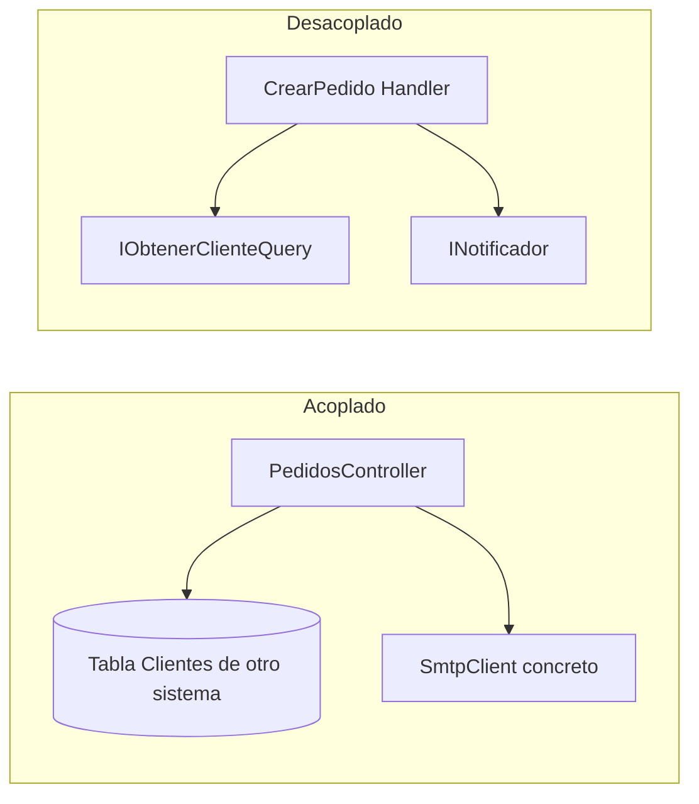

# Acoplamiento y cohesión

Parte de: [[02-Fundamentos/08 Computación general/_Índice Computación general|Computación general]]

> [!info] Cómo avanzar
> `progreso`: **pendiente** → **viendo** (estudiando) → **visto** (contestaste la autoevaluación sin abrir las respuestas) → **dominado** (hiciste el laboratorio o lo aplicaste de verdad).

## Contenido

### Qué es
Son dos medidas complementarias de la calidad de un diseño:

- **Acoplamiento**: cuánto **depende** un módulo (clase, slice, servicio) de los detalles de otro. Con acoplamiento fuerte, un cambio en uno obliga a cambiar el otro.
- **Cohesión**: qué tan **relacionadas entre sí** están las responsabilidades **dentro** de un módulo. Alta cohesión significa que todo lo que hay ahí trabaja hacia el mismo propósito.

La meta clásica es **bajo acoplamiento y alta cohesión**: módulos enfocados que se comunican por contratos pequeños y estables. Eso hace que el código sea más fácil de cambiar, probar y entender por partes.

### Cómo funciona
El acoplamiento tiene grados. De más dañino a más aceptable:

1. **De contenido**: un módulo toca el estado interno de otro (reflexión sobre campos privados, leer tablas de otro servicio directamente).
2. **Común/global**: varios módulos comparten variables globales o un singleton mutable.
3. **De control**: le pasas a otro una bandera que decide su lógica (`Procesar(pedido, modo: 3)`).
4. **De estampa**: pasas un objeto enorme cuando solo se usan dos campos.
5. **De datos**: solo pasas los datos que necesita, por parámetros o mensajes.
6. **Por abstracción/contrato**: dependes de una interfaz o de un DTO/evento estable, no de una implementación.

Los dos últimos son **aceptables** y normales: un sistema sin acoplamiento no hace nada. También es aceptable depender de cosas **muy estables** (la BCL de .NET, `ILogger<T>`) y el acoplamiento **dentro** de un mismo módulo cohesivo.

Señales de **baja cohesión**:
- Nombres genéricos: `Utils`, `Helpers`, `Manager`, `CommonService`.
- Una clase cuyos métodos usan conjuntos de campos distintos que nunca se cruzan (en realidad son dos clases).
- Para describir qué hace necesitas "y": "valida pedidos **y** manda correos **y** genera reportes".
- Cambios por razones sin relación tocan el mismo archivo.



### Ejemplo
Acoplamiento fuerte en Itzamna.Dionisio:

```csharp
public class PedidosController : ControllerBase
{
    [HttpPost]
    public async Task<IActionResult> Crear(PedidoDto dto)
    {
        // Conoce la cadena de conexión, el SQL y el servidor de correo
        using var cn = new SqlConnection("Server=prod;Database=Ventas;...");
        await cn.ExecuteAsync("INSERT INTO Pedidos ...", dto);
        var smtp = new SmtpClient("smtp.empresa.mx");
        smtp.Send("ventas@empresa.mx", dto.Correo, "Pedido", "Recibido");
        return Ok();
    }
}
```

Cambiar de servidor SMTP, probar sin base de datos o reutilizar la lógica requiere tocar el controller. Versión con alta cohesión por slice y acoplamiento por contrato:

```csharp
// Features/Pedidos/Crear/
public interface IInsertarPedidoCommand { Task<int> EjecutarAsync(Pedido p, CancellationToken ct); }
public interface INotificador { Task EnviarAsync(string para, string asunto, string cuerpo, CancellationToken ct); }

public sealed class CrearPedidoHandler(IInsertarPedidoCommand insertar, INotificador notificador)
{
    public async Task<int> ManejarAsync(Pedido p, CancellationToken ct)
    {
        var id = await insertar.EjecutarAsync(p, ct);       // SQL en InsertarPedido.sql con Dapper
        await notificador.EnviarAsync(p.Correo, "Pedido recibido", $"Folio {id}", ct);
        return id;
    }
}
```

Todo lo de "crear pedido" vive junto (cohesión del slice) y las dependencias externas se ven solo como interfaces registradas en [[Inyección de dependencias]]. Ver también [[SOLID - Inversión de dependencias (DIP)]] y [[SOLID - Responsabilidad única (SRP)]].

### Cuándo usarlo y cuándo no
- Busca bajo acoplamiento en las **fronteras**: entre slices, con la base de datos, con servicios externos, entre front y API (contratos JSON versionados).
- No desacoples **por reflejo**: una interfaz con una sola implementación que nunca cambia y no se sustituye en pruebas agrega ruido. Eso choca con [[DRY, KISS y YAGNI]].
- En microservicios, el acoplamiento más caro es **compartir base de datos** o necesitar desplegar dos servicios juntos.

### Errores comunes
- **Confundir "pocas clases" con cohesión**: una clase gigante tiene baja cohesión aunque esté "todo en un lugar".
- **Crear proyectos `Common`/`Shared`** donde todo depende de todo: acopla todos los módulos entre sí.
- **Interfaces que filtran detalles** (`IRepositorio` que expone `SqlConnection` o `IQueryable`): el acoplamiento sigue ahí, solo cambia de nombre.
- **DRY entre slices**: unir dos códigos que se parecen pero cambian por razones distintas aumenta el acoplamiento.

### Para profundizar
- [Principios de arquitectura (Microsoft Learn)](https://learn.microsoft.com/dotnet/architecture/modern-web-apps-azure/architectural-principles)
- [Coupling and cohesion en el glosario de Martin Fowler (Refactoring)](https://refactoring.com/catalog/)
- [Code smells relacionados con acoplamiento (Refactoring.Guru)](https://refactoring.guru/es/refactoring/smells/couplers)

## Autoevaluación

Contesta primero en voz alta o en papel; luego despliega la respuesta.

> [!question]- ¿Qué son el acoplamiento y la cohesión?
> **Acoplamiento**: cuánto depende un módulo de otro. **Cohesión**: qué tan relacionadas están las responsabilidades dentro de un módulo. Se busca **bajo acoplamiento y alta cohesión**.

> [!question]- Da un ejemplo de acoplamiento fuerte.
> Un controlador que crea `new SqlConnection` y arma SQL a mano, o dos servicios que comparten tablas de base de datos: cambiar uno obliga a cambiar el otro.

> [!question]- ¿Cómo reconoces baja cohesión?
> Clases `Utils`/`Helpers`/`Manager` con métodos sin relación, o que cambian por motivos muy distintos.

> [!question]- ¿Qué tipo de acoplamiento es aceptable?
> Hacia abstracciones estables y contratos (interfaces, mensajes, APIs versionadas). Acoplamiento cero no existe: la meta es que sea explícito y con dirección clara.

