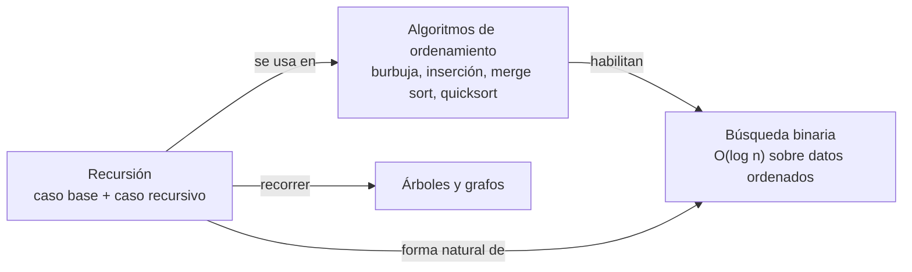

# Algoritmos básicos (búsqueda, ordenamiento, recursión)

Parte de: [[02-Fundamentos/08 Computación general/_Índice Computación general|Computación general]]

> [!info] Cómo avanzar
> `progreso`: **pendiente** → **viendo** (estudiando) → **visto** (contestaste la autoevaluación sin abrir las respuestas) → **dominado** (hiciste el laboratorio o lo aplicaste de verdad).

## Contenido

### Qué es
Un **algoritmo** es una secuencia finita de pasos bien definidos para resolver un problema. Los "algoritmos básicos" son el puñado que aparece en todas partes: **buscar** un elemento, **ordenar** una colección y resolver problemas que se definen en términos de sí mismos con **recursión**. Casi nunca los vas a implementar desde cero en producción, porque .NET, JavaScript, Python y SQL Server ya los traen optimizados; pero entenderlos te permite **elegir bien, predecir el rendimiento y detectar problemas**.

### Cómo funciona
Los tres subtemas se apoyan entre sí y en [[Complejidad algorítmica (Big O)]]:



- [[Búsqueda lineal y binaria]]: recorrer uno por uno (O(n), sirve para cualquier colección) frente a partir a la mitad (O(log n), solo si los datos están ordenados).
- [[Algoritmos de ordenamiento]]: los sencillos O(n²) y los eficientes O(n log n), sus ventajas y cuándo importa cada uno.
- [[Recursión (algoritmos)]]: la técnica detrás de merge sort, quicksort, recorridos de árboles y de directorios.

**¿Por qué conocerlos si las librerías ya los traen?**
- Para **elegir la herramienta**: saber que `List<T>.Contains` es O(n) y `HashSet<T>.Contains` es O(1) cambia el diseño; saber que la búsqueda binaria exige orden te evita resultados incorrectos con `Array.BinarySearch`.
- Para **predecir el costo** al crecer los datos, y entender planes de ejecución de SQL Server (*index seek* es búsqueda en árbol; *sort* es un ordenamiento con costo n log n y posible uso de `tempdb`).
- Para **reconocer patrones** en problemas reales: recorrer una jerarquía de categorías, detectar ciclos, combinar listas ordenadas.
- Porque aparecen en **entrevistas técnicas** para puestos senior.

**El ordenamiento de .NET.** `Array.Sort` y `List<T>.Sort` usan **introsort** (ordenamiento introspectivo): empiezan con quicksort, cambian a heapsort si la recursión se vuelve demasiado profunda (para evitar el peor caso O(n²)) y usan inserción para particiones pequeñas. Resultado: O(n log n) en el peor caso y **no estable**. En cambio, `Enumerable.OrderBy`/`ThenBy` de LINQ **sí es estable**.

**¿Qué es un ordenamiento estable?** Uno que **conserva el orden relativo original de los elementos que comparan igual**. Si ordenas pedidos por fecha y dos tienen la misma fecha, uno estable los deja en el orden en que venían (por ejemplo, por folio); uno inestable puede intercambiarlos. Importa cuando ordenas en varias pasadas o cuando el orden original tiene significado.

### Ejemplo
Estabilidad en la práctica, en Wee.Reporteria:

```csharp
var movimientos = new List<Movimiento>
{
    new(Folio: 101, Fecha: new DateOnly(2026, 11, 3)),
    new(Folio: 102, Fecha: new DateOnly(2026, 11, 1)),
    new(Folio: 103, Fecha: new DateOnly(2026, 11, 3)),
};

// LINQ: estable. 101 queda antes que 103 (ambos del día 3) porque así venían.
var estable = movimientos.OrderBy(m => m.Fecha).ToList();

// List.Sort: introsort, no garantiza el orden entre 101 y 103.
movimientos.Sort((a, b) => a.Fecha.CompareTo(b.Fecha));

// Si el desempate importa, hazlo explícito y no dependas de la estabilidad:
var explicito = movimientos.OrderBy(m => m.Fecha).ThenBy(m => m.Folio).ToList();

public sealed record Movimiento(int Folio, DateOnly Fecha);
```

En SQL pasa lo mismo: sin `ORDER BY` completo, SQL Server no garantiza ningún orden; si dos filas empatan en la columna ordenada, su orden relativo puede cambiar entre ejecuciones. Agrega una columna de desempate (`ORDER BY Fecha, Folio`).

### Cuándo usarlo y cuándo no
- En producción, **usa lo que trae la plataforma**: `Sort`, `OrderBy`, `BinarySearch`, `ORDER BY`, índices. Están probados y optimizados.
- Implementa a mano solo para aprender, para casos muy específicos (por ejemplo, combinar flujos ya ordenados sin cargar todo a memoria) o cuando una librería no existe en tu contexto.
- Si los datos viven en la base, ordena y filtra **allá**, no trayendo todo a memoria.

### Errores comunes
- **Asumir estabilidad** con `List.Sort` o `Array.Sort`: usa `OrderBy` o un desempate explícito.
- **Búsqueda binaria sobre datos no ordenados**: no lanza error, devuelve resultados incorrectos.
- **Reordenar en cada iteración** de un bucle en lugar de una vez.
- **Recursión sin caso base** o con datos muy profundos: desbordamiento de pila.
- **Ordenar en memoria lo que la base ya puede devolver ordenado** usando un índice.

### Para profundizar
- [Array.Sort (Microsoft Learn): notas sobre introsort y estabilidad](https://learn.microsoft.com/dotnet/api/system.array.sort)
- [VisuAlgo: visualización de algoritmos (en español)](https://visualgo.net/es)
- [Sorting HOW TO de Python (estabilidad y claves)](https://docs.python.org/3/howto/sorting.html)

## Subtemas

- [[Búsqueda lineal y binaria]]
- [[Algoritmos de ordenamiento]]
- [[Recursión (algoritmos)]]

## Autoevaluación

Contesta primero en voz alta o en papel; luego despliega la respuesta.

> [!question]- ¿Por qué conviene conocer algoritmos básicos si las librerías ya los traen?
> Para elegir la herramienta correcta (por ejemplo búsqueda binaria solo sobre datos ordenados), entender su costo y reconocer problemas de rendimiento en código propio y en consultas.

> [!question]- ¿Qué algoritmo de ordenamiento usa `Array.Sort` en .NET?
> Introsort: quicksort que cambia a heapsort si la recursión se profundiza demasiado y a inserción para particiones pequeñas. No es estable; `OrderBy` de LINQ sí es estable.

> [!question]- ¿Qué significa que un ordenamiento sea estable?
> Que los elementos con la misma clave conservan su orden original. Importa al ordenar por varios criterios en pasos.

## Progreso de los subtemas

```base
filters:
  and:
    - file.inFolder("02-Fundamentos/08 Computación general/Algoritmos básicos (búsqueda, ordenamiento, recursión)")
    - file.name != "Algoritmos básicos (búsqueda, ordenamiento, recursión)"
views:
  - type: table
    name: Progreso
    order:
      - file.name
      - progreso
      - nivel
```
