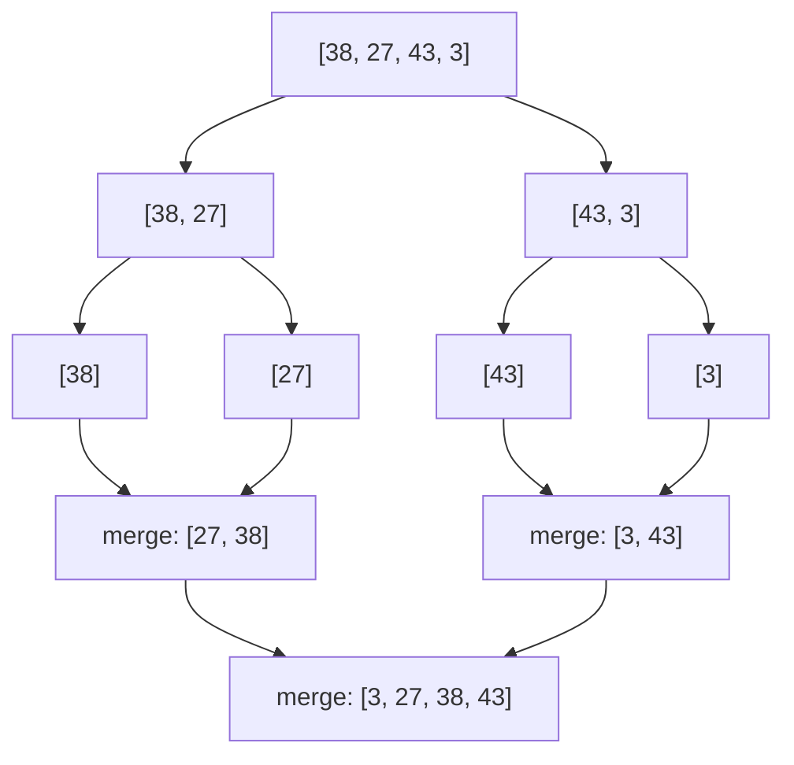

# Algoritmos de ordenamiento

Parte de: [[Algoritmos básicos (búsqueda, ordenamiento, recursión)]]

> [!info] Cómo avanzar
> `progreso`: **pendiente** → **viendo** (estudiando) → **visto** (contestaste la autoevaluación sin abrir las respuestas) → **dominado** (hiciste el laboratorio o lo aplicaste de verdad).

## Contenido

### Qué es
Un **algoritmo de ordenamiento** reorganiza los elementos de una colección según un criterio (ascendente, descendente, por varias claves). Ordenar es la base de muchas otras operaciones: búsqueda binaria, eliminar duplicados, agrupar, combinar listas, presentar reportes. Los cuatro que conviene entender son **burbuja** e **inserción** (simples, O(n²)) y **merge sort** y **quicksort** (eficientes, O(n log n)).

### Cómo funciona
**Burbuja (bubble sort):** recorre la lista comparando pares **adyacentes** e intercambiándolos si están en desorden. Tras cada pasada completa, el mayor queda al final (como una burbuja que sube). Ejemplo de una pasada sobre `[4, 3, 1, 2]`:
- 4 > 3 → intercambia → `[3, 4, 1, 2]`
- 4 > 1 → intercambia → `[3, 1, 4, 2]`
- 4 > 2 → intercambia → `[3, 1, 2, 4]` (el 4 ya está en su lugar)

**Inserción (insertion sort):** como ordenar cartas en la mano: toma cada elemento y lo **desplaza hacia la izquierda** hasta su posición dentro de la parte ya ordenada. Si la lista ya está casi ordenada, cada elemento se mueve poco: **O(n)** en el mejor caso.

**Merge sort:** **divide y vencerás**. Parte la lista a la mitad, ordena cada mitad recursivamente y luego **combina** (merge) las dos mitades ordenadas tomando siempre el menor de los frentes. Siempre O(n log n), estable, pero necesita **memoria extra O(n)** para combinar.

**Quicksort:** elige un **pivote**, **particiona** la lista en menores y mayores que el pivote, y ordena cada parte recursivamente. En promedio O(n log n) y muy rápido en la práctica porque trabaja **en el mismo arreglo** (in situ) y aprovecha bien la caché. Con malos pivotes (por ejemplo, siempre el primero sobre una lista ya ordenada) cae a **O(n²)**. No es estable.

| Algoritmo | Mejor | Promedio | Peor | Memoria extra | Estable |
|---|---|---|---|---|---|
| Burbuja | O(n) con bandera de "sin cambios" | O(n²) | O(n²) | O(1) | sí |
| Inserción | O(n) | O(n²) | O(n²) | O(1) | sí |
| Merge sort | O(n log n) | O(n log n) | O(n log n) | O(n) | sí |
| Quicksort | O(n log n) | O(n log n) | O(n²) | O(log n) por la recursión | no |

Los lenguajes combinan ideas: .NET usa **introsort** (quicksort + heapsort + inserción), Python usa un algoritmo híbrido de merge e inserción derivado de **Timsort** (estable), y `Array.prototype.sort` de JavaScript es estable desde ES2019.



### Ejemplo
Merge sort en Python (devuelve una lista nueva):

```python
def merge_sort(datos: list[int]) -> list[int]:
    if len(datos) <= 1:                 # caso base
        return datos
    medio = len(datos) // 2
    izq = merge_sort(datos[:medio])
    der = merge_sort(datos[medio:])
    return combinar(izq, der)

def combinar(a: list[int], b: list[int]) -> list[int]:
    resultado, i, j = [], 0, 0
    while i < len(a) and j < len(b):
        if a[i] <= b[j]:                # <= conserva la estabilidad
            resultado.append(a[i]); i += 1
        else:
            resultado.append(b[j]); j += 1
    resultado.extend(a[i:])
    resultado.extend(b[j:])
    return resultado

print(merge_sort([38, 27, 43, 3, 9, 82, 10]))  # [3, 9, 10, 27, 38, 43, 82]
```

En C#, para reportes de Wee.Reporteria ordenarías con LINQ por varias claves:

```csharp
var ordenados = facturas
    .OrderBy(f => f.Sucursal)
    .ThenByDescending(f => f.Total)
    .ThenBy(f => f.Folio)
    .ToList();
```

`OrderBy` define la clave principal; cada `ThenBy`/`ThenByDescending` desempata la anterior. Llamar `OrderBy` dos veces seguidas **reemplaza** el orden anterior en lugar de desempatar.

### Cuándo usarlo y cuándo no
- **Inserción**: listas pequeñas (unas decenas de elementos) o **casi ordenadas**, por ejemplo agregar unos pocos registros nuevos a una lista ya ordenada. Por eso los algoritmos híbridos la usan para particiones pequeñas.
- **Merge sort**: cuando necesitas **estabilidad** o peor caso garantizado, y para **ordenar datos que no caben en memoria** (ordenamiento externo: ordenas bloques y luego los combinas). Su desventaja frente a quicksort es la **memoria adicional O(n)** y, en arreglos, ser algo más lento en la práctica por copiar datos.
- **Quicksort**: ordenamiento general en memoria cuando no importa la estabilidad, con buena elección de pivote.
- **Burbuja**: casi solo para enseñar.
- En el día a día: `OrderBy`, `Sort` y `ORDER BY` de SQL.

### Errores comunes
- **Implementar tu propio ordenamiento** en producción: más lento y con bugs.
- **Comparadores inconsistentes** (que no cumplen que si a < b entonces b > a): resultados erráticos o excepciones en `Sort`.
- **Encadenar `OrderBy().OrderBy()`** en lugar de `ThenBy`.
- **Ordenar cadenas sin pensar en la cultura**: "Ñ" o acentos se ordenan distinto según `StringComparer.Ordinal` o `CurrentCulture`.
- **Quicksort con pivote fijo** sobre datos ya ordenados: cae a O(n²).

### Para profundizar
- [VisuAlgo: animaciones de ordenamientos](https://visualgo.net/es/sorting)
- [Ordenar datos con LINQ (Microsoft Learn)](https://learn.microsoft.com/dotnet/csharp/linq/standard-query-operators/sorting-data)
- [Sorting HOW TO de Python](https://docs.python.org/3/howto/sorting.html)

## Ejercicios

Resuélvelos en papel o en la herramienta; la solución está plegada.

> [!question]- Escribe merge sort en Python.
> ```python
> def merge_sort(a):
>     if len(a) <= 1: return a
>     m = len(a) // 2
>     i, d = merge_sort(a[:m]), merge_sort(a[m:])
>     r = []
>     while i and d:
>         r.append(i.pop(0) if i[0] <= d[0] else d.pop(0))
>     return r + i + d
> ```
> (Versión didáctica: `pop(0)` es O(n); en serio, usa índices.)

> [!question]- Aplica una pasada de burbuja a `[5, 1, 4, 2]`.
> `[1, 4, 2, 5]` (el mayor "burbujea" al final).

> [!question]- Ordena empleados por departamento y, dentro, por nombre con LINQ.
> `empleados.OrderBy(e => e.Departamento).ThenBy(e => e.Nombre)`

## Autoevaluación

Contesta primero en voz alta o en papel; luego despliega la respuesta.

> [!question]- Compara burbuja, inserción, merge sort y quicksort.
> | Algoritmo | Promedio | Peor | Estable |
> |---|---|---|---|
> | Burbuja | O(n²) | O(n²) | Sí |
> | Inserción | O(n²) | O(n²) | Sí |
> | Merge sort | O(n log n) | O(n log n) | Sí |
> | Quicksort | O(n log n) | O(n²) | No |

> [!question]- ¿Cuándo inserción es buena opción?
> Con pocos elementos o datos casi ordenados (O(n) en el mejor caso). Por eso los algoritmos híbridos la usan para particiones pequeñas.

> [!question]- ¿Qué desventaja tiene merge sort frente a quicksort?
> Necesita memoria adicional O(n) para mezclar; quicksort ordena en el mismo arreglo.

