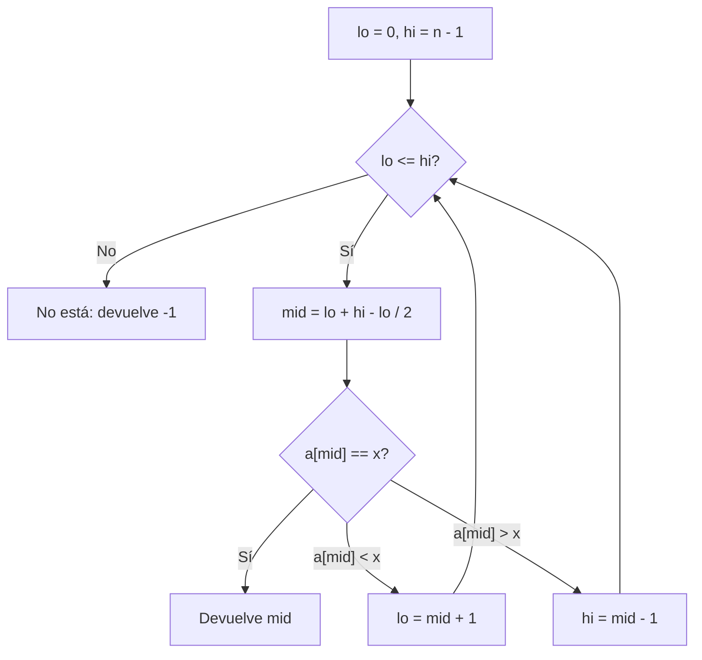

# Búsqueda lineal y binaria

Parte de: [[Algoritmos básicos (búsqueda, ordenamiento, recursión)]]

> [!info] Cómo avanzar
> `progreso`: **pendiente** → **viendo** (estudiando) → **visto** (contestaste la autoevaluación sin abrir las respuestas) → **dominado** (hiciste el laboratorio o lo aplicaste de verdad).

## Contenido

### Qué es
Buscar es encontrar la posición de un valor en una colección (o saber que no está).

- **Búsqueda lineal**: revisa los elementos **uno por uno** desde el inicio hasta encontrarlo o acabar. Funciona con **cualquier** colección, ordenada o no. Costo **O(n)**.
- **Búsqueda binaria**: en una colección **ordenada**, compara con el elemento del **medio** y descarta la mitad donde no puede estar; repite con la mitad restante. Costo **O(log n)**.

### Cómo funciona
**Lineal:** en el peor caso (no está o está al final) hace `n` comparaciones; en promedio, `n/2` si está.

**Binaria**, con índices `lo` y `hi` que delimitan el rango que aún puede contener el valor:
1. `mid` = punto medio entre `lo` y `hi`.
2. Si `a[mid]` es el buscado, termina.
3. Si `a[mid]` es menor, el valor solo puede estar a la derecha: `lo = mid + 1`.
4. Si es mayor, solo puede estar a la izquierda: `hi = mid - 1`.
5. Si `lo > hi`, no está.

Cada paso **reduce el rango a la mitad**, así que el número máximo de comparaciones es ⌊log₂ n⌋ + 1. Para 1,000 elementos son 10; para 1,000,000, 20; para mil millones, 31. Con lineal serían 1,000, 1,000,000 y mil millones.

Traza buscando 30 en `[3, 7, 11, 15, 19, 24, 30, 42]` (índices 0 a 7):

| Paso | lo | hi | mid | a[mid] | Decisión |
|---|---|---|---|---|---|
| 1 | 0 | 7 | 3 | 15 | 15 < 30 → `lo = 4` |
| 2 | 4 | 7 | 5 | 24 | 24 < 30 → `lo = 6` |
| 3 | 6 | 7 | 6 | 30 | encontrado en el índice 6 |



**El bug clásico del punto medio:** `mid = (lo + hi) / 2` puede **desbordar** cuando `lo + hi` supera el máximo de un entero (en C# o Java con `int`, a partir de unos 2,147 millones), produciendo un número negativo e índices inválidos. Este error estuvo años en la búsqueda binaria de la biblioteca estándar de Java. La forma segura es `mid = lo + (hi - lo) / 2`. En Python los enteros no desbordan, pero usar la forma segura es buena costumbre.

### Ejemplo
Implementación iterativa en Python:

```python
def buscar_binaria(datos: list[int], objetivo: int) -> int:
    """Devuelve el índice de objetivo en datos (ordenada ascendente) o -1."""
    lo, hi = 0, len(datos) - 1
    while lo <= hi:
        mid = lo + (hi - lo) // 2
        if datos[mid] == objetivo:
            return mid
        if datos[mid] < objetivo:
            lo = mid + 1
        else:
            hi = mid - 1
    return -1

print(buscar_binaria([3, 7, 11, 15, 19, 24, 30, 42], 30))  # 6
print(buscar_binaria([3, 7, 11, 15, 19, 24, 30, 42], 8))   # -1
```

En la práctica usarías lo que ya trae el lenguaje: en Python el módulo `bisect`; en .NET `Array.BinarySearch` y `List<T>.BinarySearch`, que devuelven el índice si lo encuentran o un **número negativo** (el complemento bit a bit del punto de inserción) si no:

```csharp
int[] folios = [1001, 1005, 1010, 1042, 1100];   // debe estar ordenado
int i = Array.BinarySearch(folios, 1042);         // 3
int j = Array.BinarySearch(folios, 1007);         // negativo: ~j = 2 es donde iría
```

Y en SQL Server, un **índice** es justamente una estructura ordenada (árbol B) que permite búsquedas logarítmicas: `WHERE Folio = @Folio` con índice hace un *seek*; sin índice, un *scan* lineal de la tabla (ver [[Árboles y árboles binarios de búsqueda]]).

### Cuándo usarlo y cuándo no
**Requisito de la binaria:** datos **ordenados** por el mismo criterio con el que comparas, y acceso por **índice en O(1)** (arreglo o lista, no lista enlazada).

**Lineal es mejor cuando:**
- La colección es **pequeña** (decenas de elementos): no hay diferencia práctica y el código es más simple.
- **No está ordenada** y la buscarás **una sola vez**: ordenar cuesta O(n log n), más que una búsqueda lineal O(n).
- Buscas por una **condición** y no por un valor exacto (`First(p => p.Total > 10_000)`).
- Los datos llegan como **flujo** (`IEnumerable`, archivo que se lee línea por línea).

Si vas a buscar **muchas veces por clave exacta**, a menudo lo mejor no es ni una ni otra, sino un `HashSet` o `Dictionary` (O(1) promedio; ver [[Tablas hash]]).

### Errores comunes
- **Binaria sobre datos desordenados**: no falla, da resultados falsos.
- **Errores de borde**: usar `lo < hi` en lugar de `lo <= hi`, o `hi = mid` en lugar de `mid - 1`, y caer en bucles infinitos o saltarte el último elemento. Prueba con listas de 0, 1 y 2 elementos.
- **Desbordamiento** en `(lo + hi) / 2`.
- **Ordenar con un criterio y buscar con otro** (por ejemplo, ordenar sin distinguir mayúsculas y comparar distinguiéndolas).
- **Interpretar mal el valor negativo** de `BinarySearch` en .NET como "-1 = no está".

### Para profundizar
- [Array.BinarySearch (Microsoft Learn)](https://learn.microsoft.com/dotnet/api/system.array.binarysearch)
- [Módulo bisect de Python](https://docs.python.org/3/library/bisect.html)
- [Nearly All Binary Searches and Mergesorts are Broken (Google Research)](https://research.google/blog/extra-extra-read-all-about-it-nearly-all-binary-searches-and-mergesorts-are-broken/)

## Ejercicios

Resuélvelos en papel o en la herramienta; la solución está plegada.

> [!question]- Implementa búsqueda binaria en Python que devuelva el índice o -1.
> ```python
> def binaria(a, x):
>     lo, hi = 0, len(a) - 1
>     while lo <= hi:
>         mid = lo + (hi - lo) // 2
>         if a[mid] == x: return mid
>         if a[mid] < x: lo = mid + 1
>         else: hi = mid - 1
>     return -1
> ```

> [!question]- ¿Cuántos pasos, como máximo, para buscar en 1,024 elementos ordenados?
> **11** comparaciones en el peor caso (⌊log₂ 1024⌋ + 1).

> [!question]- En `[2, 5, 8, 12, 16, 23, 38]` buscando 23, ¿qué índices `mid` se revisan?
> 3 (12) → 5 (23). Encontrado en el índice 5.

## Autoevaluación

Contesta primero en voz alta o en papel; luego despliega la respuesta.

> [!question]- ¿Qué requisito tiene la búsqueda binaria?
> Que los datos estén **ordenados** (y acceso por índice). Divide el rango a la mitad en cada paso: O(log n).

> [!question]- ¿Cuándo es mejor la búsqueda lineal?
> Con pocos elementos, datos desordenados que se buscan una sola vez (ordenar cuesta O(n log n)) o cuando hay que revisar todos de todas formas.

> [!question]- ¿Qué bug clásico tiene `mid = (lo + hi) / 2`?
> Desbordamiento de enteros cuando `lo + hi` supera el máximo. Se usa `lo + (hi - lo) / 2`.

