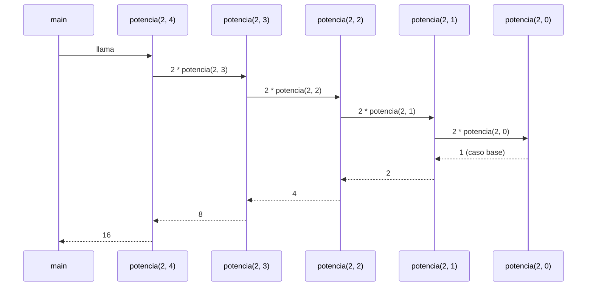

# Recursión (algoritmos)

Parte de: [[Algoritmos básicos (búsqueda, ordenamiento, recursión)]]

> [!info] Cómo avanzar
> `progreso`: **pendiente** → **viendo** (estudiando) → **visto** (contestaste la autoevaluación sin abrir las respuestas) → **dominado** (hiciste el laboratorio o lo aplicaste de verdad).

## Contenido

### Qué es
**Recursión** es cuando una función se **llama a sí misma** para resolver una versión más pequeña del mismo problema. Es la forma natural de expresar problemas con estructura repetida: árboles (categorías, menús, carpetas), divide y vencerás (merge sort), y definiciones matemáticas (factorial, Fibonacci).

Toda función recursiva necesita dos partes:
1. **Caso base**: una entrada tan simple que se responde directamente, sin volver a llamarse.
2. **Caso recursivo**: reduce el problema y se llama a sí misma, **acercándose** siempre al caso base.

Si falta el caso base o la llamada no progresa hacia él, la recursión nunca termina.

### Cómo funciona
Cada llamada crea un **marco de pila** (*stack frame*) con sus parámetros y variables locales. Las llamadas se apilan hasta llegar al caso base; luego se resuelven en orden inverso.



**Recursión muy profunda.** La pila tiene un tamaño limitado. Si la profundidad crece con la entrada (por ejemplo, recursión sobre una lista de 100,000 elementos), se agota:
- En **Python** hay un límite de profundidad (por defecto 1000, consultable con `sys.getrecursionlimit()`); al superarlo lanza `RecursionError`.
- En **.NET** se produce un `StackOverflowException` que **no se puede atrapar** y **termina el proceso** completo; en un API, se cae todo el servicio.
- Soluciones: convertir a **iteración** (bucle con una pila o cola explícita), limitar la profundidad o reestructurar para que la profundidad sea logarítmica (como en merge sort). C# y Python **no** garantizan optimización de llamadas de cola, así que no cuentes con ella.

**Subproblemas repetidos.** Fibonacci definido como `fib(n) = fib(n-1) + fib(n-2)` es elegante pero muy lento: `fib(n-2)` se calcula dentro de `fib(n-1)` y otra vez por separado, y así en cascada. El número de llamadas crece de forma **exponencial** (aproximadamente 1.6ⁿ): para `fib(30)` son unos 2.7 millones de llamadas. La solución es **memoización**: guardar cada resultado la primera vez y reutilizarlo, lo que deja el costo en O(n). Es la idea base de la **programación dinámica**.

### Ejemplo
Potencia y suma de una lista, recursivas, en Python:

```python
def potencia(base: int, exp: int) -> int:
    if exp == 0:                         # caso base
        return 1
    return base * potencia(base, exp - 1)   # se acerca al caso base

def suma(lista: list[int]) -> int:
    if not lista:                        # caso base: lista vacía
        return 0
    return lista[0] + suma(lista[1:])

print(potencia(2, 10))   # 1024
print(suma([4, 8, 15]))  # 27
```

Memoización con la biblioteca estándar:

```python
from functools import lru_cache

@lru_cache(maxsize=None)
def caminos(filas: int, columnas: int) -> int:
    """Caminos en una cuadrícula moviéndose solo a la derecha o hacia abajo."""
    if filas == 1 or columnas == 1:
        return 1
    return caminos(filas - 1, columnas) + caminos(filas, columnas - 1)

print(caminos(18, 18))   # instantáneo gracias a la caché
```

Un caso real en C#: el árbol de categorías de un catálogo (tabla con `Id` y `PadreId`) cargado en memoria y recorrido para armar el menú de Itzamna.Clio:

```csharp
public sealed record Categoria(int Id, string Nombre, IReadOnlyList<Categoria> Hijas);

static int ContarProductos(Categoria c, IReadOnlyDictionary<int, int> productosPorCategoria) =>
    productosPorCategoria.GetValueOrDefault(c.Id)
    + c.Hijas.Sum(h => ContarProductos(h, productosPorCategoria)); // caso base implícito: sin hijas
```

En SQL Server, las jerarquías se recorren con un **CTE recursivo** (`WITH ... UNION ALL`), que tiene su propio límite (`MAXRECURSION`, 100 por defecto).

### Cuándo usarlo y cuándo no
- **Sí**: estructuras naturalmente recursivas (árboles, JSON anidado, carpetas), divide y vencerás, *backtracking*. Suele dar código más claro.
- **No**: cuando la profundidad depende del tamaño de datos grandes (listas largas, cadenas de registros); usa un bucle. Tampoco cuando un bucle simple es igual de claro.
- Si hay subproblemas repetidos, memoiza o usa programación dinámica iterativa.

### Errores comunes
- **Olvidar el caso base** o escribir uno que nunca se alcanza (por ejemplo, con números negativos).
- **No reducir el problema** en la llamada recursiva: bucle infinito hasta desbordar la pila.
- **Recursión ingenua con subproblemas repetidos**: tiempos exponenciales.
- **Copiar listas en cada llamada** (`lista[1:]`): agrega O(n) por nivel; con listas grandes conviene pasar un índice.
- **Datos con ciclos** (un grafo, una categoría que apunta a sí misma): recursión infinita si no marcas los visitados.

### Para profundizar
- [functools.lru_cache (Python)](https://docs.python.org/3/library/functools.html#functools.lru_cache)
- [sys.getrecursionlimit (Python)](https://docs.python.org/3/library/sys.html#sys.getrecursionlimit)
- [Consultas recursivas con expresiones de tabla común (SQL Server)](https://learn.microsoft.com/sql/t-sql/queries/with-common-table-expression-transact-sql)

## Ejercicios

Resuélvelos en papel o en la herramienta; la solución está plegada.

> [!question]- Escribe factorial recursivo en Python.
> ```python
> def fact(n):
>     return 1 if n <= 1 else n * fact(n - 1)
> ```
> `fact(5)` → 120.

> [!question]- Calcula la suma de los dígitos de un número de forma recursiva.
> ```python
> def suma_digitos(n):
>     return n if n < 10 else n % 10 + suma_digitos(n // 10)
> ```
> `suma_digitos(1234)` → 10.

> [!question]- Fibonacci con memoización.
> ```python
> from functools import lru_cache
> @lru_cache(None)
> def fib(n):
>     return n if n < 2 else fib(n - 1) + fib(n - 2)
> ```
> `fib(50)` → 12586269025.

## Autoevaluación

Contesta primero en voz alta o en papel; luego despliega la respuesta.

> [!question]- ¿Qué necesita toda función recursiva?
> Un **caso base** que termina sin recursión y un paso recursivo que acerca el problema al caso base.

> [!question]- ¿Qué pasa si la recursión es muy profunda?
> Se agota la pila de llamadas: `StackOverflowException` en .NET (que mata el proceso) o `RecursionError` en Python. Se convierte a iteración con una pila explícita.

> [!question]- ¿Por qué Fibonacci recursivo ingenuo es lento y cómo se arregla?
> Recalcula los mismos subproblemas: O(2ⁿ). Con memoización o versión iterativa baja a O(n).

