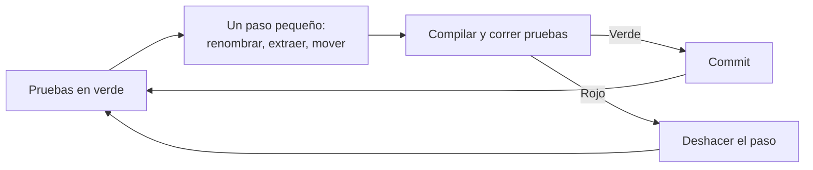

# Code smells y refactorización

Parte de: [[02-Fundamentos/08 Computación general/_Índice Computación general|Computación general]]

> [!info] Cómo avanzar
> `progreso`: **pendiente** → **viendo** (estudiando) → **visto** (contestaste la autoevaluación sin abrir las respuestas) → **dominado** (hiciste el laboratorio o lo aplicaste de verdad).

## Contenido

### Qué es
Un **code smell** ("mal olor") es una **señal superficial** en el código que suele indicar un problema de diseño más profundo. No es un bug: el programa funciona, pero es más difícil de entender o cambiar. El término lo popularizaron Kent Beck y Martin Fowler en *Refactoring*.

**Refactorizar** es **cambiar la estructura interna del código sin cambiar su comportamiento observable**, en pasos pequeños, para que sea más fácil de entender y modificar. Lo que lo hace **seguro** es tener **pruebas automatizadas** que confirmen que el comportamiento sigue igual después de cada paso, más el uso de herramientas del IDE que hacen las transformaciones mecánicamente.

### Cómo funciona
Smells frecuentes y su refactorización típica:

| Smell | Señal | Refactorización |
|---|---|---|
| Método largo | 80 líneas, varios comentarios que separan "secciones" | **Extraer método** |
| Clase grande | muchos campos y responsabilidades | **Extraer clase** |
| Código duplicado | mismo bloque en tres lugares | Extraer método/función compartida |
| Lista larga de parámetros | `Crear(a, b, c, d, e, f, g)` | **Introducir objeto parámetro** (un record) |
| Obsesión por primitivos | RFC, montos y correos como `string`/`decimal` sueltos | Tipos de valor (`record struct Rfc`) |
| `switch` repetido por tipo | el mismo `switch (tipo)` en varios lugares | **Reemplazar condicional con polimorfismo** |
| Envidia de funcionalidad | un método usa más datos de otra clase que de la suya | **Mover método** |
| Nombres confusos | `Procesar2`, `data`, `tmp` | **Renombrar** |
| Número mágico | `if (estatus == 9)` | Reemplazar con constante o enum |

El ciclo de refactorización:



Si no hay pruebas, el primer paso es escribir **pruebas de caracterización**: capturan lo que el código hace hoy (aunque sea raro) para detectar si cambias algo sin querer.

### Ejemplo
Extraer método e introducir objeto parámetro en Itzamna.Dionisio:

```csharp
// Antes
public decimal CalcularTotal(decimal subtotal, decimal tasaIva, bool exento,
                             decimal descuento, string tipoCliente)
{
    var d = tipoCliente == "MAYORISTA" ? descuento * 1.5m : descuento;
    var baseGravable = subtotal - d;
    if (exento) return baseGravable;
    return baseGravable + baseGravable * tasaIva;
}

// Después
public sealed record DatosTotal(decimal Subtotal, decimal TasaIva, bool Exento,
                                decimal Descuento, TipoCliente TipoCliente);

public decimal CalcularTotal(DatosTotal d)
{
    var baseGravable = d.Subtotal - DescuentoAplicable(d);
    return d.Exento ? baseGravable : baseGravable * (1 + d.TasaIva);
}

private static decimal DescuentoAplicable(DatosTotal d) =>
    d.TipoCliente == TipoCliente.Mayorista ? d.Descuento * 1.5m : d.Descuento;
```

Antes de tocarlo, una prueba con [[xUnit]] fija el resultado para varios casos (exento, mayorista, normal); se corre después de cada paso.

**Por qué no mezclar refactor y cambio de funcionalidad en un commit:** si algo se rompe, no sabes si fue la reestructuración o la lógica nueva; el revisor no puede distinguir el cambio de comportamiento entre cientos de líneas movidas; y no puedes revertir uno sin el otro. Haz primero el commit `refactor:` (pruebas en verde, sin cambio de comportamiento) y después el `feat:` o `fix:`.

### Cuándo usarlo y cuándo no
- **Regla del boy scout**: deja el código un poco mejor de como lo encontraste, sobre todo justo **antes** de agregar una funcionalidad en esa zona ("primero haz fácil el cambio, luego haz el cambio fácil").
- **No refactorices** código que no vas a tocar ni que nadie lee, ni justo antes de una entrega crítica sin pruebas.
- Una reescritura total no es refactorización: es otro proyecto con otro riesgo.

### Errores comunes
- **Refactorizar sin pruebas**: es "cambiar código y rezar".
- **Pasos gigantes**: si las pruebas fallan no sabes por qué. Pasos pequeños y commits frecuentes.
- **Tratar cada smell como obligatorio**: un `switch` en un solo lugar puede estar bien (ver [[SOLID - Abierto-cerrado (OCP)]]).
- **Mezclar con funcionalidad** en el mismo commit o PR.
- **No usar las herramientas del IDE**: renombrar a mano deja referencias rotas; usa las acciones de refactorización de Visual Studio, Rider o VS Code.

### Para profundizar
- [Catálogo de refactorizaciones (Martin Fowler)](https://refactoring.com/catalog/)
- [Code smells (Refactoring.Guru, en español)](https://refactoring.guru/es/refactoring/smells)
- [Refactorizaciones rápidas en Visual Studio](https://learn.microsoft.com/visualstudio/ide/refactoring-in-visual-studio)

## Autoevaluación

Contesta primero en voz alta o en papel; luego despliega la respuesta.

> [!question]- ¿Qué es un code smell?
> Una señal en el código de un posible problema de diseño (no un bug): método largo, clase grande, parámetros excesivos, duplicación, "obsesión por primitivos", envidia de funcionalidad, cadenas de `if` por tipo.

> [!question]- ¿Qué es refactorizar y qué lo hace seguro?
> Cambiar la estructura interna **sin cambiar el comportamiento observable**, en pasos pequeños. Lo hace seguro tener pruebas automatizadas que lo verifiquen.

> [!question]- Nombra tres refactorizaciones comunes.
> Extraer método, renombrar, introducir objeto de parámetros, reemplazar condicional por polimorfismo, extraer clase, sustituir número mágico por constante.

> [!question]- Error común: mezclar refactorización y cambio de funcionalidad en un mismo commit. ¿Por qué evitarlo?
> Complica la revisión y, si algo falla, no se sabe qué lo rompió. Separa en commits o PRs distintos.

