# Concurrencia vs paralelismo

Parte de: [[02-Fundamentos/08 Computación general/_Índice Computación general|Computación general]]

> [!info] Cómo avanzar
> `progreso`: **pendiente** → **viendo** (estudiando) → **visto** (contestaste la autoevaluación sin abrir las respuestas) → **dominado** (hiciste el laboratorio o lo aplicaste de verdad).

## Contenido

### Qué es
- **Concurrencia**: **estructurar** un programa para que maneje **varias tareas en curso al mismo tiempo**, intercalando su avance. No necesita varios núcleos: una sola CPU puede atender mil peticiones si cada una pasa la mayor parte del tiempo esperando.
- **Paralelismo**: **ejecutar** varias operaciones **literalmente al mismo instante** en distintos núcleos o máquinas para terminar antes un trabajo de cómputo.

Una frase útil (de Rob Pike): la concurrencia trata de **lidiar** con muchas cosas a la vez; el paralelismo, de **hacer** muchas cosas a la vez. Se pueden combinar: un servidor concurrente que además corre en 8 núcleos.

### Cómo funciona

```mermaid
gantt
  dateFormat X
  axisFormat %s
  section Concurrencia (1 núcleo)
  Petición A CPU      :a1, 0, 1
  Petición B CPU      :b1, 1, 2
  Petición A CPU      :a2, 2, 3
  Petición B CPU      :b2, 3, 4
  section Paralelismo (2 núcleos)
  Núcleo 1 tarea A    :p1, 0, 4
  Núcleo 2 tarea B    :p2, 0, 4
```


En concurrencia, mientras A espera (red, disco, base de datos), B avanza. En paralelismo, A y B consumen CPU simultáneamente.

En .NET:
- **Concurrencia para E/S** se logra con `async`/`await` (ver [[Síncrono vs asíncrono]]): mientras una consulta a SQL Server espera, el hilo regresa al thread pool y atiende otra petición. Así ASP.NET Core atiende miles de peticiones con pocos hilos.
- **Paralelismo para CPU** se logra con `Parallel.For`/`Parallel.ForEach`, PLINQ (`AsParallel()`), o `Task.Run` para varias tareas de cálculo; el runtime reparte trabajo entre núcleos del [[Procesos e hilos|thread pool]].
- `Parallel.ForEachAsync` (desde .NET 6) combina ambas: procesa una colección con un límite de concurrencia, con cuerpo asíncrono.

**Cuándo ayuda el paralelismo:** cuando el trabajo está **limitado por CPU** (CPU-bound) y se puede **dividir en partes independientes**: procesar miles de imágenes, calcular hashes, generar muchos archivos Excel en Wee.Reporteria, comprimir, cálculos numéricos. No ayuda (o empeora) si el cuello de botella es E/S, si las partes comparten estado con bloqueos, o si la tarea es tan pequeña que el costo de repartirla supera la ganancia. La **ley de Amdahl** pone el límite: si 25% del proceso es secuencial, aunque tengas infinitos núcleos no bajarás de ese 25%: el speedup máximo es 4×.

### Ejemplo
Un API que atiende 1,000 peticiones que esperan a la base de datos necesita **concurrencia**, no paralelismo: la CPU casi no trabaja, solo espera.

```csharp
// Concurrente: el hilo se libera mientras SQL Server responde
[HttpGet("{id:int}")]
public async Task<IActionResult> Obtener(int id, CancellationToken ct)
{
    var cliente = await _obtenerCliente.EjecutarAsync(id, ct); // Dapper QuerySingleOrDefaultAsync
    return cliente is null ? NotFound() : Ok(cliente);
}
```

Generar 2,000 reportes en Excel a partir de datos ya cargados es trabajo de **CPU**: ahí sí ayuda el paralelismo.

```csharp
var opciones = new ParallelOptions { MaxDegreeOfParallelism = Environment.ProcessorCount };
Parallel.ForEach(clientes, opciones, cliente =>
{
    var bytes = GeneradorExcel.Crear(cliente.Movimientos); // CPU pura, sin estado compartido
    File.WriteAllBytes(Path.Combine(salida, $"{cliente.Rfc}.xlsx"), bytes);
});
```

Y llamar a una API externa para 500 clientes, con un máximo de 10 llamadas simultáneas:

```csharp
await Parallel.ForEachAsync(clientes, new ParallelOptions { MaxDegreeOfParallelism = 10 },
    async (c, ct) => await _hermes.NotificarAsync(c.Correo, ct));
```

### Cuándo usarlo y cuándo no
- **E/S (red, BD, archivos)**: concurrencia con `async`. No uses `Parallel.For` para esperar llamadas HTTP; bloquea hilos.
- **CPU, datos independientes**: paralelismo, limitando el grado al número de núcleos.
- **En un servidor web**, el paralelismo dentro de una petición compite con las demás peticiones por los mismos núcleos; úsalo con moderación y mide.
- Para trabajo pesado de fondo, considera una cola y un worker separado en vez de paralelizar dentro del request.

### Errores comunes
- **Pensar que `async` hace las cosas en paralelo**: un `await` tras otro es secuencial; para concurrencia entre llamadas independientes usa `Task.WhenAll`.
- **Estado compartido sin sincronizar** en `Parallel.ForEach` (`lista.Add` en una `List<T>`): condiciones de carrera. Usa colecciones concurrentes o agrega resultados por partición.
- **Sin límite de concurrencia**: 10,000 llamadas simultáneas a un servicio externo lo tumban o te bloquean.
- **Paralelizar trabajo diminuto**: el costo de coordinación supera la ganancia.

### Para profundizar
- [Programación en paralelo en .NET (Microsoft Learn)](https://learn.microsoft.com/dotnet/standard/parallel-programming/)
- [Programación asincrónica con async y await](https://learn.microsoft.com/dotnet/csharp/asynchronous-programming/)
- [Concurrency is not Parallelism (Rob Pike, blog de Go)](https://go.dev/blog/waza-talk)

## Autoevaluación

Contesta primero en voz alta o en papel; luego despliega la respuesta.

> [!question]- ¿Qué diferencia hay entre concurrencia y paralelismo?
> **Concurrencia**: varias tareas en progreso al mismo tiempo, intercalándose (estructura). **Paralelismo**: varias tareas ejecutándose **literalmente a la vez** en varios núcleos (ejecución).

> [!question]- Un servidor web atiende 1,000 peticiones que esperan a la BD. ¿Necesita concurrencia o paralelismo?
> Concurrencia: casi todo el tiempo es espera de E/S; con `async` pocos hilos atienden muchas peticiones.

> [!question]- ¿Cuándo ayuda el paralelismo?
> En trabajo **de CPU** divisible (procesar imágenes, cálculos sobre grandes colecciones) con `Parallel.ForEach` o PLINQ. Para E/S no ayuda y puede empeorar las cosas.

