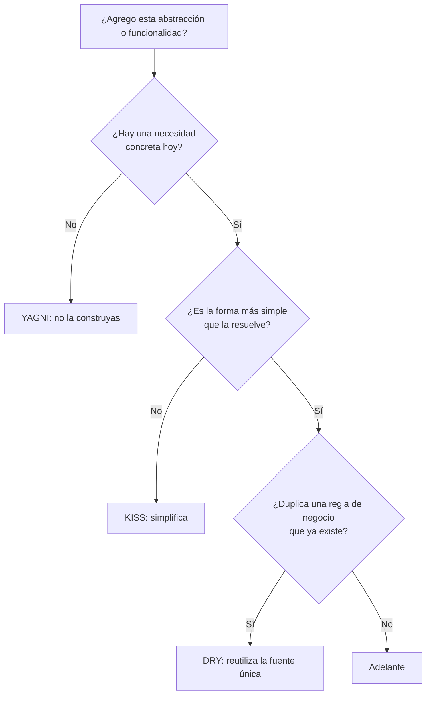

# DRY, KISS y YAGNI

Parte de: [[02-Fundamentos/08 Computación general/_Índice Computación general|Computación general]]

> [!info] Cómo avanzar
> `progreso`: **pendiente** → **viendo** (estudiando) → **visto** (contestaste la autoevaluación sin abrir las respuestas) → **dominado** (hiciste el laboratorio o lo aplicaste de verdad).

## Contenido

### Qué es
Tres principios cortos que sirven como freno contra dos males opuestos: la duplicación y la complejidad innecesaria.

- **DRY** (*Don't Repeat Yourself*, "no te repitas"): cada **pieza de conocimiento** debe tener una representación única y autorizada en el sistema. Lo formularon Andy Hunt y Dave Thomas en *The Pragmatic Programmer*.
- **KISS** (*Keep It Simple, Stupid*): la solución más simple que resuelve el problema suele ser la mejor; la complejidad debe justificarse.
- **YAGNI** (*You Aren't Gonna Need It*, "no lo vas a necesitar"): no construyas funcionalidad ni flexibilidad hasta que haya una necesidad real, no una imaginada. Viene de Extreme Programming.

### Cómo funciona
**DRY no es "eliminar todo lo que se parezca".** Habla de **conocimiento**, no de texto. Dos bloques de código pueden verse idénticos y representar reglas distintas que cambiarán por razones distintas: la validación del RFC de un cliente y la del RFC de un proveedor hoy son iguales, pero si el negocio decide que a proveedores extranjeros se les acepta un identificador fiscal distinto, unificarlas te obliga a meter condiciones. Esa duplicación es **accidental** y unirla aumenta el acoplamiento. Una heurística útil es la **regla de tres**: tolera la segunda copia, abstrae a la tercera, cuando ya ves el patrón real.

DRY sí aplica fuertemente a cosas como: la tasa de IVA escrita en diez lugares, la cadena de conexión en varios archivos, la misma regla de negocio implementada en el front y en el procedimiento sin una fuente de verdad, o el esquema de la base duplicado a mano en DTOs que se desincronizan.

**KISS** se aplica eligiendo la estructura más directa: un `if` antes que una jerarquía de estrategias; un procedimiento almacenado claro antes que un motor de reglas; una tabla antes que un servicio de configuración distribuido. "Simple" no es "fácil de escribir": es fácil de entender y de cambiar.

**YAGNI** te protege de pagar hoy costos (código, pruebas, mantenimiento, documentación) por necesidades que quizá nunca lleguen, y que si llegan probablemente serán distintas de lo que imaginaste. Aplica a funcionalidad especulativa, no a prácticas que facilitan el cambio (pruebas, buen diseño, refactorización).



### Ejemplo
En Wee.Reporteria te piden: "exportar el reporte de cobranza a CSV". Propuesta sobrediseñada:

```csharp
public interface IExportador { byte[] Exportar<T>(IEnumerable<T> datos, OpcionesExportacion o); }
public class FabricaExportadores { /* CSV, XLSX, PDF, XML, JSON con plugins */ }
```

Eso viola **YAGNI** (cuatro formatos que nadie pidió) y **KISS** (fábrica, opciones, plugins). La solución suficiente:

```csharp
public static class CobranzaCsv
{
    public static string Generar(IEnumerable<FilaCobranza> filas)
    {
        var sb = new StringBuilder("Cliente,Folio,Saldo\n");
        foreach (var f in filas)
            sb.AppendLine($"\"{f.Cliente.Replace("\"", "\"\"")}\",{f.Folio},{f.Saldo.ToString(CultureInfo.InvariantCulture)}");
        return sb.ToString();
    }
}
```

Cuando llegue el segundo formato real (por ejemplo, Excel, que el proyecto ya usa), extraes lo común con datos en la mano. Y aplicas **DRY** donde sí importa: la regla "saldo vencido = saldo con más de 30 días" vive en un solo `.sql` y no se reescribe en cada reporte.

### Cuándo usarlo y cuándo no
- Úsalos como **preguntas de revisión** en PR y diseño: ¿esto es necesario hoy?, ¿hay algo más simple?, ¿esta regla ya existe en otro lado?
- Hay excepciones razonables a YAGNI: decisiones **caras de revertir** (formato de un contrato público de API, esquema de identificadores, seguridad). Ahí sí conviene pensar a futuro.
- DRY y bajo acoplamiento pueden chocar: entre slices o microservicios, se prefiere a veces un poco de duplicación a una librería compartida que los ata (ver [[Acoplamiento y cohesión]]).

### Errores comunes
- **DRY textual**: unir código parecido con banderas y parámetros hasta crear una función ilegible.
- **Abstracciones prematuras** "para cuando cambiemos de base de datos" que nunca llega.
- **Confundir simple con improvisado**: KISS no justifica saltarse validaciones, pruebas o manejo de errores.
- **Usar YAGNI para no refactorizar**: el diseño que permite cambiar sí lo necesitas.

### Para profundizar
- [Yagni (Martin Fowler)](https://martinfowler.com/bliki/Yagni.html)
- [Principios de arquitectura en .NET (Microsoft Learn)](https://learn.microsoft.com/dotnet/architecture/modern-web-apps-azure/architectural-principles)
- [The Pragmatic Programmer (sitio de los autores)](https://pragprog.com/titles/tpp20/the-pragmatic-programmer-20th-anniversary-edition/)

## Autoevaluación

Contesta primero en voz alta o en papel; luego despliega la respuesta.

> [!question]- ¿Qué significan DRY, KISS y YAGNI?
> **DRY**: no repitas conocimiento (cada regla en un solo lugar). **KISS**: mantenlo simple. **YAGNI**: no construyas lo que aún no necesitas.

> [!question]- ¿DRY significa eliminar todo código que se parezca?
> No. Se trata de no duplicar **conocimiento**. Dos fragmentos parecidos que cambian por razones distintas deben quedarse separados; unirlos crea acoplamiento ("duplicación accidental").

> [!question]- Te piden exportar a CSV y propones un motor genérico de exportación a 5 formatos. ¿Qué principio violas?
> YAGNI (y KISS): resuelve el CSV; generaliza cuando aparezca el segundo formato real.

