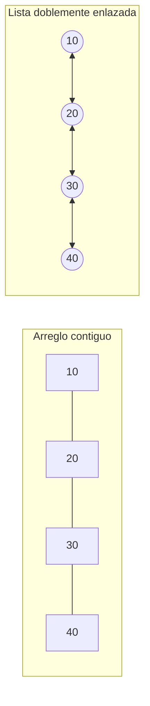

# Arreglos y listas enlazadas

Parte de: [[Estructuras de datos básicas]]

> [!info] Cómo avanzar
> `progreso`: **pendiente** → **viendo** (estudiando) → **visto** (contestaste la autoevaluación sin abrir las respuestas) → **dominado** (hiciste el laboratorio o lo aplicaste de verdad).

## Contenido

### Qué es
Son las dos formas básicas de guardar una **secuencia** de elementos:

- **Arreglo**: un bloque de **memoria contigua** donde los elementos están uno junto al otro. Conociendo la dirección inicial y el tamaño de cada elemento, se llega a cualquier posición con una cuenta: acceso por índice **O(1)**. Su tamaño es fijo; para crecer hay que crear otro más grande y copiar.
- **Lista enlazada**: una cadena de **nodos** dispersos en memoria; cada nodo guarda un valor y una referencia al siguiente (y al anterior, en la doblemente enlazada). Para llegar al elemento *k* hay que recorrer desde el inicio: **O(n)**. A cambio, insertar o quitar un nodo cuando ya lo tienes localizado es **O(1)**: solo se cambian referencias.

### Cómo funciona
| Operación | Arreglo / `List<T>` | Lista enlazada / `LinkedList<T>` |
|---|---|---|
| Acceso por índice | O(1) | O(n) |
| Buscar un valor | O(n) | O(n) |
| Agregar al final | O(1) amortizado | O(1) |
| Insertar o borrar al inicio o en medio | O(n) (hay que desplazar) | O(1) si ya tienes el nodo; O(n) si hay que buscarlo |
| Memoria por elemento | solo el valor | valor + 1 o 2 referencias + encabezado de objeto |



**`List<T>` en .NET** es un **arreglo dinámico**: por dentro tiene un `T[]` y un contador. `Capacity` es el tamaño del arreglo interno; `Count`, cuántos elementos están en uso. Cuando agregas y ya no cabe, crea un arreglo nuevo del **doble de capacidad** (si empezó vacía, la primera capacidad es 4), copia los elementos y descarta el viejo. Así, aunque una copia individual cueste O(n), en promedio cada `Add` cuesta **O(1) amortizado**. Si sabes cuántos elementos vas a meter, pásalo al constructor (`new List<T>(10_000)`) o usa `EnsureCapacity` para evitar copias.

**¿Por qué los arreglos suelen ganar en la práctica?** La teoría de la tabla cuenta operaciones, pero el hardware moderno premia la **localidad de memoria**:
- Un arreglo se recorre de forma secuencial; el CPU carga en caché bloques de memoria contigua y adivina lo siguiente (*prefetching*). Recorrer una `List<int>` es muy rápido.
- Los nodos de una lista enlazada están dispersos en el heap: cada salto puede ser un fallo de caché, decenas de veces más lento que leer un elemento contiguo.
- Cada nodo es un objeto: más memoria, más trabajo para el recolector de basura.
- Desplazar elementos de un arreglo con copia de bloques (`memmove`) es muy rápido para tamaños moderados.
Resultado: incluso para insertar en medio, una `List<T>` de miles de elementos suele superar a `LinkedList<T>`, porque en la lista enlazada primero hay que **llegar** al punto de inserción recorriendo nodos.

### Ejemplo
```csharp
// List<T>: crece duplicando su capacidad
var folios = new List<int>();
Console.WriteLine(folios.Capacity);        // 0
folios.Add(1);
Console.WriteLine(folios.Capacity);        // 4
for (var i = 2; i <= 5; i++) folios.Add(i);
Console.WriteLine(folios.Capacity);        // 8 (se duplicó al agregar el quinto)

// Capacidad conocida: sin copias intermedias
var filas = new List<FilaReporte>(capacity: totalFilas);

// LinkedList<T>: útil cuando mantienes referencias a nodos
var recientes = new LinkedList<string>();
var nodo = recientes.AddFirst("cliente-42");
recientes.AddFirst("cliente-7");
recientes.Remove(nodo);                    // O(1): ya teníamos el nodo
recientes.AddFirst(nodo);                  // mover al frente, sin buscar
```

El último patrón (lista enlazada + diccionario de nodos) es la base de una **caché LRU**: el diccionario encuentra el nodo en O(1) y la lista lo mueve al frente en O(1).

### Cuándo usarlo y cuándo no
- **Arreglo / `List<T>`**: la opción por defecto para secuencias. Arreglos fijos (`T[]`) cuando el tamaño no cambia; `Span<T>` para trabajar sobre porciones sin copiar.
- **`LinkedList<T>`**: cuando haces muchas inserciones/eliminaciones en medio **y ya tienes la referencia al nodo** (cachés LRU, listas de tareas reordenables). Es poco común.
- Para insertar y quitar en ambos extremos, `Queue<T>` o `Deque` (ver [[Pilas y colas (estructuras de datos)]]) suelen ser mejores.

### Errores comunes
- **Elegir `LinkedList` "porque inserta en O(1)"** sin considerar que encontrar la posición es O(n).
- **`List.Insert(0, x)` o `RemoveAt(0)` en bucles** sobre listas grandes: O(n) cada uno. Usa `Queue<T>` o invierte el orden.
- **No reservar capacidad** cuando conoces el tamaño: copias innecesarias y basura.
- **Modificar una lista mientras la recorres con `foreach`**: `InvalidOperationException`.
- **Confundir `Count` con `Capacity`**.

### Para profundizar
- [List<T> (Microsoft Learn)](https://learn.microsoft.com/dotnet/api/system.collections.generic.list-1)
- [LinkedList<T> (Microsoft Learn)](https://learn.microsoft.com/dotnet/api/system.collections.generic.linkedlist-1)
- [Colecciones en .NET](https://learn.microsoft.com/dotnet/standard/collections/)

## Autoevaluación

Contesta primero en voz alta o en papel; luego despliega la respuesta.

> [!question]- ¿Qué diferencia de costos hay entre arreglo y lista enlazada?
> **Arreglo**: acceso por índice O(1), insertar en medio O(n). **Lista enlazada**: insertar o quitar con referencia al nodo O(1), acceso por índice O(n).

> [!question]- ¿Cómo crece un `List<T>` en .NET?
> Usa un arreglo interno; al llenarse crea otro del doble de capacidad y copia. Agregar al final es O(1) amortizado. Si conoces el tamaño, pásalo en el constructor.

> [!question]- ¿Por qué en la práctica los arreglos suelen ganar aunque la teoría favorezca a la lista enlazada?
> Memoria contigua: aprovechan la caché del CPU. Los nodos dispersos de una lista enlazada causan fallos de caché.

