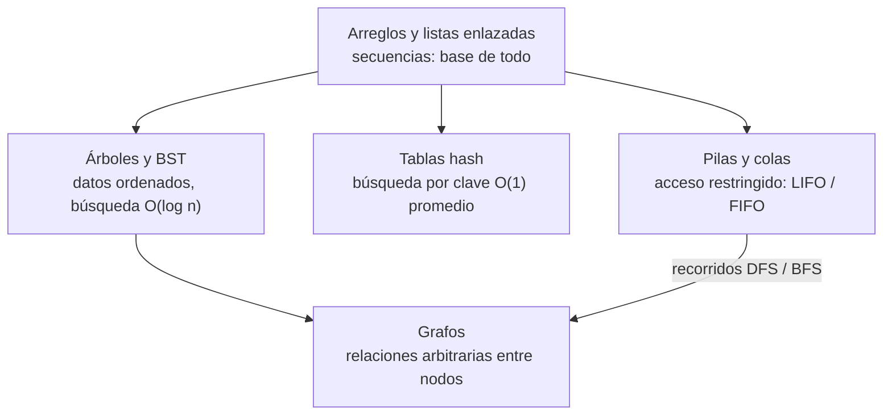

# Estructuras de datos básicas

Parte de: [[02-Fundamentos/08 Computación general/_Índice Computación general|Computación general]]

> [!info] Cómo avanzar
> `progreso`: **pendiente** → **viendo** (estudiando) → **visto** (contestaste la autoevaluación sin abrir las respuestas) → **dominado** (hiciste el laboratorio o lo aplicaste de verdad).

## Contenido

### Qué es
Una **estructura de datos** es una forma de **organizar datos en memoria** para que ciertas operaciones (buscar, insertar, borrar, recorrer en orden) sean eficientes. No existe una "mejor" estructura: cada una hace baratas unas operaciones a costa de otras. Elegir bien suele importar más que micro-optimizar el código, porque cambia la complejidad de O(n) a O(1) o de O(n²) a O(n log n) (ver [[Complejidad algorítmica (Big O)]]).

### Cómo funciona
Panorama de las estructuras básicas y su relación:



- [[Arreglos y listas enlazadas]]: memoria contigua con acceso por índice O(1) frente a nodos ligados con inserción O(1) si ya tienes la posición. `List<T>` es un arreglo dinámico.
- [[Pilas y colas (estructuras de datos)]]: colecciones donde solo accedes a un extremo: el último en entrar (pila) o el primero (cola). Base de deshacer, recorridos y procesamiento de trabajos.
- [[Tablas hash]]: `Dictionary` y `HashSet`; asocian una clave con un valor y responden "¿existe?" en tiempo casi constante.
- [[Árboles y árboles binarios de búsqueda]]: jerarquías y datos ordenados; son la base de los índices de bases de datos.
- [[Grafos (estructuras de datos)]]: nodos y aristas para modelar dependencias, rutas y redes; los árboles son un caso particular.

Resumen de costos típicos (promedio):

| Estructura (.NET) | Acceso por índice | Buscar valor | Insertar | Ordenado |
|---|---|---|---|---|
| `T[]` / `List<T>` | O(1) | O(n) | O(1) amortizado al final, O(n) en medio | no |
| `LinkedList<T>` | O(n) | O(n) | O(1) con el nodo en mano | no |
| `Stack<T>` / `Queue<T>` | solo el extremo | O(n) | O(1) | no |
| `Dictionary<K,V>` / `HashSet<T>` | por clave O(1) | por clave O(1) | O(1) | no |
| `SortedDictionary<K,V>` / `SortedSet<T>` | por clave O(log n) | O(log n) | O(log n) | sí |

### Ejemplo
**Verificar si ya procesaste un id entre millones** (por ejemplo, evitar reprocesar mensajes de Ocelotl.Hermes que llegan duplicados): un `HashSet<T>`. Comprobar y agregar cuesta O(1) promedio, sin importar cuántos haya.

```csharp
var procesados = new HashSet<Guid>();

foreach (var mensaje in lote)
{
    // Add devuelve false si ya existía: verificación y registro en una sola operación
    if (!procesados.Add(mensaje.Id))
        continue;                         // duplicado: se ignora
    await _procesador.ManejarAsync(mensaje, ct);
}
```

Con una `List<Guid>` y `Contains`, cada verificación sería O(n): con 5 millones de ids, procesar el lote completo tomaría del orden de billones de comparaciones. Si los ids deben sobrevivir reinicios o compartirse entre instancias, esa misma idea se lleva a una tabla con clave primaria o a una caché distribuida.

**Cuándo una lista es mejor que un diccionario:**
- Pocos elementos (decenas): recorrer es tan rápido o más que calcular hashes, y usa menos memoria.
- Necesitas **orden** de inserción o acceso por **posición**.
- Vas a **recorrer todo** y no buscar por clave.
- Puede haber **duplicados** que importan.
- Para serializar a JSON un arreglo, que es lo que espera el front.

### Cuándo usarlo y cuándo no
- Pregúntate qué operación se hará **más seguido**: ¿buscar por clave?, ¿recorrer en orden?, ¿sacar el siguiente pendiente? Esa operación decide la estructura.
- Empieza por lo simple (`List<T>`) y cambia cuando haya una búsqueda repetida o un volumen que lo justifique.
- Si los datos viven en SQL Server, muchas de estas decisiones se traducen en **índices** y en la forma de la consulta, no en estructuras en memoria.

### Errores comunes
- **`List.Contains` dentro de un bucle** sobre colecciones grandes: O(n²) escondido.
- **Diccionarios para todo**, incluso con 5 elementos o cuando necesitas orden.
- **Claves mutables** en `Dictionary`/`HashSet`: si cambia el hash, el elemento "desaparece".
- **Usar `LinkedList` creyendo que es más rápida** para insertar: en la práctica casi siempre gana `List<T>`.
- **Ignorar la memoria**: un `Dictionary` de millones de objetos pesa mucho más que un arreglo de structs.

### Para profundizar
- [Colecciones y estructuras de datos en .NET (Microsoft Learn)](https://learn.microsoft.com/dotnet/standard/collections/)
- [Seleccionar una clase de colección](https://learn.microsoft.com/dotnet/standard/collections/selecting-a-collection-class)
- [VisuAlgo: estructuras de datos animadas](https://visualgo.net/es)

## Subtemas

- [[Arreglos y listas enlazadas]]
- [[Pilas y colas (estructuras de datos)]]
- [[Tablas hash]]
- [[Árboles y árboles binarios de búsqueda]]
- [[Grafos (estructuras de datos)]]

## Autoevaluación

Contesta primero en voz alta o en papel; luego despliega la respuesta.

> [!question]- ¿Por qué importa elegir bien la estructura de datos?
> Determina el costo de las operaciones frecuentes: buscar en una lista es O(n), en una tabla hash O(1) en promedio. Elegir mal convierte un proceso de segundos en horas.

> [!question]- ¿Qué estructura usarías para verificar si ya procesaste un id entre millones?
> Un conjunto basado en hash (`HashSet<T>`): inserción y búsqueda O(1) en promedio.

> [!question]- ¿Cuándo una lista es mejor que un diccionario?
> Cuando importa el orden, se recorre todo secuencialmente o hay pocos elementos: menos memoria y mejor localidad de caché.

## Progreso de los subtemas

```base
filters:
  and:
    - file.inFolder("02-Fundamentos/08 Computación general/Estructuras de datos básicas")
    - file.name != "Estructuras de datos básicas"
views:
  - type: table
    name: Progreso
    order:
      - file.name
      - progreso
      - nivel
```
