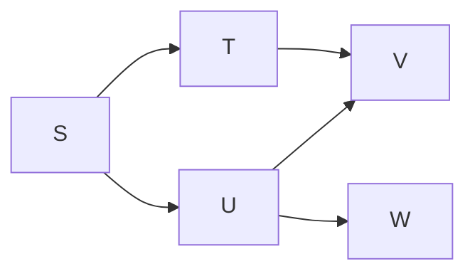

# Grafos (estructuras de datos)

Parte de: [[Estructuras de datos básicas]]

> [!info] Cómo avanzar
> `progreso`: **pendiente** → **viendo** (estudiando) → **visto** (contestaste la autoevaluación sin abrir las respuestas) → **dominado** (hiciste el laboratorio o lo aplicaste de verdad).

## Contenido

### Qué es
Un **grafo** es un conjunto de **nodos** (vértices) conectados por **aristas**. Modela **relaciones arbitrarias**: dependencias entre proyectos, rutas entre ciudades, quién sigue a quién, permisos heredados. Puede ser:
- **Dirigido** (las aristas tienen sentido, A→B) o **no dirigido** (A—B).
- **Ponderado** (cada arista tiene un costo: distancia, tiempo) o no.
- **Cíclico** o **acíclico**. Un **DAG** (*directed acyclic graph*) es dirigido y sin ciclos; los árboles son un caso particular de grafo.

### Cómo funciona
**Representaciones:**
- **Lista de adyacencia**: para cada nodo, la lista de sus vecinos. Ocupa memoria proporcional a nodos + aristas; ideal para grafos **dispersos** (la mayoría de los casos reales). En C#: `Dictionary<string, List<string>>`.
- **Matriz de adyacencia**: tabla de n × n con 1 si hay arista. Consultar si existe una arista es O(1), pero ocupa n² aunque haya pocas aristas.
- En una base de datos: una tabla de nodos y otra de aristas (`Origen`, `Destino`).

**Recorridos:**
- **BFS** (*breadth-first search*, en anchura): visita primero todos los vecinos directos, luego los vecinos de los vecinos, por **niveles**. Usa una **cola**. Encuentra el **camino más corto en número de aristas** en grafos no ponderados.
- **DFS** (*depth-first search*, en profundidad): sigue un camino hasta el fondo antes de retroceder. Usa una **pila** (o recursión). Sirve para detectar ciclos, componentes conectados y orden topológico.
Ambos deben **marcar los visitados** para no entrar en ciclos. Costo O(V + E) (nodos + aristas).

Ejemplo con la lista `{S: [T, U], T: [V], U: [V, W], V: [], W: []}`, visitando vecinos en el orden en que aparecen:
- **BFS desde S**: S, T, U, V, W (nivel 0: S; nivel 1: T, U; nivel 2: V, W).
- **DFS desde S**: S, T, V, U, W (baja por T hasta V, regresa y sigue con U; V ya está visitado, así que solo falta W).



**Orden topológico:** en un DAG, una lista de nodos donde cada nodo aparece **antes que todos los que dependen de él**. Para el grafo anterior, `S, T, U, V, W` y `S, U, W, T, V` son válidos. Se obtiene con el algoritmo de **Kahn** (ir sacando nodos sin dependencias pendientes con una cola) o con DFS en post-orden invertido. Si hay un ciclo, **no existe** orden topológico, y eso sirve para detectarlo.

Casos reales: el **orden de compilación** de proyectos de una solución .NET (`dotnet build` respeta las referencias), el orden de los **stages** con `dependsOn` en un pipeline de Azure DevOps, el orden de ejecución de **scripts de migración** con dependencias, la resolución de paquetes NuGet/npm, el orden de creación de recursos en Bicep/Terraform.

### Ejemplo
Orden de despliegue de componentes con el algoritmo de Kahn en C#:

```csharp
// Arista A -> B significa "A debe desplegarse antes que B"
var grafo = new Dictionary<string, List<string>>
{
    ["Xolotl.Hecate"]     = ["Itzamna.Dionisio", "Ocelotl.Hermes"],
    ["Itzamna.Dionisio"]  = ["Itzamna.Clio"],
    ["Ocelotl.Hermes"]    = ["Itzamna.Clio"],
    ["Itzamna.Clio"]      = [],
};

static List<string> OrdenTopologico(Dictionary<string, List<string>> g)
{
    var entrantes = g.Keys.ToDictionary(k => k, _ => 0);
    foreach (var destinos in g.Values)
        foreach (var d in destinos) entrantes[d]++;

    var listos = new Queue<string>(entrantes.Where(e => e.Value == 0).Select(e => e.Key));
    var orden = new List<string>();

    while (listos.TryDequeue(out var nodo))
    {
        orden.Add(nodo);
        foreach (var vecino in g[nodo])
            if (--entrantes[vecino] == 0) listos.Enqueue(vecino);
    }

    if (orden.Count != g.Count)
        throw new InvalidOperationException("Hay un ciclo de dependencias");
    return orden;
}

Console.WriteLine(string.Join(" -> ", OrdenTopologico(grafo)));
// Xolotl.Hecate -> Itzamna.Dionisio -> Ocelotl.Hermes -> Itzamna.Clio
```

### Cuándo usarlo y cuándo no
- Modela como grafo cuando las relaciones **no son jerárquicas** (un nodo puede tener varios "padres") o puede haber **ciclos**.
- Si es una jerarquía estricta, un árbol es más simple (ver [[Árboles y árboles binarios de búsqueda]]).
- Para caminos más cortos con costos, usa **Dijkstra** (con cola de prioridad; ver [[Pilas y colas (estructuras de datos)]]).
- Para grafos enormes y consultas complejas existen bases de grafos (SQL Server tiene tablas `NODE`/`EDGE`; también Neo4j o Cosmos DB con Gremlin).

### Errores comunes
- **No marcar visitados**: bucles infinitos en grafos con ciclos.
- **DFS recursivo en grafos muy profundos**: desbordamiento de pila; usa una pila explícita.
- **Usar matriz de adyacencia** con muchos nodos y pocas aristas: memoria desperdiciada.
- **Suponer que no hay ciclos** en dependencias que capturan personas: valida y reporta el ciclo.
- **Confundir el sentido de las aristas** ("A depende de B" frente a "A antes que B"): invierte el orden resultante.

### Para profundizar
- [VisuAlgo: recorridos de grafos (DFS/BFS)](https://visualgo.net/es/dfsbfs)
- [Algoritmo de Kahn y orden topológico (Wikipedia)](https://es.wikipedia.org/wiki/Ordenamiento_topol%C3%B3gico)
- [Grafos en SQL Server (tablas NODE y EDGE)](https://learn.microsoft.com/sql/relational-databases/graphs/sql-graph-overview)

## Ejercicios

Resuélvelos en papel o en la herramienta; la solución está plegada.

> [!question]- Grafo: A→B, A→C, B→D, C→D. ¿Un orden topológico válido?
> A, B, C, D (también A, C, B, D).

> [!question]- Con la lista de adyacencia `{A:[B,C], B:[D], C:[D], D:[]}`, ¿qué orden da BFS desde A visitando vecinos en orden?
> A, B, C, D.

> [!question]- ¿Y DFS recursivo desde A con el mismo orden de vecinos?
> A, B, D, C.

## Autoevaluación

Contesta primero en voz alta o en papel; luego despliega la respuesta.

> [!question]- ¿Qué es un grafo y cómo se representa?
> Nodos (vértices) conectados por aristas, dirigidas o no y con o sin peso. Se representa con **lista de adyacencia** (eficiente en grafos dispersos) o **matriz de adyacencia** (consulta O(1) de si hay arista, memoria O(V²)).

> [!question]- ¿Qué diferencia hay entre BFS y DFS?
> **BFS** (anchura, con cola) visita por niveles y encuentra el camino más corto en aristas sin peso. **DFS** (profundidad, con pila o recursión) llega hasta el fondo; útil para detectar ciclos y orden topológico.

> [!question]- Da un caso real de orden topológico.
> Determinar en qué orden compilar proyectos o ejecutar migraciones según sus dependencias (grafo dirigido acíclico). Si hay ciclo, no existe orden válido.

