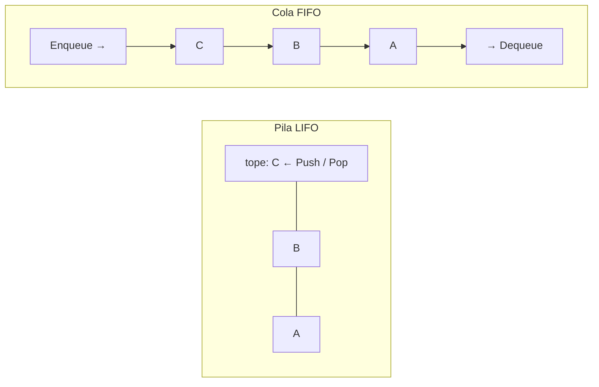

# Pilas y colas (estructuras de datos)

Parte de: [[Estructuras de datos básicas]]

> [!info] Cómo avanzar
> `progreso`: **pendiente** → **viendo** (estudiando) → **visto** (contestaste la autoevaluación sin abrir las respuestas) → **dominado** (hiciste el laboratorio o lo aplicaste de verdad).

## Contenido

### Qué es
Son colecciones con **acceso restringido a un extremo**, lo que las hace simples y rápidas (O(1) para meter y sacar):

- **Pila (stack)**: **LIFO**, *last in, first out*: el último que entra es el primero que sale, como una pila de platos. Operaciones: `Push` (apilar), `Pop` (desapilar) y `Peek` (ver el tope sin sacarlo).
- **Cola (queue)**: **FIFO**, *first in, first out*: el primero que entra es el primero que sale, como la fila del banco. Operaciones: `Enqueue` (formar), `Dequeue` (atender) y `Peek`.

### Cómo funciona


Trazas para fijar la idea:
- **Pila**: `Push(A)`, `Push(B)`, `Push(C)`, `Pop()` → sale **C**. `Push(D)`. Ahora el tope es **D**; los siguientes `Pop` dan D, B, A.
- **Cola**: `Enqueue(A)`, `Enqueue(B)`, `Enqueue(C)`, `Dequeue()` → sale **A**. `Enqueue(D)`. Quedan, en orden de salida, **B, C, D**.

En .NET, `Stack<T>` y `Queue<T>` se implementan sobre arreglos (la cola como **búfer circular**), así que las operaciones son O(1) amortizado.

**Usos reales:**
- **Pila**: la **pila de llamadas** del programa (por eso la recursión profunda la desborda; ver [[Recursión (algoritmos)]]), **deshacer/rehacer** en un editor, **validar paréntesis** o etiquetas anidadas, evaluar expresiones, recorrido en profundidad (**DFS**) iterativo, el historial de "atrás" del navegador.
- **Cola**: **trabajos pendientes** en orden de llegada (envío de correos en Ocelotl.Hermes, generación de reportes en Wee.Reporteria), colas de mensajes como **Azure Service Bus** o Storage Queues, búfer entre un productor y un consumidor (`Channel<T>` en .NET), recorrido en anchura (**BFS**).

**Cola de prioridad:** no sale el primero en llegar, sino el de **mayor prioridad** (o menor valor de prioridad). Se implementa con un **montículo binario** (*heap*): insertar y sacar cuestan O(log n). En .NET 6+ existe `PriorityQueue<TElement, TPriority>`, que saca primero el de **prioridad más baja** (un min-heap) y **no garantiza FIFO** entre elementos con la misma prioridad. Usos: planificadores de tareas, el algoritmo de Dijkstra para rutas, atender primero las alertas críticas.

### Ejemplo
Validar que los delimitadores estén balanceados (útil, por ejemplo, para revisar plantillas de reportes o fórmulas):

```csharp
static bool Balanceado(string texto)
{
    var pila = new Stack<char>();
    var pares = new Dictionary<char, char> { [')'] = '(', [']'] = '[', ['}'] = '{' };

    foreach (var c in texto)
    {
        if (c is '(' or '[' or '{')
            pila.Push(c);                                  // abre: apila
        else if (pares.TryGetValue(c, out var apertura))   // cierra: debe coincidir con el tope
        {
            if (pila.Count == 0 || pila.Pop() != apertura)
                return false;
        }
    }
    return pila.Count == 0;                                // no deben quedar abiertos
}

Console.WriteLine(Balanceado("{[()()]}"));   // True
Console.WriteLine(Balanceado("([)]"));       // False: cierra ')' cuando el tope es '['
```

Cola de prioridad para atender notificaciones:

```csharp
var pendientes = new PriorityQueue<string, int>();
pendientes.Enqueue("Recordatorio de pago", 3);
pendientes.Enqueue("Fallo en el cobro", 1);       // prioridad 1 = la más urgente
pendientes.Enqueue("Boletín mensual", 5);

while (pendientes.TryDequeue(out var aviso, out var prioridad))
    Console.WriteLine($"{prioridad}: {aviso}");    // 1, 3, 5
```

### Cuándo usarlo y cuándo no
- **Pila** cuando lo más reciente debe atenderse primero o hay anidación.
- **Cola** cuando el orden de llegada es la regla de justicia o de consistencia.
- **Cola de prioridad** cuando la urgencia importa más que la llegada.
- Para trabajo que debe sobrevivir a reinicios o repartirse entre instancias, la cola en memoria no basta: usa una cola durable (Service Bus, Storage Queue).
- Para concurrencia entre hilos, `ConcurrentQueue<T>` o `Channel<T>`, no `Queue<T>`.

### Errores comunes
- **`Pop`/`Dequeue` sobre una colección vacía**: `InvalidOperationException`. Usa `TryPop`/`TryDequeue`.
- **Usar `List<T>` con `RemoveAt(0)` como cola**: cada salida es O(n).
- **Esperar FIFO en `PriorityQueue`** con prioridades iguales: agrega un contador de llegada como desempate.
- **Compartir `Queue<T>` entre hilos** sin sincronización.
- **Colas en memoria para trabajos críticos**: se pierden si el proceso se reinicia.

### Para profundizar
- [Stack<T> (Microsoft Learn)](https://learn.microsoft.com/dotnet/api/system.collections.generic.stack-1)
- [Queue<T> (Microsoft Learn)](https://learn.microsoft.com/dotnet/api/system.collections.generic.queue-1)
- [PriorityQueue<TElement,TPriority> (Microsoft Learn)](https://learn.microsoft.com/dotnet/api/system.collections.generic.priorityqueue-2)

## Ejercicios

Resuélvelos en papel o en la herramienta; la solución está plegada.

> [!question]- Valida con una pila si `({[]})` está balanceado.
> ```python
> def balanceado(s):
>     pares = {')': '(', ']': '[', '}': '{'}
>     pila = []
>     for c in s:
>         if c in '([{': pila.append(c)
>         elif c in pares:
>             if not pila or pila.pop() != pares[c]: return False
>     return not pila
> ```
> `balanceado('({[]})')` → `True`; `balanceado('(]')` → `False`.

> [!question]- Encolas 1, 2, 3, sacas uno y encolas 4. ¿Qué orden de salida queda?
> Ya salió 1; quedan **2, 3, 4**.

> [!question]- Apilas 1, 2, 3, sacas uno y apilas 4. ¿Qué sale a continuación?
> Salió 3; la pila es [1, 2, 4] y lo siguiente que sale es **4**.

## Autoevaluación

Contesta primero en voz alta o en papel; luego despliega la respuesta.

> [!question]- ¿Qué diferencia hay entre una pila y una cola?
> **Pila** (LIFO): el último en entrar es el primero en salir (`Push`/`Pop`). **Cola** (FIFO): el primero en entrar es el primero en salir (`Enqueue`/`Dequeue`).

> [!question]- Da un uso real de cada una.
> Pila: la pila de llamadas, deshacer (Ctrl+Z), validar paréntesis. Cola: procesar trabajos en orden de llegada, recorrido BFS.

> [!question]- ¿Qué es una cola de prioridad?
> Sale primero el elemento de mayor prioridad, no el más antiguo. En .NET: `PriorityQueue<TElement, TPriority>` (implementada con un heap, O(log n)).

