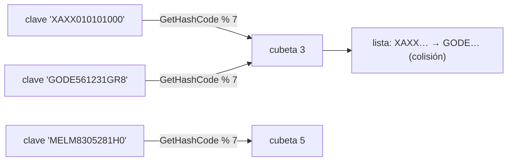

# Tablas hash

Parte de: [[Estructuras de datos básicas]]

> [!info] Cómo avanzar
> `progreso`: **pendiente** → **viendo** (estudiando) → **visto** (contestaste la autoevaluación sin abrir las respuestas) → **dominado** (hiciste el laboratorio o lo aplicaste de verdad).

## Contenido

### Qué es
Una **tabla hash** asocia **claves** con **valores** y permite buscar, insertar y borrar por clave en tiempo **O(1) promedio**, sin importar cuántos elementos tenga. En .NET son `Dictionary<TKey, TValue>` y `HashSet<T>` (solo claves); en JavaScript, `Map` y `Set`; en Python, `dict` y `set`. Son la herramienta para "¿ya existe?", "dame el registro con este id" y agrupar por clave.

### Cómo funciona
1. Se calcula el **hash** de la clave: un número entero obtenido con una función (`GetHashCode()` en .NET).
2. Ese número se reduce a un índice dentro de un arreglo de **cubetas** (*buckets*), por ejemplo con el residuo `hash % numeroDeCubetas`.
3. Se guarda el par en esa cubeta. Dos claves distintas pueden caer en la misma cubeta: es una **colisión**. Se resuelve guardando varios elementos por cubeta (encadenamiento; así lo hace `Dictionary` de .NET) o buscando otra posición libre (direccionamiento abierto).
4. Para buscar, se recalcula el hash, se va a la cubeta y se compara con `Equals` **solo** contra los elementos de esa cubeta.
5. Cuando la tabla se llena demasiado, **crece**: crea más cubetas y redistribuye todo (O(n) puntual, O(1) amortizado).



**El contrato de `Equals` y `GetHashCode`.** Para usar un objeto como clave:
- Si dos objetos son **iguales** según `Equals`, **deben** devolver el **mismo** `GetHashCode`. Si no, quedan en cubetas distintas y la tabla nunca los encuentra como iguales.
- El hash debe ser **estable** mientras el objeto está en la tabla: no uses como clave un objeto cuyos campos que participan en el hash puedan cambiar.
- Lo inverso no se exige: objetos distintos pueden tener el mismo hash (colisión), pero conviene que el hash esté **bien distribuido**.
Los `record` de C# generan `Equals` y `GetHashCode` por valor automáticamente, lo que los hace buenas claves (si sus propiedades son inmutables). También puedes pasar un `IEqualityComparer<T>`, como `StringComparer.OrdinalIgnoreCase`.

**Cuándo se degrada a O(n):** si muchas claves caen en la **misma cubeta**, buscar se vuelve recorrer una lista larga. Pasa con un `GetHashCode` malo (por ejemplo, que siempre devuelve 0 o solo usa un campo con pocos valores distintos) o con ataques de **inundación de hash**, donde alguien envía a propósito claves que colisionan para tumbar un servidor. .NET mitiga esto último usando hashes de cadenas **aleatorizados** por proceso; por eso nunca debes guardar ni comparar valores de `string.GetHashCode()` entre ejecuciones.

### Ejemplo
Clave compuesta para agrupar saldos por cliente y sucursal en Itzamna.Dionisio:

```csharp
// record: Equals y GetHashCode por valor, inmutable
public readonly record struct ClaveSaldo(string Rfc, int SucursalId);

var saldos = new Dictionary<ClaveSaldo, decimal>();
foreach (var m in movimientos)
{
    var clave = new ClaveSaldo(m.Rfc, m.SucursalId);
    saldos[clave] = saldos.GetValueOrDefault(clave) + m.Importe;   // O(1) promedio
}

// Búsqueda directa por clave
if (saldos.TryGetValue(new ClaveSaldo("XAXX010101000", 3), out var saldo))
    Console.WriteLine(saldo);

// Claves de texto sin distinguir mayúsculas
var porCorreo = new Dictionary<string, Cliente>(StringComparer.OrdinalIgnoreCase);
```

Una clase escrita a mano debe implementar ambos métodos de forma coherente:

```csharp
public sealed class Rfc : IEquatable<Rfc>
{
    public Rfc(string valor) => Valor = valor.Trim().ToUpperInvariant();
    public string Valor { get; }

    public bool Equals(Rfc? otro) => otro is not null && Valor == otro.Valor;
    public override bool Equals(object? obj) => Equals(obj as Rfc);
    public override int GetHashCode() => Valor.GetHashCode(); // mismo campo que Equals
}
```

### Cuándo usarlo y cuándo no
- **Sí**: búsquedas repetidas por clave exacta, deduplicar, contar o agrupar, cachés en memoria, unir dos colecciones (en lugar de bucles anidados).
- **No**: cuando necesitas **orden** (usa `SortedDictionary` o ordena al final), búsquedas por **rango** o prefijo (árboles; ver [[Árboles y árboles binarios de búsqueda]]), o colecciones diminutas.
- Para acceso concurrente, `ConcurrentDictionary<TKey, TValue>`; para datos que no cambian tras construirse, `FrozenDictionary` (.NET 8+) optimiza las lecturas.

### Errores comunes
- **Sobrescribir `Equals` sin `GetHashCode`** (o al revés): búsquedas que fallan sin explicación.
- **Claves mutables**: cambias una propiedad y el elemento queda "perdido" en la cubeta vieja.
- **`dict[clave]` sobre una clave inexistente**: `KeyNotFoundException`. Usa `TryGetValue`.
- **Persistir `GetHashCode()`** de strings: cambia entre ejecuciones.
- **Asumir un orden de enumeración**: un `Dictionary` no garantiza orden.

### Para profundizar
- [Dictionary<TKey,TValue> (Microsoft Learn)](https://learn.microsoft.com/dotnet/api/system.collections.generic.dictionary-2)
- [Object.GetHashCode: comentarios y reglas](https://learn.microsoft.com/dotnet/api/system.object.gethashcode)
- [Igualdad de valores en C# (records y IEquatable)](https://learn.microsoft.com/dotnet/csharp/programming-guide/statements-expressions-operators/how-to-define-value-equality-for-a-type)

## Autoevaluación

Contesta primero en voz alta o en papel; luego despliega la respuesta.

> [!question]- ¿Cómo funciona una tabla hash?
> Una función hash convierte la clave en un índice de un arreglo (cubeta). Búsqueda, inserción y borrado son O(1) en promedio; las colisiones se resuelven con encadenamiento o direccionamiento abierto.

> [!question]- ¿Qué deben cumplir `Equals` y `GetHashCode` para usar un objeto como clave?
> Objetos iguales deben dar el mismo hash, y el hash no debe cambiar mientras el objeto esté en el diccionario (claves inmutables). Los `record` de C# ya lo implementan por valor.

> [!question]- ¿Cuándo una tabla hash se degrada a O(n)?
> Con muchas colisiones: una mala función hash o claves elegidas por un atacante (hash flooding). Los runtimes modernos usan hashes con semilla aleatoria para cadenas.

