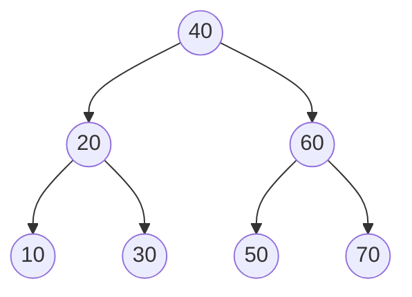

# Árboles y árboles binarios de búsqueda

Parte de: [[Estructuras de datos básicas]]

> [!info] Cómo avanzar
> `progreso`: **pendiente** → **viendo** (estudiando) → **visto** (contestaste la autoevaluación sin abrir las respuestas) → **dominado** (hiciste el laboratorio o lo aplicaste de verdad).

## Contenido

### Qué es
Un **árbol** es una estructura **jerárquica**: un nodo **raíz**, y cada nodo puede tener **hijos**; los nodos sin hijos son **hojas**. No hay ciclos. Modela cosas como carpetas, categorías, organigramas, el DOM de una página o el árbol de componentes de React.

Un **árbol binario de búsqueda (BST)** es un árbol donde cada nodo tiene como máximo dos hijos y se cumple la **propiedad de orden**: **todo** lo que está en el subárbol izquierdo de un nodo es **menor** que él, y todo lo del subárbol derecho es **mayor**. Esa propiedad permite buscar descartando la mitad del árbol en cada paso, como una búsqueda binaria.

### Cómo funciona
**Buscar o insertar** un valor: empieza en la raíz; si el valor es menor, ve a la izquierda; si es mayor, a la derecha; repite hasta encontrarlo o llegar a un hueco (donde se insertaría).

Insertando en orden 40, 20, 60, 10, 30, 50, 70:



**Recorridos** (en profundidad):
- **En orden (in-order)**: izquierdo, nodo, derecho. En un BST da los valores **ordenados**: 10, 20, 30, 40, 50, 60, 70.
- **Pre-orden**: nodo, izquierdo, derecho (útil para copiar o serializar el árbol): 40, 20, 10, 30, 60, 50, 70.
- **Post-orden**: izquierdo, derecho, nodo (útil para borrar o calcular tamaños de carpetas): 10, 30, 20, 50, 70, 60, 40.

**Altura y balance.** El costo de buscar es proporcional a la **altura** del árbol. En un árbol **balanceado** con *n* nodos la altura es aproximadamente log₂ n: con 1,000 nodos, unas 10 comparaciones; con mil millones, unas 30. Pero si insertas datos **ya ordenados** (10, 20, 30, 40...), cada nodo nuevo va siempre a la derecha y el árbol degenera en una **lista**: altura *n* y búsquedas O(n).

Por eso se usan **árboles autobalanceados** (AVL, rojo-negro), que tras cada inserción o borrado hacen **rotaciones** para mantener la altura en O(log n) en el peor caso. `SortedDictionary<TKey,TValue>` y `SortedSet<T>` de .NET están implementados con árboles rojo-negro.

**Relación con los índices de base de datos.** Los índices de SQL Server (y de PostgreSQL) son **árboles B+**: una generalización de los árboles balanceados donde cada nodo es una **página** de 8 KB con **cientos de claves** y punteros. Al tener tantas ramas por nodo, el árbol es muy bajo: unos pocos niveles alcanzan para millones de filas, y cada nivel es una lectura de página. Las hojas están ligadas en orden, lo que hace eficientes las consultas por **rango** (`BETWEEN`, `ORDER BY`). Un *index seek* es bajar por el árbol; un *scan* es recorrer las hojas. El **índice agrupado** guarda las filas completas en las hojas; uno **no agrupado** guarda la clave y un puntero a la fila.

### Ejemplo
BST mínimo en C# para entender la mecánica:

```csharp
public sealed class NodoBst(int valor)
{
    public int Valor { get; } = valor;
    public NodoBst? Izq { get; set; }
    public NodoBst? Der { get; set; }
}

public sealed class Bst
{
    private NodoBst? _raiz;

    public void Insertar(int valor) => _raiz = Insertar(_raiz, valor);

    private static NodoBst Insertar(NodoBst? nodo, int valor)
    {
        if (nodo is null) return new NodoBst(valor);           // hueco encontrado
        if (valor < nodo.Valor) nodo.Izq = Insertar(nodo.Izq, valor);
        else if (valor > nodo.Valor) nodo.Der = Insertar(nodo.Der, valor);
        return nodo;                                            // duplicados se ignoran
    }

    public bool Contiene(int valor)
    {
        var actual = _raiz;
        while (actual is not null)
        {
            if (valor == actual.Valor) return true;
            actual = valor < actual.Valor ? actual.Izq : actual.Der;
        }
        return false;
    }

    public IEnumerable<int> EnOrden() => EnOrden(_raiz);

    private static IEnumerable<int> EnOrden(NodoBst? n)
    {
        if (n is null) yield break;
        foreach (var v in EnOrden(n.Izq)) yield return v;
        yield return n.Valor;
        foreach (var v in EnOrden(n.Der)) yield return v;
    }
}
```

En el día a día usarías `SortedSet<int>` o `SortedDictionary`, y en la base de datos, un índice:

```sql
CREATE NONCLUSTERED INDEX IX_Movimientos_ClienteId_Fecha
    ON dbo.Movimientos (ClienteId, Fecha)
    INCLUDE (Importe);
```

### Cuándo usarlo y cuándo no
- **Árbol balanceado / colecciones ordenadas**: cuando necesitas datos **ordenados** con inserciones frecuentes, búsquedas por **rango**, mínimo/máximo o el siguiente mayor.
- **Tabla hash** si solo buscas por clave exacta (O(1) promedio frente a O(log n)).
- **Lista ordenada + búsqueda binaria** si los datos casi no cambian.
- Nunca un BST sin balanceo con datos que podrían llegar ordenados.

### Errores comunes
- **Implementar un BST simple** para producción: con datos ordenados degenera a lista.
- **Confundir árbol binario con BST**: un árbol binario cualquiera no tiene la propiedad de orden.
- **Recursión profunda** en árboles degenerados: desbordamiento de pila.
- **Índices en columnas equivocadas** o en orden equivocado en un índice compuesto: el árbol no sirve para la consulta.
- **Demasiados índices**: cada inserción actualiza todos los árboles.

### Para profundizar
- [SortedSet<T> (Microsoft Learn)](https://learn.microsoft.com/dotnet/api/system.collections.generic.sortedset-1)
- [Guía de arquitectura y diseño de índices de SQL Server](https://learn.microsoft.com/sql/relational-databases/sql-server-index-design-guide)
- [VisuAlgo: árboles binarios de búsqueda y AVL](https://visualgo.net/es/bst)

## Ejercicios

Resuélvelos en papel o en la herramienta; la solución está plegada.

> [!question]- Inserta en un BST vacío: 50, 30, 70, 20, 40, 60. ¿Recorrido en orden (in-order)?
> 20, 30, 40, 50, 60, 70 (in-order de un BST siempre da los valores ordenados).

> [!question]- ¿Cuántas comparaciones, como máximo, para buscar en un BST balanceado de 1,000,000 de nodos?
> ≈ ⌈log₂(1,000,000)⌉ = **20**.

> [!question]- ¿Qué altura tiene un BST si insertas 1, 2, 3, 4, 5 en ese orden?
> 5 (cada nodo queda a la derecha del anterior: es una lista).

## Autoevaluación

Contesta primero en voz alta o en papel; luego despliega la respuesta.

> [!question]- ¿Qué propiedad tiene un árbol binario de búsqueda (BST)?
> Para cada nodo, todo su subárbol izquierdo es menor y todo el derecho es mayor. Así buscar es O(altura).

> [!question]- ¿Por qué se usan árboles balanceados?
> Un BST con datos ya ordenados se vuelve una lista (altura n, O(n)). Los balanceados (rojo-negro, AVL) mantienen altura O(log n). `SortedDictionary` de .NET usa uno rojo-negro.

> [!question]- ¿Qué relación tienen los árboles con los índices de base de datos?
> Los índices de SQL Server son **árboles B+**: muy anchos y poco profundos, para encontrar una fila con pocas lecturas de página y recorrer rangos ordenados.

