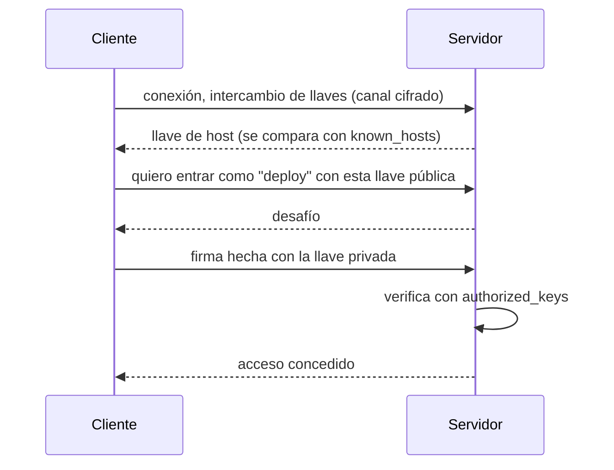

# Linux - SSH y llaves

Parte de: [[Linux para desarrolladores (SSH, permisos, procesos y systemd)]]

> [!info] Cómo avanzar
> `progreso`: **pendiente** → **viendo** (estudiando) → **visto** (contestaste la autoevaluación sin abrir las respuestas) → **dominado** (hiciste el laboratorio o lo aplicaste de verdad).

## Contenido

### Qué es
**SSH** (*Secure Shell*) es el protocolo para conectarse de forma **cifrada** a otra máquina y ejecutar comandos, copiar archivos (`scp`, `sftp`) o crear **túneles**. La implementación más usada es **OpenSSH**, que viene en Linux, macOS y en Windows 10/11. La forma recomendada de autenticarse no es la contraseña sino un **par de llaves** (pública y privada).

### Cómo funciona
**Autenticación con llave (criptografía asimétrica):**
1. Generas un par: la **llave privada** se queda en tu máquina (`~/.ssh/id_ed25519`) y nunca se comparte; la **llave pública** (`id_ed25519.pub`) se puede repartir libremente.
2. Copias la pública al servidor, en `~/.ssh/authorized_keys` del usuario con el que vas a entrar.
3. Al conectarte, el servidor te manda un desafío; tu cliente lo **firma con la llave privada** y el servidor verifica la firma con la pública. La llave privada **nunca viaja** por la red.
4. Antes de eso, tu cliente verifica la identidad del **servidor** con su llave de host, guardada en `~/.ssh/known_hosts` la primera vez. Si cambia, SSH te advierte de un posible ataque de intermediario.



**Permisos:** OpenSSH es estricto. Si `~/.ssh` o `authorized_keys` en el servidor tienen permisos de escritura para otros (o el home es escribible por otros), el servidor **ignora** esas llaves (opción `StrictModes`, activa por defecto) y la autenticación falla sin un mensaje claro. Del lado cliente, si tu llave privada es legible por otros, `ssh` se niega a usarla ("UNPROTECTED PRIVATE KEY FILE"). Valores correctos: `~/.ssh` en `700`, llave privada y `authorized_keys` en `600`, públicas en `644`.

**Túneles (port forwarding):** `ssh -L puerto_local:destino:puerto_destino bastion` abre un puerto en **tu** máquina; todo lo que entra ahí viaja cifrado hasta `bastion`, y desde el bastión sale hacia `destino:puerto_destino`. Sirve para llegar a algo que solo es accesible desde la red interna.

### Ejemplo
Configurar acceso al servidor de QA de Itzamna.Dionisio:

```bash
 # 1. Generar llave (Ed25519 es la opción moderna recomendada); pide una frase de paso
ssh-keygen -t ed25519 -C "dionisio-qa" -f ~/.ssh/dionisio_qa

 # 2. Copiar la pública al servidor (en Windows, sin ssh-copy-id, se agrega a mano a authorized_keys)
ssh-copy-id -i ~/.ssh/dionisio_qa.pub deploy@qa.interno.mx

 # 3. Corregir permisos si hace falta
chmod 700 ~/.ssh && chmod 600 ~/.ssh/dionisio_qa
```

`~/.ssh/config` para no repetir opciones:

```text
Host bastion
    HostName bastion.empresa.mx
    User deploy
    IdentityFile ~/.ssh/dionisio_qa

Host dionisio-qa
    HostName 10.20.0.15
    User deploy
    IdentityFile ~/.ssh/dionisio_qa
    ProxyJump bastion
```

Ahora `ssh dionisio-qa` entra saltando por el bastión (`ProxyJump`, equivalente a `ssh -J`).

Túnel para conectar SSMS o Azure Data Studio a un PostgreSQL de Pochteca.Nomisma que solo acepta conexiones desde la red interna:

```bash
ssh -N -L 15432:pg-nomisma.interno:5432 bastion
 # -N: no abre shell, solo el túnel. Luego te conectas a localhost:15432
```

Con `ssh-agent` (o el agente de Windows, servicio "OpenSSH Authentication Agent") escribes la frase de paso una vez por sesión: `ssh-add ~/.ssh/dionisio_qa`.

### Cuándo usarlo y cuándo no
- SSH con llaves para administrar VMs, acceder a repositorios Git (`git@ssh.dev.azure.com:v3/...`) y crear túneles puntuales.
- En Azure, para VMs sin IP pública considera **Azure Bastion**; para App Service, su consola SSH desde el portal. Para servicios PaaS, mejor redes privadas y Private Endpoints que túneles permanentes.
- Deshabilita el login por contraseña en servidores (`PasswordAuthentication no`) una vez que las llaves funcionen.

### Errores comunes
- **Compartir la llave privada** o subirla a un repo: es como regalar tu contraseña. Si se filtra, quítala de todos los `authorized_keys`.
- **Llaves sin frase de paso** en laptops: si te roban el equipo, tienen acceso directo.
- **Permisos abiertos** en `~/.ssh`: el servidor ignora las llaves.
- **Aceptar a ciegas** el aviso de cambio de llave de host.
- **Dejar túneles abiertos** o usar `-L 0.0.0.0:...`: expones el recurso a toda tu red.

### Para profundizar
- [Manuales de OpenSSH](https://www.openssh.com/manual.html)
- [ssh_config(5): opciones como ProxyJump e IdentityFile](https://man.openbsd.org/ssh_config)
- [Administración de llaves de OpenSSH en Windows](https://learn.microsoft.com/windows-server/administration/openssh/openssh_keymanagement)

## Autoevaluación

Contesta primero en voz alta o en papel; luego despliega la respuesta.

> [!question]- ¿Cómo funciona la autenticación con llave en SSH?
> Generas un par (`ssh-keygen -t ed25519`); la pública va al `~/.ssh/authorized_keys` del servidor y la privada se queda contigo. El servidor verifica que tienes la privada sin que viaje.

> [!question]- ¿Qué pasa si los permisos de `~/.ssh` son muy abiertos?
> OpenSSH rechaza usar la llave o `authorized_keys`. Deben ser `700` para `~/.ssh` y `600` para la llave privada y `authorized_keys`.

> [!question]- ¿Qué hace `ssh -L 1433:servidor-sql:1433 bastion`?
> Un túnel local: lo que conectes a tu `localhost:1433` viaja cifrado al bastión y de ahí a `servidor-sql:1433`.

