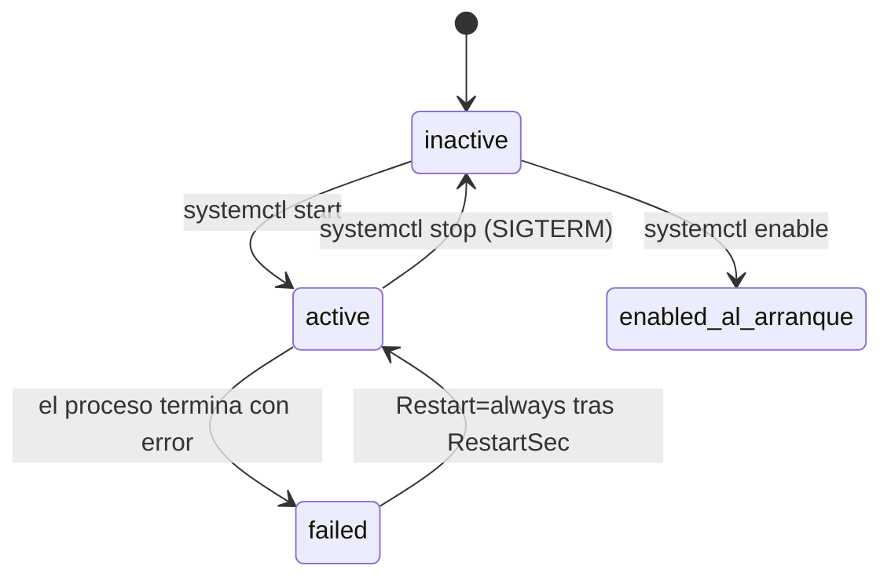

# Linux - servicios con systemd

Parte de: [[Linux para desarrolladores (SSH, permisos, procesos y systemd)]]

> [!info] Cómo avanzar
> `progreso`: **pendiente** → **viendo** (estudiando) → **visto** (contestaste la autoevaluación sin abrir las respuestas) → **dominado** (hiciste el laboratorio o lo aplicaste de verdad).

## Contenido

### Qué es
**systemd** es el **sistema de inicio y administrador de servicios** de la mayoría de las distribuciones Linux modernas (Ubuntu, Debian, RHEL, Fedora). Es el proceso con PID 1 en la máquina: arranca los servicios al encender, los reinicia si fallan, gestiona sus dependencias y recoge sus logs en el **journal**. Para un desarrollador .NET, es la forma estándar de ejecutar una API o un worker en una VM Linux como un servicio que "siempre está arriba".

### Cómo funciona
systemd trabaja con **units** (unidades) descritas en archivos de texto. La más común es la de tipo **service** (`.service`). Los archivos propios van en `/etc/systemd/system/`. Una unidad tiene tres secciones:

- `[Unit]`: descripción y dependencias (`After=network.target`).
- `[Service]`: cómo se ejecuta: comando, usuario, directorio, variables de entorno, política de reinicio, señal de apagado.
- `[Install]`: cuándo se activa al arrancar el sistema (`WantedBy=multi-user.target`).



**Comandos para administrar un servicio:**

```bash
sudo systemctl daemon-reload                 # tras crear o editar un archivo de unidad
sudo systemctl start dionisio                # iniciar
sudo systemctl stop dionisio                 # detener (envía la señal configurada, luego SIGKILL)
sudo systemctl restart dionisio              # reiniciar
sudo systemctl enable --now dionisio         # que arranque con el sistema, y arrancarlo ya
sudo systemctl disable dionisio              # que no arranque con el sistema
systemctl status dionisio                    # estado, PID, memoria y últimas líneas de log
journalctl -u dionisio -f                    # logs en vivo
systemctl list-units --type=service --failed # servicios caídos
```

### Ejemplo
Unidad mínima para la API de Itzamna.Dionisio publicada en `/opt/dionisio` (detrás de Nginx como proxy inverso):

```ini
 # /etc/systemd/system/dionisio.service
[Unit]
Description=Itzamna.Dionisio API
After=network.target

[Service]
WorkingDirectory=/opt/dionisio
ExecStart=/usr/bin/dotnet /opt/dionisio/Itzamna.Dionisio.Api.dll
User=dionisio
Restart=always
RestartSec=10
KillSignal=SIGINT
SyslogIdentifier=dionisio
Environment=ASPNETCORE_ENVIRONMENT=Production
Environment=ASPNETCORE_URLS=http://127.0.0.1:5000
Environment=DOTNET_NOLOGO=true
EnvironmentFile=-/etc/dionisio/secretos.env

[Install]
WantedBy=multi-user.target
```

Qué hace cada pieza importante:
- `ExecStart`: ruta **absoluta** al ejecutable (`dotnet` + dll, o el ejecutable autocontenido).
- `User`: usuario sin privilegios dedicado (ver [[Linux - permisos de archivos]]).
- `Restart=always` + `RestartSec`: si la app se cae, systemd la levanta de nuevo.
- `KillSignal=SIGINT`: así lo muestra la guía oficial de Microsoft para ASP.NET Core; la app hace apagado ordenado con SIGINT igual que con SIGTERM (ver [[Linux - procesos y señales]]).
- `Environment` / `EnvironmentFile`: configuración por ambiente (con `__` para jerarquía; ver [[Variables de entorno]]). El `-` delante de la ruta hace que no falle si el archivo no existe. Ese archivo debe tener permisos `600`.

Integración opcional: con el paquete `Microsoft.Extensions.Hosting.Systemd` y `builder.Services.AddSystemd()` (o `UseSystemd()` en el host), la app avisa a systemd cuándo está lista y formatea los logs para el journal; en ese caso se usa `Type=notify` en la sección `[Service]`.

Despliegue y verificación:

```bash
sudo systemctl daemon-reload
sudo systemctl enable --now dionisio
systemctl status dionisio
curl -s http://127.0.0.1:5000/health
```

### Cuándo usarlo y cuándo no
- **Sí**: APIs y workers en VMs Linux propias; tareas programadas con **timers** de systemd en lugar de cron (`.timer` + `.service`).
- **No hace falta**: en contenedores (el orquestador hace ese papel: Docker, Container Apps, Kubernetes) ni en App Service, donde la plataforma administra el proceso.
- Para endurecer el servicio, systemd ofrece opciones como `NoNewPrivileges=true`, `ProtectSystem=strict` y `ReadWritePaths=/var/dionisio`; agrégalas cuando el servicio ya funcione.

### Errores comunes
- **Olvidar `daemon-reload`** tras editar la unidad: systemd sigue usando la versión anterior.
- **Rutas relativas** en `ExecStart` o sin `WorkingDirectory`: la app no encuentra `appsettings.json`.
- **Correr como root** por no definir `User=`.
- **Secretos directamente en `Environment=`** dentro de una unidad legible por todos: usa `EnvironmentFile` con permisos restringidos o una bóveda.
- **Bucles de reinicio**: con `Restart=always` una app que falla al arrancar se reinicia sin parar; revisa `journalctl -u` y los límites `StartLimitBurst`.

### Para profundizar
- [Hospedar ASP.NET Core en Linux con Nginx (incluye el archivo de servicio)](https://learn.microsoft.com/aspnet/core/host-and-deploy/linux-nginx)
- [systemd.service(5)](https://www.freedesktop.org/software/systemd/man/latest/systemd.service.html)
- [systemctl(1)](https://www.freedesktop.org/software/systemd/man/latest/systemctl.html)
- [journalctl(1)](https://www.freedesktop.org/software/systemd/man/latest/journalctl.html)

## Autoevaluación

Contesta primero en voz alta o en papel; luego despliega la respuesta.

> [!question]- ¿Qué es systemd?
> El sistema de inicio y administrador de servicios de la mayoría de las distribuciones: arranca servicios definidos en archivos *unit*, los reinicia y concentra sus logs en el journal.

> [!question]- ¿Qué comandos usas para administrar un servicio?
> `systemctl status|start|stop|restart app`, `systemctl enable app` (arrancar al iniciar), `systemctl daemon-reload` tras editar el unit, y `journalctl -u app`.

> [!question]- ¿Qué lleva un unit mínimo para una app ASP.NET Core?
> ```ini
> [Unit]
> Description=Mi API
>
> [Service]
> WorkingDirectory=/var/www/miapi
> ExecStart=/usr/bin/dotnet /var/www/miapi/MiApi.dll
> Restart=always
> User=www-data
> Environment=ASPNETCORE_ENVIRONMENT=Production
>
> [Install]
> WantedBy=multi-user.target
> ```

