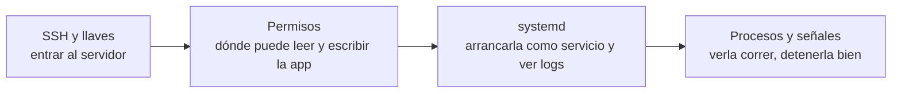

# Linux para desarrolladores (SSH, permisos, procesos y systemd)

Parte de: [[02-Fundamentos/08 Computación general/_Índice Computación general|Computación general]]

> [!info] Cómo avanzar
> `progreso`: **pendiente** → **viendo** (estudiando) → **visto** (contestaste la autoevaluación sin abrir las respuestas) → **dominado** (hiciste el laboratorio o lo aplicaste de verdad).

## Contenido

### Qué es
Es el conjunto mínimo de Linux que un desarrollador necesita para **desplegar, operar y depurar** sus aplicaciones: conectarse a servidores, entender permisos, ver y detener procesos y administrar servicios. Aunque desarrolles en Windows con Visual Studio, tu código .NET probablemente corra en Linux: **contenedores** (las imágenes oficiales de .NET son Linux), **Azure App Service para Linux**, Azure Container Apps, AKS, agentes de Azure Pipelines con Ubuntu y WSL en tu propia máquina. Cuando algo falla en producción, necesitas leer logs, revisar permisos y reiniciar servicios sin interfaz gráfica.

### Cómo funciona
Los cuatro subtemas encajan en el ciclo de vida de una app en un servidor:



- [[Linux - SSH y llaves]]: acceso remoto seguro con llaves en lugar de contraseñas, y túneles para llegar a recursos internos (por ejemplo, SQL Server detrás de un bastión).
- [[Linux - permisos de archivos]]: usuarios, grupos y bits `rwx`; la causa número uno de "Permission denied".
- [[Linux - procesos y señales]]: `ps`, `top`, `kill`; la diferencia entre pedir que un proceso termine (`SIGTERM`) y matarlo (`SIGKILL`), y por qué importa en contenedores.
- [[Linux - servicios con systemd]]: definir la API como servicio que arranca con el sistema, se reinicia si falla y escribe logs en el journal.

Conceptos transversales:
- **Todo es un archivo**: configuración en `/etc`, logs en `/var/log` (o en el journal), apps en `/opt` o `/var/www`, temporales en `/tmp`.
- **Usuario `root` y `sudo`**: administras con `sudo`, pero la app corre con un **usuario sin privilegios** dedicado.
- **Gestor de paquetes**: `apt` (Debian/Ubuntu), `dnf` (RHEL/Fedora).

### Ejemplo
**¿Dónde están los logs de un servicio con systemd?** En el **journal**, consultado con `journalctl`:

```bash
sudo systemctl status dionisio.service           # estado y últimas líneas de log
sudo journalctl -u dionisio.service -n 100       # últimas 100 líneas
sudo journalctl -u dionisio.service -f           # en vivo
sudo journalctl -u dionisio.service --since "1 hour ago" -p err
```

Si la app además escribe archivos (Serilog a archivo, por ejemplo), estarán en la ruta que configuraste, típicamente bajo `/var/log/<app>/`.

**La app falla con `Permission denied` al escribir en `/var/dionisio/archivos`.** Revisión ordenada:

```bash
 # 1. ¿Con qué usuario corre la app?
systemctl show dionisio.service -p User          # o: ps -o user= -p <PID>

 # 2. ¿Quién es dueño de la carpeta y qué permisos tiene? (-d: la carpeta, no su contenido)
ls -ld /var/dionisio/archivos
namei -l /var/dionisio/archivos                  # permisos de cada directorio de la ruta

 # 3. Corregir dando propiedad al usuario de la app, sin abrir de más
sudo chown -R dionisio:dionisio /var/dionisio/archivos
sudo chmod 750 /var/dionisio/archivos
```

Revisa también que **cada directorio padre** tenga permiso de ejecución (`x`) para ese usuario (si no, no puede atravesarlo), que el disco no esté montado como solo lectura y, en sistemas con SELinux/AppArmor, que la política lo permita. En contenedores, el equivalente es revisar el `USER` de la imagen y los permisos del volumen montado.

### Cuándo usarlo y cuándo no
- Imprescindible si despliegas en VMs Linux, contenedores o depuras agentes de pipeline.
- En plataformas administradas (App Service, Container Apps) tocas menos el sistema, pero los conceptos siguen apareciendo: usuario del contenedor, señales de apagado, rutas con permisos, consola SSH de App Service.
- WSL es la forma más cómoda de practicar en Windows sin una VM.

### Errores comunes
- **Correr la app como `root`** "para que no haya problemas de permisos": cualquier vulnerabilidad da control total del servidor.
- **`chmod 777`** como solución universal (ver [[Linux - permisos de archivos]]).
- **`kill -9` como primera opción**: la app no alcanza a cerrar conexiones ni terminar peticiones.
- **Buscar logs en archivos** cuando el servicio escribe a stdout y systemd los manda al journal.
- **Editar archivos de unidad y olvidar `systemctl daemon-reload`**.

### Para profundizar
- [Hospedar ASP.NET Core en Linux con Nginx (Microsoft Learn)](https://learn.microsoft.com/aspnet/core/host-and-deploy/linux-nginx)
- [Instalar Linux en Windows con WSL](https://learn.microsoft.com/windows/wsl/install)
- [Páginas de manual de Linux (man7.org)](https://man7.org/linux/man-pages/)

## Subtemas

- [[Linux - SSH y llaves]]
- [[Linux - permisos de archivos]]
- [[Linux - procesos y señales]]
- [[Linux - servicios con systemd]]

## Autoevaluación

Contesta primero en voz alta o en papel; luego despliega la respuesta.

> [!question]- ¿Por qué un desarrollador .NET necesita saber Linux?
> Contenedores, App Service Linux, agentes de CI y servidores suelen correr Linux: hay que diagnosticar permisos, procesos, logs y servicios ahí.

> [!question]- ¿Dónde buscas los logs de un servicio en un Linux con systemd?
> `journalctl -u nombre.service` (con `-f` para seguir en vivo y `--since "10 min ago"` para acotar).

> [!question]- Tu app falla con `Permission denied` al escribir en `/var/app/data`. ¿Qué revisas?
> Con qué usuario corre el proceso (`ps -o user= -p <pid>`), dueño y permisos del directorio (`ls -ld`) y, si aplica, SELinux/AppArmor o un volumen montado solo lectura.

## Práctica

- [[Lab 1 - Terminal, variables de entorno y procesos]]

## Progreso de los subtemas

```base
filters:
  and:
    - file.inFolder("02-Fundamentos/08 Computación general/Linux para desarrolladores (SSH, permisos, procesos y systemd)")
    - file.name != "Linux para desarrolladores (SSH, permisos, procesos y systemd)"
views:
  - type: table
    name: Progreso
    order:
      - file.name
      - progreso
      - nivel
```
