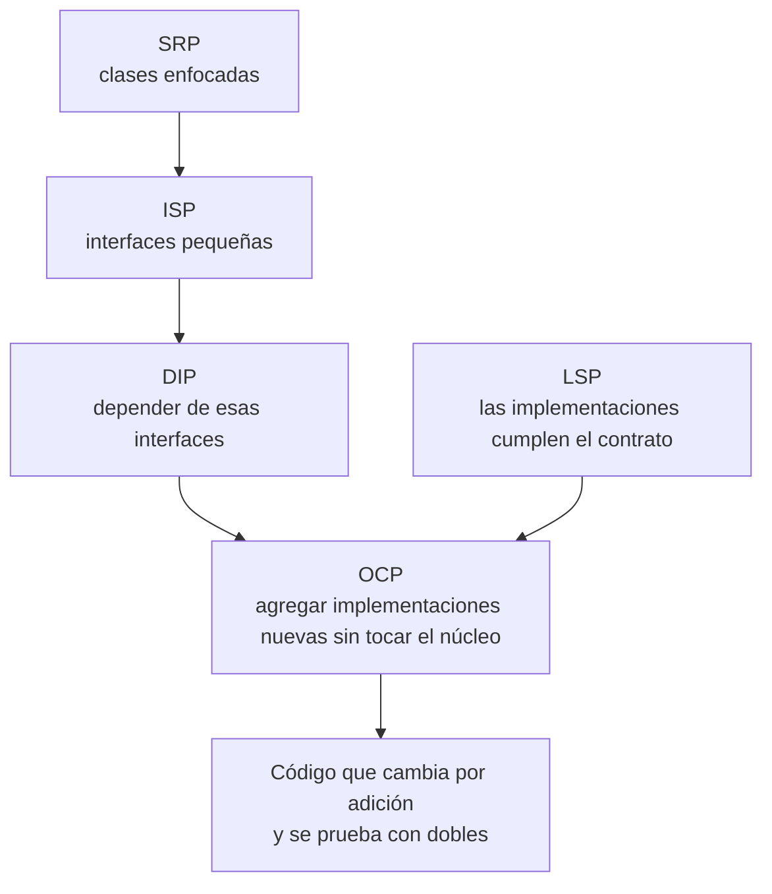

# Principios SOLID

Parte de: [[02-Fundamentos/08 Computación general/_Índice Computación general|Computación general]]

> [!info] Cómo avanzar
> `progreso`: **pendiente** → **viendo** (estudiando) → **visto** (contestaste la autoevaluación sin abrir las respuestas) → **dominado** (hiciste el laboratorio o lo aplicaste de verdad).

## Contenido

### Qué es
**SOLID** es un acrónimo de cinco principios de diseño orientado a objetos reunidos por Robert C. Martin a principios de los 2000 (el acrónimo lo acuñó Michael Feathers). Buscan código **fácil de cambiar, de probar y de entender**: que agregar una funcionalidad no obligue a modificar medio sistema y que cada pieza se pueda sustituir o probar por separado.

| Letra | Principio | Idea en una frase |
|---|---|---|
| **S** | Responsabilidad única (SRP) | un módulo debe tener **una sola razón para cambiar** |
| **O** | Abierto-cerrado (OCP) | abierto a extensión, cerrado a modificación |
| **L** | Sustitución de Liskov (LSP) | un subtipo debe poder usarse donde se espera el tipo base sin sorpresas |
| **I** | Segregación de interfaces (ISP) | interfaces pequeñas y específicas para cada cliente |
| **D** | Inversión de dependencias (DIP) | depender de abstracciones, no de detalles concretos |

### Cómo funciona
Los cinco se refuerzan entre sí y apuntan a lo mismo: **bajo acoplamiento y alta cohesión** (ver [[Acoplamiento y cohesión]]).



- [[SOLID - Responsabilidad única (SRP)]]: separa lo que cambia por razones distintas (cálculo de impuestos, generación de PDF, envío de correo).
- [[SOLID - Abierto-cerrado (OCP)]]: los puntos de variación (métodos de pago, formatos de exportación) se extienden agregando clases, no editando un `switch` central.
- [[SOLID - Sustitución de Liskov (LSP)]]: garantiza que esas extensiones se comporten como promete la abstracción; si no, OCP se rompe.
- [[SOLID - Segregación de interfaces (ISP)]]: evita interfaces "gordas" que obligan a implementar lo que no se usa.
- [[SOLID - Inversión de dependencias (DIP)]]: la lógica de negocio define las interfaces que necesita y la infraestructura las implementa; en .NET se conecta con [[Inyección de dependencias]].

**Para qué sirven en la práctica:**
- **Pruebas unitarias** sin base de datos ni servicios externos, sustituyendo dependencias por dobles.
- **Cambios localizados**: una regla nueva toca una clase, no diez.
- **Revisiones de código** con vocabulario común: "esta clase tiene dos razones para cambiar".
- **Trabajo en paralelo**: dos personas tocan slices distintos sin pisarse.

### Ejemplo
Un slice de Itzamna.Dionisio que aplica los cinco sin ceremonia excesiva:

```csharp
// ISP + DIP: interfaces pequeñas, definidas por lo que el handler necesita
public interface IObtenerPedidoQuery { Task<Pedido?> EjecutarAsync(int id, CancellationToken ct); }
public interface ICalculadoraImpuestos { decimal Calcular(Pedido p); }

// SRP: el handler solo coordina el caso de uso
public sealed class ObtenerTotalPedidoHandler(IObtenerPedidoQuery query, ICalculadoraImpuestos impuestos)
{
    public async Task<decimal?> ManejarAsync(int id, CancellationToken ct)
    {
        var pedido = await query.EjecutarAsync(id, ct);
        return pedido is null ? null : pedido.Subtotal + impuestos.Calcular(pedido);
    }
}

// OCP + LSP: una calculadora nueva (zona fronteriza) se agrega sin tocar el handler,
// y cumple el mismo contrato (no lanza NotSupportedException ni cambia el significado)
public sealed class ImpuestoGeneral : ICalculadoraImpuestos
{ public decimal Calcular(Pedido p) => p.Subtotal * 0.16m; }

public sealed class ImpuestoFronterizo : ICalculadoraImpuestos
{ public decimal Calcular(Pedido p) => p.Subtotal * 0.08m; }
```

```csharp
// Program.cs: la composición vive en un solo lugar
builder.Services.AddScoped<IObtenerPedidoQuery, ObtenerPedidoQuery>();   // Dapper + ObtenerPedido.sql
builder.Services.AddSingleton<ICalculadoraImpuestos, ImpuestoGeneral>();
builder.Services.AddScoped<ObtenerTotalPedidoHandler>();
```

(Las tasas son ilustrativas; las reglas fiscales reales dependen del producto y la región.)

### Cuándo usarlo y cuándo no
- Aplícalos donde **hay cambio real o esperado con evidencia**: reglas de negocio que varían, integraciones externas, código que necesitas probar aislado.
- **Error común: aplicar SOLID a todo desde el día uno.** Produce sobreingeniería: interfaces para cada clase con una sola implementación, capas y fábricas que nadie necesita, saltos entre diez archivos para seguir una operación simple. El código se vuelve más difícil de leer, que es justo lo contrario de lo que buscan los principios, y choca con [[DRY, KISS y YAGNI]]. Es mejor empezar simple y **refactorizar hacia SOLID** cuando aparece la segunda variante o una prueba lo pide (ver [[Code smells y refactorización]]).
- En código funcional o en scripts pequeños muchas de estas ideas se expresan con funciones y módulos, sin clases.

### Errores comunes
- **Tratar SOLID como reglas absolutas** en lugar de heurísticas.
- **"Una interfaz por clase"** como sinónimo de DIP.
- **SRP como "un método por clase"**.
- **Herencia para reutilizar código** que luego viola LSP; prefiere composición.
- **Olvidar el objetivo**: si el cambio no se volvió más fácil, el principio no ayudó.

### Para profundizar
- [Principios de arquitectura comunes en .NET (Microsoft Learn)](https://learn.microsoft.com/dotnet/architecture/modern-web-apps-azure/architectural-principles)
- [Inyección de dependencias en .NET](https://learn.microsoft.com/dotnet/core/extensions/dependency-injection)
- [The Principles of OOD (Robert C. Martin)](http://butunclebob.com/ArticleS.UncleBob.PrinciplesOfOod)

## Subtemas

- [[SOLID - Responsabilidad única (SRP)]]
- [[SOLID - Abierto-cerrado (OCP)]]
- [[SOLID - Sustitución de Liskov (LSP)]]
- [[SOLID - Segregación de interfaces (ISP)]]
- [[SOLID - Inversión de dependencias (DIP)]]

## Autoevaluación

Contesta primero en voz alta o en papel; luego despliega la respuesta.

> [!question]- ¿Qué significan las letras de SOLID?
> **S**ingle responsibility, **O**pen/closed, **L**iskov substitution, **I**nterface segregation, **D**ependency inversion.

> [!question]- ¿Para qué sirven en la práctica?
> Para que el código sea fácil de cambiar y probar: clases con un motivo de cambio, extensibles sin modificarlas y dependientes de abstracciones en lugar de detalles.

> [!question]- Error común: aplicar SOLID a todo desde el día uno. ¿Qué problema trae?
> Sobreingeniería: interfaces con una sola implementación "por si acaso", capas y fábricas sin necesidad. Aplícalos cuando el cambio real lo pida (YAGNI).

## Progreso de los subtemas

```base
filters:
  and:
    - file.inFolder("02-Fundamentos/08 Computación general/Principios SOLID")
    - file.name != "Principios SOLID"
views:
  - type: table
    name: Progreso
    order:
      - file.name
      - progreso
      - nivel
```
