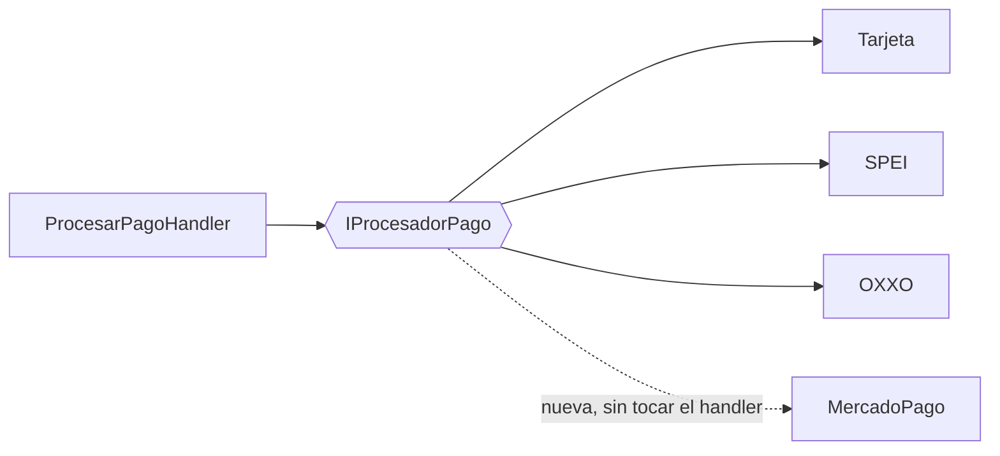

# SOLID - Abierto-cerrado (OCP)

Parte de: [[Principios SOLID]]

> [!info] Cómo avanzar
> `progreso`: **pendiente** → **viendo** (estudiando) → **visto** (contestaste la autoevaluación sin abrir las respuestas) → **dominado** (hiciste el laboratorio o lo aplicaste de verdad).

## Contenido

### Qué es
El **principio abierto-cerrado**, formulado por Bertrand Meyer en 1988, dice que las entidades de software deben estar **abiertas a la extensión pero cerradas a la modificación**: deberías poder **agregar comportamiento nuevo escribiendo código nuevo**, sin editar código que ya funciona y está probado. Así, cada funcionalidad nueva tiene menos riesgo de romper las existentes.

### Cómo funciona
Se identifican los **puntos de variación** (lo que cambia con frecuencia: métodos de pago, formatos de exportación, reglas de descuento, proveedores de notificación) y se ocultan detrás de una **abstracción**. El código central depende de la abstracción y no conoce las variantes. Agregar una variante es crear una clase nueva y registrarla.

Mecanismos habituales en C#:
- **Polimorfismo con interfaces** (patrón *Strategy*).
- **Registro de implementaciones** en [[Inyección de dependencias]] y resolución por clave (servicios con clave desde .NET 8: `AddKeyedScoped`, `[FromKeyedServices]`).
- **Delegados o diccionarios** de funciones para casos sencillos.
- **Decoradores** y *middleware*: agregar comportamiento (logging, caché, reintentos) envolviendo algo existente sin modificarlo; el pipeline de ASP.NET Core es un ejemplo de OCP.



### Ejemplo
Un `switch` que crece con cada método de pago:

```csharp
public async Task<ResultadoPago> CobrarAsync(Pago p)
{
    switch (p.Metodo)
    {
        case "TARJETA": /* 40 líneas con el SDK del banco */ break;
        case "SPEI":    /* 30 líneas: genera CLABE de referencia */ break;
        case "OXXO":    /* 25 líneas: genera ficha */ break;
        // cada método nuevo = editar, recompilar y volver a probar todo este método
    }
    ...
}
```

Con OCP:

```csharp
public interface IProcesadorPago
{
    string Metodo { get; }
    Task<ResultadoPago> CobrarAsync(Pago p, CancellationToken ct);
}

public sealed class ProcesadorSpei(IGenerarReferenciaCommand referencias) : IProcesadorPago
{
    public string Metodo => "SPEI";
    public async Task<ResultadoPago> CobrarAsync(Pago p, CancellationToken ct)
    {
        var clabe = await referencias.EjecutarAsync(p.PedidoId, ct);
        return ResultadoPago.Pendiente(clabe);
    }
}

public sealed class CobrarHandler(IEnumerable<IProcesadorPago> procesadores)
{
    private readonly Dictionary<string, IProcesadorPago> _porMetodo =
        procesadores.ToDictionary(p => p.Metodo, StringComparer.OrdinalIgnoreCase);

    public Task<ResultadoPago> ManejarAsync(Pago p, CancellationToken ct) =>
        _porMetodo.TryGetValue(p.Metodo, out var procesador)
            ? procesador.CobrarAsync(p, ct)
            : throw new MetodoPagoNoSoportadoException(p.Metodo); // se traduce a ProblemDetails con codigo
}
```

```csharp
builder.Services.AddScoped<IProcesadorPago, ProcesadorTarjeta>();
builder.Services.AddScoped<IProcesadorPago, ProcesadorSpei>();
builder.Services.AddScoped<IProcesadorPago, ProcesadorOxxo>();
builder.Services.AddScoped<CobrarHandler>();
```

Agregar un método nuevo = una clase nueva + una línea de registro. `CobrarHandler` y los procesadores existentes no se tocan, y cada procesador se prueba por separado.

### Cuándo usarlo y cuándo no
**¿Siempre hay que eliminar los `switch`?** No. Un `switch` está bien cuando:
- El conjunto de casos es **cerrado y estable** (días de la semana, estatus de un flujo que no cambia).
- Aparece en **un solo lugar** y cada rama es corta.
- Es el **punto de composición**: una fábrica con un `switch` que decide qué estrategia crear es aceptable; lo problemático es el mismo `switch` repetido por todo el código.
- Con `switch` de expresiones y tipos sellados, el compilador puede avisarte de casos faltantes.

Aplica OCP cuando hay **evidencia** de que ese punto va a variar (ya tienes la tercera variante, o el negocio anuncia más). Diseñar extensibilidad que nunca se usa contradice [[DRY, KISS y YAGNI]].

### Errores comunes
- **Abstraer todo "por si acaso"**: interfaces y fábricas para algo que nunca tuvo una segunda variante.
- **Abstracciones que filtran las variantes**: si la interfaz tiene `if (this is ProcesadorOxxo)` en algún lado, OCP se rompió.
- **Implementaciones que no cumplen el contrato** (lanzan `NotSupportedException` en un método): eso viola [[SOLID - Sustitución de Liskov (LSP)]] y obliga a volver a los `if`.
- **Confundir OCP con "nunca modificar código"**: corregir bugs y refactorizar sigue siendo necesario.

### Para profundizar
- [The Open Closed Principle (Robert C. Martin, blog Clean Coder)](https://blog.cleancoder.com/uncle-bob/2014/05/12/TheOpenClosedPrinciple.html)
- [Patrón Strategy (Refactoring.Guru)](https://refactoring.guru/es/design-patterns/strategy)
- [Servicios con clave en la inyección de dependencias de .NET](https://learn.microsoft.com/dotnet/core/extensions/dependency-injection#keyed-services)

## Autoevaluación

Contesta primero en voz alta o en papel; luego despliega la respuesta.

> [!question]- ¿Qué dice el principio abierto-cerrado?
> El código debe estar **abierto a extensión y cerrado a modificación**: agregar comportamiento nuevo sin editar código probado.

> [!question]- Tienes un `switch` por tipo de pago que crece con cada método nuevo. ¿Cómo aplicas OCP?
> Define `IProcesadorPago` con una implementación por método y regístralas en DI; el código que procesa elige la implementación sin conocer cada caso. Agregar uno nuevo es crear una clase.

> [!question]- ¿Siempre hay que eliminar los `switch`?
> No. Si el conjunto de casos es estable y pequeño, un `switch` es más claro. OCP vale la pena donde el cambio es frecuente.

