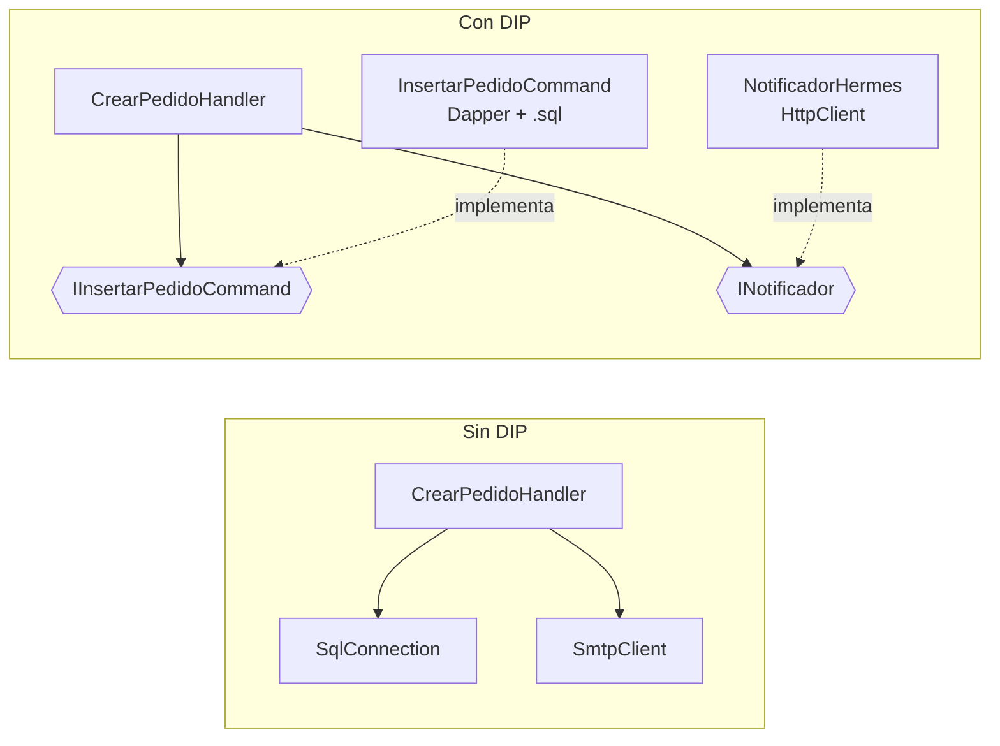

# SOLID - Inversión de dependencias (DIP)

Parte de: [[Principios SOLID]]

> [!info] Cómo avanzar
> `progreso`: **pendiente** → **viendo** (estudiando) → **visto** (contestaste la autoevaluación sin abrir las respuestas) → **dominado** (hiciste el laboratorio o lo aplicaste de verdad).

## Contenido

### Qué es
El **principio de inversión de dependencias** tiene dos partes:
1. Los módulos de **alto nivel** (la lógica de negocio, los casos de uso) **no deben depender** de módulos de **bajo nivel** (acceso a datos, correo, archivos, APIs externas). **Ambos deben depender de abstracciones.**
2. Las abstracciones no deben depender de los detalles; **los detalles deben depender de las abstracciones**.

La "inversión" está en la dirección de la dependencia: en un diseño ingenuo, el caso de uso conoce y crea `SqlConnection` o `SmtpClient`. Con DIP, el caso de uso **define** la interfaz que necesita (`INotificador`) y la infraestructura la **implementa**. La flecha de dependencia del código apunta ahora de la infraestructura hacia el negocio.

### Cómo funciona


**¿DIP es lo mismo que inyección de dependencias?** No:
- **DIP** es un **principio de diseño**: de qué deben depender los módulos (de abstracciones).
- **Inyección de dependencias (DI)** es una **técnica**: en lugar de que una clase cree sus dependencias con `new`, se las **pasan desde fuera** (normalmente por el constructor).
- Un **contenedor de DI** (`IServiceCollection` en .NET) es una **herramienta** que automatiza esa inyección.
Se complementan, pero son independientes: puedes inyectar clases concretas (DI sin DIP) o aplicar DIP pasando dependencias a mano sin contenedor. Ver [[Inyección de dependencias]].

**Dónde viven las interfaces:** junto al código que las **usa** (el caso de uso o slice), no junto a la implementación. Así el negocio no depende de ningún paquete de infraestructura.

### Ejemplo
En Itzamna.Dionisio, el handler de crear pedido:

```csharp
// Features/Pedidos/Crear/ (alto nivel: define lo que necesita)
public interface IInsertarPedidoCommand
{
    Task<int> EjecutarAsync(NuevoPedido pedido, CancellationToken ct);
}

public interface INotificador
{
    Task EnviarAsync(string para, string asunto, string cuerpo, CancellationToken ct);
}

public sealed class CrearPedidoHandler(IInsertarPedidoCommand insertar, INotificador notificador)
{
    public async Task<int> ManejarAsync(NuevoPedido p, CancellationToken ct)
    {
        var folio = await insertar.EjecutarAsync(p, ct);
        await notificador.EnviarAsync(p.Correo, "Pedido recibido", $"Folio {folio}", ct);
        return folio;
    }
}
```

```csharp
// Infraestructura (bajo nivel: depende de la abstracción)
public sealed class InsertarPedidoCommand(IDbConnectionFactory factory, ISqlProvider sql)
    : IInsertarPedidoCommand
{
    public async Task<int> EjecutarAsync(NuevoPedido p, CancellationToken ct)
    {
        await using var cn = factory.Crear();
        var cmd = new CommandDefinition("dbo.usp_Pedido_Insertar", p,
            commandType: CommandType.StoredProcedure, cancellationToken: ct);
        return await cn.ExecuteScalarAsync<int>(cmd);
    }
}

public sealed class NotificadorHermes(HttpClient http) : INotificador
{
    public async Task EnviarAsync(string para, string asunto, string cuerpo, CancellationToken ct)
    {
        var resp = await http.PostAsJsonAsync("/api/mensajes", new { para, asunto, cuerpo }, ct);
        resp.EnsureSuccessStatusCode();
    }
}
```

```csharp
// Program.cs: la raíz de composición decide las implementaciones
builder.Services.AddScoped<IInsertarPedidoCommand, InsertarPedidoCommand>();
builder.Services.AddHttpClient<INotificador, NotificadorHermes>(c =>
    c.BaseAddress = new Uri(builder.Configuration["Hermes:Url"]!));
builder.Services.AddScoped<CrearPedidoHandler>();
```

En pruebas, el handler se construye con dobles (`new CrearPedidoHandler(new InsertarFalso(), new NotificadorEnMemoria())`) sin base de datos ni red. Cambiar Hermes por otro proveedor es otra implementación de `INotificador`, sin tocar el negocio.

### Cuándo usarlo y cuándo no
- **Sí**: en las fronteras con el mundo exterior: base de datos, colas, correo, almacenamiento, APIs de terceros, reloj del sistema (`TimeProvider` en .NET 8+), generadores de identificadores.
- **No hace falta**: para clases de valor, utilidades puras sin efectos (cálculos, formateos) o tipos estables de la BCL. Una interfaz para un `CalculadoraIva` puro que nunca se sustituye agrega ruido ([[DRY, KISS y YAGNI]]).
- Combínalo con [[SOLID - Segregación de interfaces (ISP)]]: abstracciones pequeñas definidas por el consumidor.

### Errores comunes
- **Confundir DIP con "usar un contenedor de DI"**: si el handler recibe un `SqlConnection` inyectado, sigue dependiendo del detalle.
- **Abstracciones que filtran detalles**: `INotificador.EnviarAsync(MailMessage m)` ata el negocio a SMTP.
- **Poner las interfaces en el proyecto de infraestructura**: el negocio termina referenciándolo.
- **Service locator** (`provider.GetService<T>()` dentro de la lógica): oculta dependencias y dificulta las pruebas.
- **Una interfaz para cada clase** sin necesidad.

### Para profundizar
- [Principios de arquitectura: inversión de dependencias (Microsoft Learn)](https://learn.microsoft.com/dotnet/architecture/modern-web-apps-azure/architectural-principles#dependency-inversion)
- [Inyección de dependencias en .NET](https://learn.microsoft.com/dotnet/core/extensions/dependency-injection)
- [Inversion of Control Containers and the Dependency Injection pattern (Martin Fowler)](https://martinfowler.com/articles/injection.html)

## Autoevaluación

Contesta primero en voz alta o en papel; luego despliega la respuesta.

> [!question]- ¿Qué dice el principio de inversión de dependencias?
> Los módulos de alto nivel no dependen de los de bajo nivel; ambos dependen de **abstracciones**, y la abstracción la define quien la usa.

> [!question]- ¿Es lo mismo DIP que inyección de dependencias?
> No. DIP es el principio de diseño (depender de abstracciones); la inyección de dependencias es una técnica para suministrarlas (por constructor, con un contenedor como el de ASP.NET Core).

> [!question]- ¿Cómo se ve en código?
> ```csharp
> public class ServicioPedidos(IRepositorioPedidos repo, IReloj reloj) { ... }
> ```
> El servicio no hace `new SqlRepositorio()` ni lee `DateTime.Now`: recibe abstracciones que en pruebas se reemplazan.

