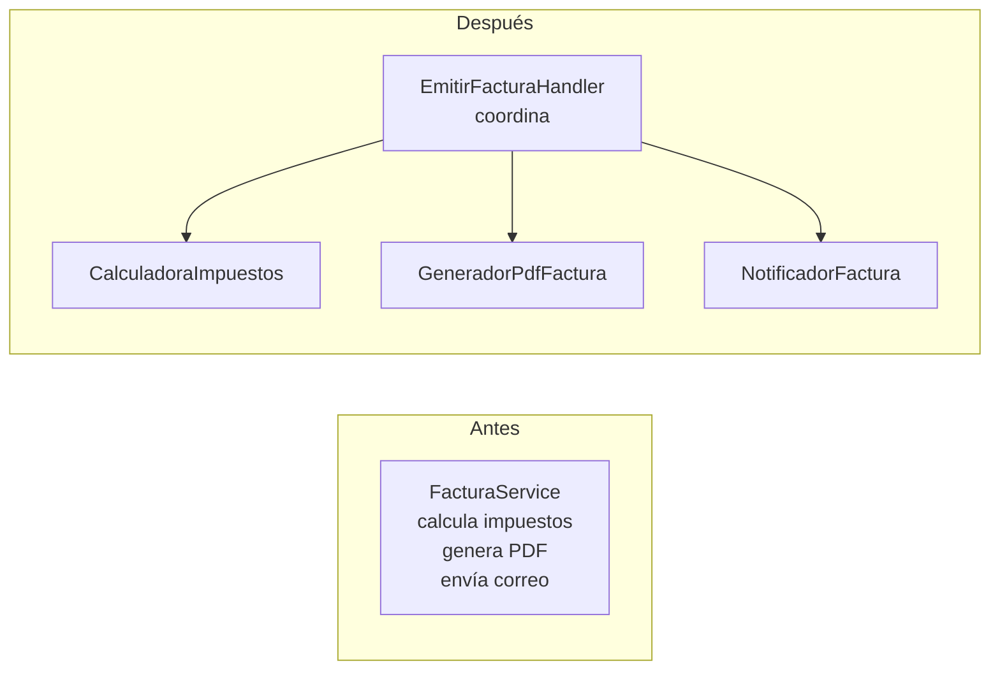

# SOLID - Responsabilidad única (SRP)

Parte de: [[Principios SOLID]]

> [!info] Cómo avanzar
> `progreso`: **pendiente** → **viendo** (estudiando) → **visto** (contestaste la autoevaluación sin abrir las respuestas) → **dominado** (hiciste el laboratorio o lo aplicaste de verdad).

## Contenido

### Qué es
El **principio de responsabilidad única** dice que **un módulo debe tener una, y solo una, razón para cambiar**. Robert C. Martin lo precisó después como: un módulo debe responder **a un solo actor**, es decir, a un solo grupo de personas o una sola fuente de requisitos. Si el área fiscal, el área de diseño de documentos y el área de comunicación pueden pedir cambios que tocan la misma clase, esa clase tiene tres responsabilidades.

### Cómo funciona
La pregunta guía no es "¿cuántas cosas hace?", sino **"¿quién podría pedirme cambiar esto, y por qué?"**. Si las respuestas son distintas, separa.

Señales de que se viola:
- La descripción de la clase necesita "y": "calcula impuestos **y** arma el PDF **y** manda el correo".
- Cambios por motivos sin relación tocan el mismo archivo y generan conflictos entre personas que trabajan en temas distintos.
- Para probar una regla de cálculo tienes que simular un servidor SMTP.
- Muchas dependencias en el constructor (cinco, seis, siete) de áreas diferentes.

**SRP no significa "una clase con un solo método".** Una clase puede tener muchos métodos si todos sirven al mismo propósito y cambian por la misma razón: un `CalculadoraImpuestos` con métodos para IVA, IEPS y retenciones es cohesiva, porque todos cambian cuando cambian las reglas fiscales. Partirla en tres clases de un método no mejora nada y dispersa la lógica.



### Ejemplo
Antes:

```csharp
public class FacturaService
{
    public async Task EmitirAsync(Factura f)
    {
        // Regla fiscal (la pide el área de impuestos)
        f.Iva = f.Subtotal * 0.16m;
        f.Total = f.Subtotal + f.Iva;

        // Diseño del documento (lo pide el área de imagen corporativa)
        var pdf = new PdfDocument();
        pdf.AddText($"Factura {f.Folio} - Total {f.Total:C}");
        var bytes = pdf.Save();

        // Comunicación (la pide el área de atención a clientes)
        using var smtp = new SmtpClient("smtp.empresa.mx");
        await smtp.SendMailAsync(new MailMessage("facturas@empresa.mx", f.Correo) { Subject = "Su factura" });
    }
}
```

Después, cada pieza responde a un actor y el caso de uso las coordina:

```csharp
public interface ICalculadoraImpuestos { void Aplicar(Factura f); }
public interface IGeneradorPdfFactura { byte[] Generar(Factura f); }
public interface INotificadorFactura { Task EnviarAsync(Factura f, byte[] pdf, CancellationToken ct); }

public sealed class EmitirFacturaHandler(
    ICalculadoraImpuestos impuestos,
    IGeneradorPdfFactura pdf,
    INotificadorFactura notificador,
    IGuardarFacturaCommand guardar)
{
    public async Task ManejarAsync(Factura f, CancellationToken ct)
    {
        impuestos.Aplicar(f);
        await guardar.EjecutarAsync(f, ct);        // Dapper + GuardarFactura.sql
        var documento = pdf.Generar(f);
        await notificador.EnviarAsync(f, documento, ct);
    }
}
```

Ahora:
- Un cambio de tasa toca solo `CalculadoraImpuestos`, y se prueba con [[xUnit]] sin PDF ni correo.
- Cambiar la plantilla del PDF no arriesga el cálculo.
- Cambiar de SMTP a un servicio como Ocelotl.Hermes es otra implementación de `INotificadorFactura`.

El handler sigue teniendo una sola razón para cambiar: **el flujo del caso de uso** "emitir factura". Esto encaja con la organización por **vertical slice**: cada slice es cohesivo en torno a un caso de uso y delega los detalles.

### Cuándo usarlo y cuándo no
- Separa cuando **ya** hay razones de cambio distintas o cuando la mezcla impide probar.
- No separes por adelantado algo que hoy cambia como un todo: diez clases diminutas para un CRUD simple es sobreingeniería ([[DRY, KISS y YAGNI]]).
- Aplica también a otros niveles: un procedimiento almacenado que valida, inserta, envía correo con Database Mail y genera un reporte tiene el mismo problema.

### Errores comunes
- **Interpretarlo como "un método por clase"** y fragmentar lógica cohesiva.
- **Clases `Manager`/`Service` genéricas** que acumulan todo lo relacionado con una entidad.
- **Separar por capa técnica pero no por razón de cambio**: un `FacturaRepository` con 40 consultas para 12 pantallas distintas tiene 12 razones para cambiar; una interfaz por consulta lo evita.
- **Mover el problema al handler**: si el coordinador vuelve a contener los detalles, no ganaste nada.

### Para profundizar
- [The Single Responsibility Principle (Robert C. Martin, blog Clean Coder)](https://blog.cleancoder.com/uncle-bob/2014/05/08/SingleReponsibilityPrinciple.html)
- [Principios de arquitectura: responsabilidad única (Microsoft Learn)](https://learn.microsoft.com/dotnet/architecture/modern-web-apps-azure/architectural-principles#single-responsibility)
- [Extraer clase (Refactoring.Guru)](https://refactoring.guru/es/extract-class)

## Autoevaluación

Contesta primero en voz alta o en papel; luego despliega la respuesta.

> [!question]- ¿Qué dice el principio de responsabilidad única?
> Una clase debe tener **un solo motivo para cambiar**, es decir, responder a un solo actor o necesidad del negocio.

> [!question]- Una clase `FacturaService` calcula impuestos, genera el PDF y envía el correo. ¿Qué haces?
> Separar en `CalculadoraImpuestos`, `GeneradorPdfFactura` y `NotificadorFactura`, y dejar un orquestador que los coordine. Cada cambio (regla fiscal, formato, proveedor de correo) toca solo una clase.

> [!question]- ¿SRP significa "una clase con un solo método"?
> No. Puede tener varios métodos mientras todos sirvan a la misma responsabilidad.

