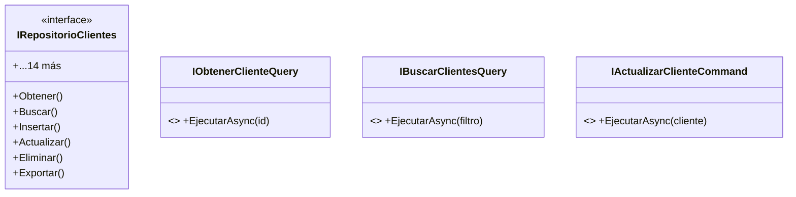

# SOLID - Segregación de interfaces (ISP)

Parte de: [[Principios SOLID]]

> [!info] Cómo avanzar
> `progreso`: **pendiente** → **viendo** (estudiando) → **visto** (contestaste la autoevaluación sin abrir las respuestas) → **dominado** (hiciste el laboratorio o lo aplicaste de verdad).

## Contenido

### Qué es
El **principio de segregación de interfaces** dice que **ningún cliente debería verse obligado a depender de métodos que no usa**. En lugar de una interfaz grande que lo abarca todo ("gorda"), conviene tener **varias interfaces pequeñas y enfocadas**, cada una pensada desde lo que necesita quien la consume.

### Cómo funciona
Una interfaz grande genera dos problemas:
1. **Para quien implementa**: debe escribir métodos que no tienen sentido para su caso, y termina con `throw new NotSupportedException()` (lo que además viola [[SOLID - Sustitución de Liskov (LSP)]]).
2. **Para quien consume**: depende de todo el contrato aunque use dos métodos. Cualquier cambio en la interfaz lo obliga a recompilar o a ajustar sus dobles de prueba, y no queda claro qué usa realmente.

La segregación se hace **desde el cliente**: ¿qué operaciones necesita *este* handler? Esa es su interfaz. Una misma clase puede implementar varias interfaces pequeñas.



### Ejemplo
Interfaz gorda en Itzamna.Dionisio:

```csharp
public interface IRepositorio<T>
{
    Task<T?> ObtenerAsync(int id);
    Task<IReadOnlyList<T>> ListarAsync();
    Task<int> InsertarAsync(T entidad);
    Task ActualizarAsync(T entidad);
    Task EliminarAsync(int id);
    Task<byte[]> ExportarExcelAsync();
    // ... 14 métodos más
}

// Un repositorio de catálogos de solo lectura (vista del SAT) debe "implementar" todo
public sealed class CatalogoUsoCfdiRepositorio : IRepositorio<UsoCfdi>
{
    public Task<int> InsertarAsync(UsoCfdi e) => throw new NotSupportedException();
    public Task ActualizarAsync(UsoCfdi e) => throw new NotSupportedException();
    public Task EliminarAsync(int id) => throw new NotSupportedException();
    // ...
}
```

Con ISP, alineado a la regla del proyecto de **una interfaz por consulta** con SQL en archivos:

```csharp
// Features/Catalogos/UsosCfdi/
public interface IListarUsosCfdiQuery
{
    Task<IReadOnlyList<UsoCfdi>> EjecutarAsync(CancellationToken ct);
}

public sealed class ListarUsosCfdiQuery(IDbConnectionFactory factory, ISqlProvider sql) : IListarUsosCfdiQuery
{
    public async Task<IReadOnlyList<UsoCfdi>> EjecutarAsync(CancellationToken ct)
    {
        await using var cn = factory.Crear();
        var cmd = new CommandDefinition(sql.Get("ListarUsosCfdi.sql"), cancellationToken: ct);
        return (await cn.QueryAsync<UsoCfdi>(cmd)).AsList();
    }
}
```

Si de verdad hay un repositorio que lee y escribe, separa en interfaces de lectura y escritura (`ILectorClientes`, `IEscritorClientes`), e implementa solo las que aplican.

**Beneficio en las pruebas:** el doble de prueba solo implementa lo que el código bajo prueba usa. Con la interfaz gorda tendrías que crear un *mock* de 20 métodos (o un *mock* "suelto" que ignora todo, ocultando dependencias); con la pequeña, el doble es trivial y la firma del handler documenta exactamente qué necesita.

```csharp
public sealed class ListarUsosCfdiFalso(params UsoCfdi[] datos) : IListarUsosCfdiQuery
{
    public Task<IReadOnlyList<UsoCfdi>> EjecutarAsync(CancellationToken ct) =>
        Task.FromResult<IReadOnlyList<UsoCfdi>>(datos);
}

[Fact]
public async Task Devuelve_solo_usos_vigentes()
{
    var handler = new ObtenerUsosVigentesHandler(
        new ListarUsosCfdiFalso(new("G03", Vigente: true), new("P01", Vigente: false)));

    var resultado = await handler.ManejarAsync(CancellationToken.None);

    Assert.Single(resultado);
}
```

Observa también lo que pasa con los cambios: si mañana se agrega un método `ExportarCsvAsync` a la interfaz gorda, **todas** sus implementaciones y todos los dobles de prueba deben actualizarse, aunque ningún handler de catálogos lo use. Con interfaces segregadas, ese cambio solo afecta al slice de exportación. En términos de [[Acoplamiento y cohesión]], cada consumidor queda acoplado únicamente a lo que usa.

### Cuándo usarlo y cuándo no
- Aplica ISP cuando una interfaz tiene **clientes distintos que usan partes distintas**, o cuando aparecen implementaciones con métodos vacíos o `NotSupportedException`.
- No fragmentes interfaces que siempre se usan juntas: `IDisposable` con un método está bien, pero partir `IComparer<T>` no tiene sentido. Las interfaces muy pequeñas que siempre van en pareja pueden agruparse.
- Encaja con [[SOLID - Inversión de dependencias (DIP)]]: el consumidor define la interfaz pequeña que necesita.

### Errores comunes
- **Repositorios genéricos `IRepositorio<T>`** con todos los métodos para todas las entidades.
- **Agregar métodos a una interfaz existente** porque "ya está ahí", en lugar de crear otra.
- **Interfaces de un método por sistema** sin pensar en el cliente: la segregación es por uso, no por cantidad.
- **Mocks gigantes** en pruebas como síntoma ignorado.

### Para profundizar
- [Principios de arquitectura: segregación de interfaces (Microsoft Learn)](https://learn.microsoft.com/dotnet/architecture/modern-web-apps-azure/architectural-principles)
- [Interfaces en C# (Microsoft Learn)](https://learn.microsoft.com/dotnet/csharp/fundamentals/types/interfaces)
- [Extraer interfaz (Refactoring.Guru)](https://refactoring.guru/es/extract-interface)

## Autoevaluación

Contesta primero en voz alta o en papel; luego despliega la respuesta.

> [!question]- ¿Qué dice el principio de segregación de interfaces?
> Ningún cliente debe depender de métodos que no usa: mejor varias interfaces pequeñas y específicas que una enorme.

> [!question]- Una interfaz `IRepositorio` con 20 métodos obliga a implementarlos todos en un repositorio de solo lectura. ¿Qué haces?
> Separarla, por ejemplo en `ILectorClientes` y `IEscritorClientes`; cada consumidor depende solo de lo que usa.

> [!question]- ¿Qué beneficio da en las pruebas?
> Los dobles de prueba (mocks o fakes) son más pequeños y claros porque solo implementan lo necesario.

