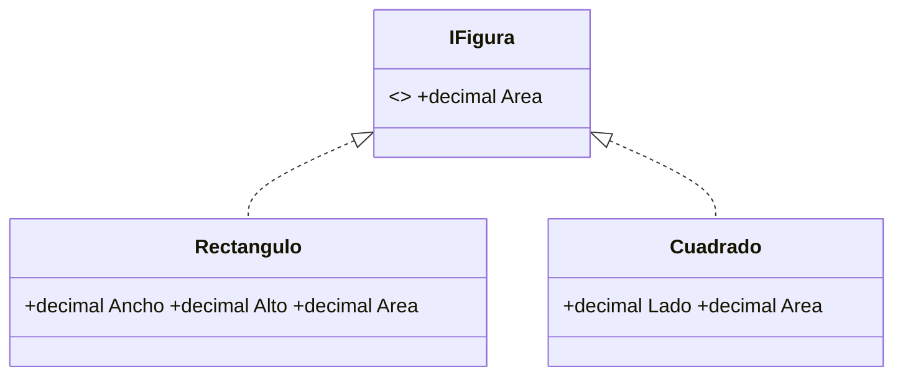

# SOLID - Sustitución de Liskov (LSP)

Parte de: [[Principios SOLID]]

> [!info] Cómo avanzar
> `progreso`: **pendiente** → **viendo** (estudiando) → **visto** (contestaste la autoevaluación sin abrir las respuestas) → **dominado** (hiciste el laboratorio o lo aplicaste de verdad).

## Contenido

### Qué es
El **principio de sustitución de Liskov**, formulado por Barbara Liskov en 1987, dice que si `S` es un subtipo de `T`, entonces **los objetos de tipo `T` deben poder reemplazarse por objetos de tipo `S` sin alterar la corrección del programa**. Dicho en práctico: cualquier código que funcione con la clase base o la interfaz debe seguir funcionando, **sin sorpresas**, con cualquier implementación o subclase. La herencia debe modelar "**se comporta como**", no solo "**es un**" en el lenguaje cotidiano.

### Cómo funciona
Un subtipo respeta el **contrato** del tipo base cuando:
- **No exige más** (precondiciones iguales o más débiles): si la base acepta cualquier monto positivo, la subclase no puede rechazar montos mayores a 1,000.
- **No promete menos** (postcondiciones iguales o más fuertes): si la base garantiza que devuelve una lista no nula, la subclase no puede devolver `null`.
- **Conserva los invariantes** de la base.
- **No lanza excepciones nuevas** inesperadas para operaciones que la base soporta.

**El ejemplo clásico: `Cuadrado` hereda de `Rectangulo`.** En geometría, un cuadrado "es un" rectángulo. Pero si `Rectangulo` tiene `Ancho` y `Alto` modificables por separado, su contrato implícito es "cambiar el ancho no cambia el alto". Un `Cuadrado` debe mantener ambos iguales, así que al cambiar el ancho también cambia el alto. El código escrito para rectángulos se rompe:

```csharp
void Ajustar(Rectangulo r)
{
    r.Ancho = 5;
    r.Alto = 4;
    Debug.Assert(r.Area == 20);   // con un Cuadrado da 16: se rompió la expectativa
}
```

El problema no es la geometría sino la **mutabilidad**: el comportamiento de `Cuadrado` no es sustituible. Soluciones: hacer las figuras **inmutables** (crear una nueva al cambiar dimensiones), o no relacionarlas por herencia y que ambas implementen una interfaz `IFigura` con `Area`.



### Ejemplo
Una violación típica en código de negocio:

```csharp
public interface IAlmacenArchivos
{
    Task GuardarAsync(string ruta, Stream contenido, CancellationToken ct);
    Task<Stream> LeerAsync(string ruta, CancellationToken ct);
    Task EliminarAsync(string ruta, CancellationToken ct);
}

public sealed class AlmacenHistoricoSoloLectura : IAlmacenArchivos
{
    public Task GuardarAsync(string r, Stream c, CancellationToken ct)
        => throw new NotSupportedException();      // sorpresa para quien usa la interfaz
    public Task EliminarAsync(string r, CancellationToken ct)
        => throw new NotSupportedException();
    public Task<Stream> LeerAsync(string r, CancellationToken ct) => /* lee de un Blob archivado */ ...;
}
```

Wee.Reporteria recibe un `IAlmacenArchivos` para guardar reportes; si alguien inyecta el almacén histórico, falla en tiempo de ejecución. Y el código empieza a defenderse:

```csharp
if (almacen is AlmacenHistoricoSoloLectura) { /* no guardar */ }   // señal de violación
```

La corrección es ajustar las abstracciones al comportamiento real (lo que también aplica [[SOLID - Segregación de interfaces (ISP)]]):

```csharp
public interface ILectorArchivos { Task<Stream> LeerAsync(string ruta, CancellationToken ct); }
public interface IEscritorArchivos
{
    Task GuardarAsync(string ruta, Stream contenido, CancellationToken ct);
    Task EliminarAsync(string ruta, CancellationToken ct);
}

public sealed class AlmacenBlob : ILectorArchivos, IEscritorArchivos { /* ... */ }
public sealed class AlmacenHistorico : ILectorArchivos { /* ... */ }
```

Ahora quien solo necesita leer pide `ILectorArchivos`, y nadie puede pasarle a un generador de reportes algo que no sabe escribir.

**Señales en el código que delatan una violación de LSP:**
- `throw new NotSupportedException()` o `NotImplementedException()` en métodos heredados o de interfaz.
- Revisiones de tipo concreto: `if (x is Tipo)`, `switch` sobre `GetType()`.
- Sobrescrituras que no hacen nada (métodos vacíos) donde la base sí hace algo.
- Subclases que endurecen validaciones o cambian el significado de un resultado.
- Pruebas escritas para la base que fallan con una subclase.

### Cuándo usarlo y cuándo no
- Tenlo presente **siempre** que heredes o implementes una interfaz: es lo que hace que el polimorfismo y [[SOLID - Abierto-cerrado (OCP)]] funcionen.
- Si una subclase no puede cumplir todo el contrato, probablemente no debería ser subclase: prefiere **composición** o interfaces más pequeñas.
- Una buena práctica es escribir **pruebas de contrato**: el mismo conjunto de pruebas ejecutado contra cada implementación.

### Errores comunes
- **Herencia por reutilizar código** en lugar de por comportamiento compartido.
- **`NotSupportedException` como salida fácil** al implementar una interfaz demasiado grande.
- **Modelar la realidad literal** ("un cuadrado es un rectángulo") sin pensar en el comportamiento.
- **Romper el contrato con nulos**: la base nunca devuelve `null` y una implementación sí.
- **Excepciones de la BCL que aceptan violaciones**: `ReadOnlyCollection<T>` implementa `IList<T>` y lanza en `Add`; no es un modelo a imitar.

### Para profundizar
- [Data Abstraction and Hierarchy (Barbara Liskov, 1987, ACM)](https://dl.acm.org/doi/10.1145/62139.62141)
- [Principios de arquitectura en .NET (Microsoft Learn)](https://learn.microsoft.com/dotnet/architecture/modern-web-apps-azure/architectural-principles)
- [Reemplazar herencia con delegación (Refactoring.Guru)](https://refactoring.guru/es/replace-inheritance-with-delegation)

## Autoevaluación

Contesta primero en voz alta o en papel; luego despliega la respuesta.

> [!question]- ¿Qué dice el principio de sustitución de Liskov?
> Un subtipo debe poder usarse donde se espera su tipo base **sin romper** el comportamiento esperado: no exige más precondiciones ni promete menos.

> [!question]- El ejemplo clásico: `Cuadrado` hereda de `Rectangulo`. ¿Por qué viola LSP?
> Código que hace `r.Ancho = 5; r.Alto = 4;` espera área 20; con un cuadrado que iguala lados obtiene 16. El subtipo cambia el contrato.

> [!question]- ¿Qué señal en el código delata una violación de LSP?
> Overrides que lanzan `NotSupportedException`, o código cliente que pregunta `if (x is TipoConcreto)` para evitar comportamientos del subtipo.

