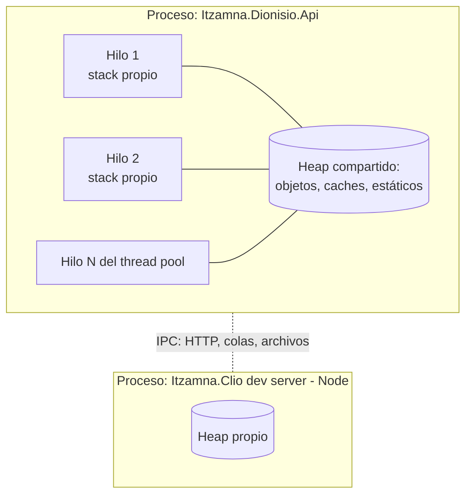

# Procesos e hilos

Parte de: [[02-Fundamentos/08 Computación general/_Índice Computación general|Computación general]]

> [!info] Cómo avanzar
> `progreso`: **pendiente** → **viendo** (estudiando) → **visto** (contestaste la autoevaluación sin abrir las respuestas) → **dominado** (hiciste el laboratorio o lo aplicaste de verdad).

## Contenido

### Qué es
- Un **proceso** es un **programa en ejecución** con su propio espacio de memoria aislado, sus recursos (archivos abiertos, sockets, variables de entorno) y al menos un hilo. Cuando arrancas `dotnet Itzamna.Dionisio.Api.dll`, el sistema operativo crea un proceso.
- Un **hilo** (*thread*) es una **secuencia de ejecución dentro de un proceso**. Todos los hilos de un proceso **comparten la memoria** del proceso (el heap, los objetos estáticos), pero cada uno tiene su propia pila (*stack*) y sus registros.

El sistema operativo reparte el tiempo de CPU entre hilos (el **planificador**); con varios núcleos, varios hilos corren al mismo tiempo.

### Cómo funciona


Diferencias clave:

| | Proceso | Hilo |
|---|---|---|
| Memoria | aislada | compartida con los hilos del mismo proceso |
| Costo de crear | alto | menor (pero no gratis: en .NET cada hilo reserva su pila) |
| Comunicación | IPC: sockets, pipes, archivos, colas | variables compartidas en memoria |
| Si falla | no afecta a otros procesos | puede tumbar todo el proceso |

**Consecuencias de compartir memoria:**
- Ventaja: comunicar datos entre hilos es rápido.
- Riesgo: **condiciones de carrera** (dos hilos leen y escriben el mismo dato y el resultado depende del orden), datos corruptos, y **deadlocks** si se usan candados mal ordenados. Se necesita **sincronización**: `lock`, `Interlocked`, `SemaphoreSlim`, colecciones concurrentes (`ConcurrentDictionary`), o diseñar con datos inmutables y sin estado compartido.

En .NET casi nunca creas hilos a mano (`new Thread`): usas el **thread pool**, un conjunto de hilos reutilizables que el runtime administra, a través de `Task`, `async/await` y `Parallel`. ASP.NET Core atiende cada petición en hilos del pool.

**Excepción no controlada en un hilo:** desde .NET 2.0, una excepción no manejada en **cualquier hilo** (uno creado con `Thread` o uno del pool ejecutando un callback) **termina todo el proceso**. Con `Task`, la excepción se guarda en la tarea y se relanza al hacer `await`; si nunca se observa, no tumba el proceso (se notifica en `TaskScheduler.UnobservedTaskException`). En cambio, una excepción en un método `async void` sí se relanza fuera y puede terminar el proceso. En un `BackgroundService`, una excepción que escapa de `ExecuteAsync` por defecto **detiene el host** desde .NET 6.

### Ejemplo
Condición de carrera y su corrección:

```csharp
// Contador de peticiones compartido entre hilos
public sealed class Metricas
{
    private int _peticiones;

    // Incorrecto: "_peticiones++" es leer, sumar y escribir; dos hilos pueden pisarse
    public void RegistrarMal() => _peticiones++;

    // Correcto: operación atómica
    public void Registrar() => Interlocked.Increment(ref _peticiones);

    public int Total => Volatile.Read(ref _peticiones);
}
```

Servicio de fondo que no tumba el host por un error puntual:

```csharp
public sealed class ConciliacionWorker(ILogger<ConciliacionWorker> log, IConciliador conciliador)
    : BackgroundService
{
    protected override async Task ExecuteAsync(CancellationToken ct)
    {
        while (!ct.IsCancellationRequested)
        {
            try { await conciliador.EjecutarAsync(ct); }
            catch (Exception ex) when (ex is not OperationCanceledException)
            {
                log.LogError(ex, "Falló la conciliación; se reintenta en 1 minuto");
            }
            await Task.Delay(TimeSpan.FromMinutes(1), ct);
        }
    }
}
```

### Cuándo usarlo y cuándo no
- **Procesos separados** cuando quieres **aislamiento**: que la caída de uno no afecte al otro, distinto lenguaje, despliegue independiente (API y worker como apps distintas, contenedores).
- **Hilos (vía tareas)** para concurrencia y paralelismo dentro de una app (ver [[Concurrencia vs paralelismo]]).
- Evita estado mutable compartido; si lo necesitas, encapsúlalo y sincronízalo.

### Errores comunes
- **Usar `Dictionary` o `List` desde varios hilos** sin sincronizar: corrupción o excepciones raras.
- **`lock` sobre `this` o sobre strings**: otros pueden bloquear el mismo objeto. Usa un objeto privado (o `System.Threading.Lock` en versiones recientes de C#).
- **`async void`** fuera de manejadores de eventos: sus excepciones pueden matar el proceso.
- **Crear hilos a mano** para cada tarea: costoso; usa el thread pool.
- **Bloquear hilos del pool** con `.Result` o `Thread.Sleep`: provoca *thread pool starvation* (ver [[Síncrono vs asíncrono]]).

### Para profundizar
- [Conceptos básicos del subprocesamiento administrado](https://learn.microsoft.com/dotnet/standard/threading/managed-threading-basics)
- [Excepciones en subprocesos administrados](https://learn.microsoft.com/dotnet/standard/threading/exceptions-in-managed-threads)
- [El grupo de subprocesos administrados (thread pool)](https://learn.microsoft.com/dotnet/standard/threading/the-managed-thread-pool)

## Autoevaluación

Contesta primero en voz alta o en papel; luego despliega la respuesta.

> [!question]- ¿Qué diferencia hay entre un proceso y un hilo?
> Un **proceso** tiene su propio espacio de memoria y recursos; un **hilo** es una unidad de ejecución dentro de un proceso que comparte memoria con los demás hilos.

> [!question]- ¿Qué consecuencia tiene que los hilos compartan memoria?
> Comunicación barata, pero riesgo de **condiciones de carrera**: dos hilos modifican el mismo dato sin sincronización (se usan `lock`, `Interlocked`, colecciones concurrentes o inmutabilidad).

> [!question]- ¿Qué pasa si un hilo lanza una excepción no controlada en .NET?
> En general termina el **proceso** completo. Por eso las tareas en segundo plano deben capturar y registrar sus errores.

## Práctica

- [[Lab 1 - Terminal, variables de entorno y procesos]]

