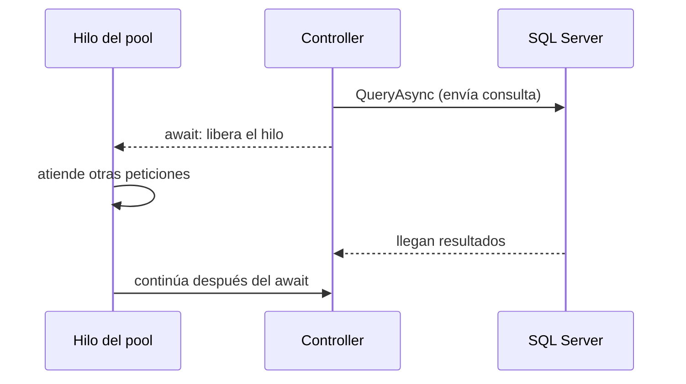

# Síncrono vs asíncrono

Parte de: [[02-Fundamentos/08 Computación general/_Índice Computación general|Computación general]]

> [!info] Cómo avanzar
> `progreso`: **pendiente** → **viendo** (estudiando) → **visto** (contestaste la autoevaluación sin abrir las respuestas) → **dominado** (hiciste el laboratorio o lo aplicaste de verdad).

## Contenido

### Qué es
- Una operación **síncrona** bloquea a quien la llama hasta terminar: el hilo se queda esperando sin hacer nada más.
- Una operación **asíncrona** inicia el trabajo y **devuelve el control de inmediato**; el resultado llega después (en .NET, a través de un `Task`/`Task<T>`). Mientras tanto, el hilo queda libre para otras cosas.

Es especialmente valioso en operaciones de **E/S** (base de datos, HTTP, disco, colas), donde la mayor parte del tiempo se pasa esperando a otro sistema, no usando CPU.

### Cómo funciona
En C#, `async`/`await` hace que el código asíncrono se lea como si fuera secuencial:

1. Llamas a `cn.QueryAsync(...)` de Dapper; el driver envía la consulta y devuelve un `Task` sin esperar.
2. `await` revisa si ya terminó. Si no, **registra la continuación** (el resto del método) y regresa el hilo al thread pool.
3. Cuando la respuesta llega por la red, el sistema operativo avisa y un hilo del pool (no necesariamente el mismo) ejecuta la continuación.



**¿Asíncrono significa más rápido?** No. Una consulta que tarda 200 ms sigue tardando 200 ms (incluso un poco más por la maquinaria de `async`). Lo que mejora es la **escalabilidad**: con los mismos hilos atiendes muchas más peticiones simultáneas porque nadie se queda bloqueado esperando. En una app de escritorio o en el navegador, además, mantiene la interfaz **responsiva**. Para trabajo de CPU, `async` no ayuda; eso es paralelismo (ver [[Concurrencia vs paralelismo]]).

Para hacer **varias operaciones independientes a la vez**, inícialas y espéralas juntas:

```csharp
var tareaCliente = _obtenerCliente.EjecutarAsync(id, ct);
var tareaSaldos  = _obtenerSaldos.EjecutarAsync(id, ct);
await Task.WhenAll(tareaCliente, tareaSaldos);   // total ≈ la más lenta, no la suma
```

(Ojo: con Dapper, cada una debe usar **su propia conexión**; una misma `SqlConnection` no admite dos comandos simultáneos sin MARS.)

### Ejemplo
Controller de Itzamna.Dionisio, asíncrono de punta a punta:

```csharp
[HttpGet("{rfc}/saldos")]
public async Task<ActionResult<SaldosDto>> ObtenerSaldos(string rfc, CancellationToken ct)
{
    var saldos = await _query.EjecutarAsync(rfc, ct);
    return saldos is null ? NotFound() : Ok(saldos);
}

// Query con Dapper y SQL en archivo
public sealed class ObtenerSaldosQuery(IDbConnectionFactory factory, ISqlProvider sql) : IObtenerSaldosQuery
{
    public async Task<SaldosDto?> EjecutarAsync(string rfc, CancellationToken ct)
    {
        await using var cn = factory.Crear();
        var cmd = new CommandDefinition(sql.Get("ObtenerSaldos.sql"), new { rfc }, cancellationToken: ct);
        return await cn.QuerySingleOrDefaultAsync<SaldosDto>(cmd);
    }
}
```

El anti-patrón **sync-over-async**:

```csharp
var r = ObtenerAsync().Result;      // o .Wait(), o .GetAwaiter().GetResult()
```

Qué causa en un API:
- **Bloquea un hilo del pool** durante toda la espera. Con carga, el pool se queda sin hilos libres (*thread pool starvation*): las peticiones se encolan, la latencia se dispara y el pool crece lentamente, aunque la CPU esté casi ociosa.
- En ASP.NET clásico (.NET Framework), WinForms o WPF, donde hay un `SynchronizationContext` de un solo hilo, provoca **deadlock**: la continuación necesita el hilo que está bloqueado esperándola. ASP.NET Core no tiene ese contexto, por lo que el problema principal ahí es el agotamiento de hilos.
- `.Result` envuelve las excepciones en `AggregateException`, lo que complica el manejo de errores.

La regla: **async de punta a punta** ("async all the way"). Si un método llama algo asíncrono, él también debe ser `async` y devolver `Task`.

### Cuándo usarlo y cuándo no
- **Sí**: todo lo que haga E/S en un API o worker: base de datos, `HttpClient`, Azure Storage, Service Bus, archivos grandes.
- **No hace falta**: cálculos en memoria rápidos; métodos que solo devuelven un valor ya conocido (usa `Task.FromResult` o `ValueTask` si implementas una interfaz asíncrona).
- En JavaScript el modelo es parecido con Promesas y `async/await`, sobre un solo hilo con *event loop*.

### Errores comunes
- **`.Result` / `.Wait()`** en código de servidor: starvation o deadlocks.
- **`async void`**: no se puede esperar y sus excepciones pueden tumbar el proceso; solo para manejadores de eventos.
- **Olvidar el `await`**: la tarea corre "suelta", las excepciones se pierden y el método termina antes de tiempo. Los analizadores (CS4014) lo advierten.
- **No propagar `CancellationToken`**: si el cliente cancela, la consulta sigue gastando recursos.
- **Envolver código síncrono en `Task.Run`** dentro de un API para "hacerlo async": solo mueve el bloqueo a otro hilo del pool.

### Para profundizar
- [Programación asincrónica con async y await (Microsoft Learn)](https://learn.microsoft.com/dotnet/csharp/asynchronous-programming/)
- [Procedimientos recomendados de rendimiento en ASP.NET Core (evitar bloqueos)](https://learn.microsoft.com/aspnet/core/fundamentals/best-practices)
- [Patrón asincrónico basado en tareas (TAP)](https://learn.microsoft.com/dotnet/standard/asynchronous-programming-patterns/task-based-asynchronous-pattern-tap)

## Autoevaluación

Contesta primero en voz alta o en papel; luego despliega la respuesta.

> [!question]- ¿Qué significa que una operación sea asíncrona?
> Que el llamador no se bloquea esperando el resultado: continúa y se le avisa al terminar. En .NET, `await` libera el hilo mientras la E/S está en curso.

> [!question]- ¿Asíncrono significa más rápido?
> No para una sola operación (incluso agrega un poco de sobrecarga). Mejora la **escalabilidad** y la capacidad de respuesta al no bloquear hilos.

> [!question]- Error común: `var r = ObtenerAsync().Result;` en un API. ¿Qué causa?
> Bloquea un hilo esperando (sync over async): con carga provoca agotamiento del thread pool y, en contextos con sincronización (UI, ASP.NET clásico), deadlocks. Usa `await` en toda la cadena.

