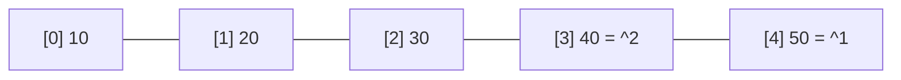

# Arrays

Parte de: [[03-CSharp-DotNet/01 Básico/_Índice Básico|Básico]]

> [!info] Cómo avanzar
> `progreso`: **pendiente** → **viendo** (estudiando) → **visto** (contestaste la autoevaluación sin abrir las respuestas) → **dominado** (hiciste el laboratorio o lo aplicaste de verdad).

## Contenido

### Qué es
Un **array** es un bloque de elementos del mismo tipo con **tamaño fijo** que se decide al crearlo. Cada elemento se accede por un índice que empieza en 0, y el acceso es inmediato (O(1)) porque los elementos están contiguos en memoria. En C# todos los arrays heredan de `System.Array` y son **tipos de referencia**, aunque contengan `int` u otros tipos de valor.

Sirve cuando conoces el número de elementos de antemano, cuando el rendimiento importa (buffers de bytes, matrices numéricas) o cuando una API lo exige (`string.Split` regresa `string[]`, `File.ReadAllBytes` regresa `byte[]`).

### Cómo funciona
1. **Creación**: `new int[3]` reserva tres posiciones y las llena con el valor por defecto del tipo: `0` para números, `false` para `bool`, `null` para referencias. No existe un array "con basura".
2. **Inicialización**: con C# 12 puedes usar *collection expressions*: `int[] a = [10, 20, 30];`. También sigue valiendo `new[] { 10, 20, 30 }`.
3. **Longitud**: `a.Length` es fija. Para "crecer" hay que crear otro array y copiar (`Array.Resize` lo hace por ti, pero crea un array nuevo).
4. **Límites**: el CLR verifica cada acceso. Si el índice es negativo o `>= Length` lanza `IndexOutOfRangeException`. Por eso `arr[arr.Length]` siempre falla: el último índice válido es `Length - 1`.
5. **Índices desde el final y rangos** (C# 8): `^1` es el último elemento, `^2` el penúltimo. `a[1..3]` toma desde el índice 1 **incluido** hasta el 3 **excluido** y crea un array nuevo (una copia).



**Multidimensional vs escalonado**: `int[,]` es una matriz rectangular, un solo objeto donde todas las filas miden lo mismo; se accede con `m[fila, col]`. `int[][]` es un array de arrays (*jagged*): cada fila es un array independiente que puede tener otra longitud y se accede con `j[fila][col]`. El escalonado suele ser más rápido en .NET y es más flexible.

### Ejemplo
```csharp
int[] ventas = [10, 20, 30, 40, 50];

Console.WriteLine(ventas[^1]);          // 50 (último)
Console.WriteLine(ventas[^2]);          // 40 (penúltimo)
int[] medio = ventas[1..3];             // [20, 30] (copia nueva)
Console.WriteLine(string.Join(",", medio));

var vacio = new int[3];                 // [0, 0, 0]

// Matriz rectangular: 2 filas x 3 columnas
int[,] tabla = { { 1, 2, 3 }, { 4, 5, 6 } };
Console.WriteLine(tabla[1, 2]);         // 6
Console.WriteLine(tabla.GetLength(0));  // 2 filas

// Escalonado: cada fila con distinta longitud
int[][] semanas = [[1, 2], [3, 4, 5], [6]];
Console.WriteLine(semanas[1][2]);       // 5

// Ordenar y buscar
Array.Sort(ventas);
int pos = Array.BinarySearch(ventas, 30); // 2 (requiere array ordenado)

// Recorrer sin salir de los límites
for (int i = 0; i < ventas.Length; i++)
    Console.Write(ventas[i] + " ");
```

Para trozos sin copiar usa `ventas.AsSpan(1, 2)` (un `Span<int>` que apunta al mismo array); lo verás en [[Span y Memory]].

### Cuándo usarlo y cuándo no
**Úsalo** cuando:
- El tamaño es fijo y conocido (los 12 meses, un buffer de 4 KB, los bytes de un archivo).
- Necesitas el máximo rendimiento y la menor memoria (no hay capacidad sobrante como en `List<T>`).
- Interoperas con APIs que lo piden (`params`, `Split`, criptografía, `Stream.Read`).

**No lo uses** cuando la cantidad cambia: agregar o quitar elementos obliga a crear arrays nuevos. Ahí conviene [[List de T]]. Si necesitas búsqueda por clave, usa [[Dictionary de TKey y TValue]]. En contratos públicos (lo que regresa un handler) suele ser mejor `IReadOnlyList<T>`, que un array también implementa.

### Errores comunes
- **Salirse por uno** (`i <= arr.Length`): provoca `IndexOutOfRangeException`. Usa `<` o mejor `foreach`.
- **Creer que un rango no copia**: `a[1..3]` en un array crea un array nuevo; si modificas la copia, el original no cambia. Si quieres una vista, usa `Span<T>`.
- **Confundir `int[,]` con `int[][]`**: la sintaxis de acceso es distinta y `Length` en el rectangular es el total de celdas (filas × columnas), no el número de filas.
- **Asumir que el array es inmutable**: `readonly int[] x` impide reasignar la variable, pero sus elementos sí se pueden cambiar. Para exponer datos de solo lectura usa `IReadOnlyList<T>` o `ImmutableArray<T>`.
- **`BinarySearch` sobre datos desordenados**: devuelve resultados sin sentido; ordena primero.

### Para profundizar
- [Arrays (referencia de C#)](https://learn.microsoft.com/dotnet/csharp/language-reference/builtin-types/arrays)
- [Índices y rangos](https://learn.microsoft.com/dotnet/csharp/tutorials/ranges-indexes)
- [Collection expressions](https://learn.microsoft.com/dotnet/csharp/language-reference/operators/collection-expressions)
- [Clase System.Array](https://learn.microsoft.com/dotnet/api/system.array)

## Ejercicios

Resuélvelos en papel o en la herramienta; la solución está plegada.

> [!question]- `int[] a = [10, 20, 30, 40, 50];` ¿Qué dan `a[^2]` y `a[1..3]`?
> `a[^2]` = `40`. `a[1..3]` = `[20, 30]` (el final es exclusivo).

> [!question]- `var b = new int[3];` ¿Qué contiene?
> `[0, 0, 0]`: los elementos se inicializan con el valor por defecto.

## Autoevaluación

Contesta primero en voz alta o en papel; luego despliega la respuesta.

> [!question]- ¿Qué diferencia hay entre `int[,]` e `int[][]`?
> `int[,]` es una matriz rectangular (un solo bloque). `int[][]` es *jagged*: un array de arrays, cada fila puede tener longitud distinta.

> [!question]- ¿Qué pasa con `arr[arr.Length]`?
> Lanza `IndexOutOfRangeException`. El último índice es `Length - 1` (o `arr[^1]`).

> [!question]- ¿Cuándo usarías un array en vez de `List<T>`?
> Cuando el tamaño es fijo y conocido, o en código muy sensible al rendimiento. Para devolver "vacío" usa `[]` o `Array.Empty<T>()`, que no asignan memoria nueva.

