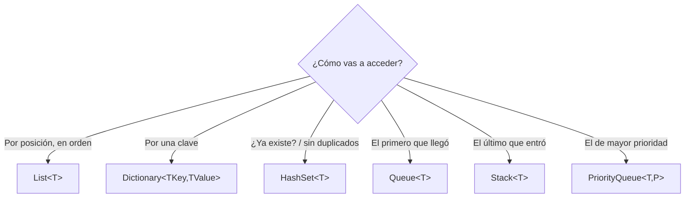

# Colecciones (List, Dictionary, HashSet, Queue, Stack)

Parte de: [[03-CSharp-DotNet/01 Básico/_Índice Básico|Básico]]

> [!info] Cómo avanzar
> `progreso`: **pendiente** → **viendo** (estudiando) → **visto** (contestaste la autoevaluación sin abrir las respuestas) → **dominado** (hiciste el laboratorio o lo aplicaste de verdad).

## Contenido

### Qué es
Las **colecciones genéricas** de `System.Collections.Generic` son las estructuras de datos que usarás todos los días para guardar grupos de objetos cuyo tamaño cambia. A diferencia de un [[Arrays|array]], crecen solas y cada una está optimizada para una forma de acceso distinta. Elegir bien la colección es una decisión de diseño: determina el costo de buscar, insertar y recorrer, y comunica la intención del código.

Esta nota da el panorama; el detalle está en cada subtema:
- [[List de T]]: secuencia ordenada por índice que crece.
- [[Dictionary de TKey y TValue]]: búsqueda por clave.
- [[HashSet de T]]: conjunto sin duplicados y pertenencia rápida.
- [[Queue y Stack de T]]: orden de llegada (FIFO) y último en entrar, primero en salir (LIFO).

### Cómo funciona
Todas implementan `IEnumerable<T>` (se pueden recorrer con `foreach` y LINQ) y la mayoría `ICollection<T>` (tienen `Count`, `Add`, `Remove`). Internamente hay dos familias:
- **Basadas en array** (`List<T>`, `Queue<T>`, `Stack<T>`): guardan los elementos en un array interno que se duplica cuando se llena. Acceso por posición rápido; buscar un valor requiere recorrer.
- **Basadas en hash** (`Dictionary<TKey,TValue>`, `HashSet<T>`): calculan `GetHashCode()` de la clave para saltar directo a una "cubeta". Buscar, agregar y quitar son O(1) en promedio.



Guía rápida:
| Necesidad | Colección |
|---|---|
| Lista ordenada que crece | `List<T>` |
| Buscar por clave (código, id) | `Dictionary<TKey,TValue>` |
| Evitar duplicados / "¿está?" | `HashSet<T>` |
| Procesar en orden de llegada | `Queue<T>` |
| Deshacer lo último | `Stack<T>` |

### Ejemplo
Un caso típico en un reporte de [[Itzamna.Dionisio]] o Wee.Reporteria: llegan movimientos, hay que agruparlos por cuenta, quitar folios repetidos y regresar el resultado sin dejar que el que llama lo modifique.

```csharp
public sealed record Movimiento(string Folio, string Cuenta, decimal Monto);

public static IReadOnlyDictionary<string, decimal> TotalesPorCuenta(IEnumerable<Movimiento> movimientos)
{
    var foliosVistos = new HashSet<string>(StringComparer.OrdinalIgnoreCase);
    var totales = new Dictionary<string, decimal>();

    foreach (var m in movimientos)
    {
        if (!foliosVistos.Add(m.Folio))      // Add regresa false si ya estaba
            continue;                         // folio duplicado: lo ignoramos

        totales[m.Cuenta] = totales.GetValueOrDefault(m.Cuenta) + m.Monto;
    }
    return totales;                           // se expone como solo lectura
}

// Un handler que lista datos regresa la interfaz de solo lectura
public async Task<IReadOnlyList<Movimiento>> Handle(CancellationToken ct)
{
    List<Movimiento> lista = await _sql.EjecutarAsync(ct);
    return lista;   // List<T> implementa IReadOnlyList<T>
}
```

**¿Qué tipo regresar?** Por dentro usa `List<T>` para construir; hacia afuera regresa `IReadOnlyList<T>` (o `IReadOnlyCollection<T>`). Así el consumidor no puede hacer `Add` y tú puedes cambiar la implementación sin romper a nadie. Para parámetros que solo se recorren, acepta `IEnumerable<T>`.

### Cuándo usarlo y cuándo no
- Usa colecciones genéricas siempre en lugar de las antiguas no genéricas (`ArrayList`, `Hashtable`), que guardan `object`, obligan a hacer casting y causan *boxing*.
- Si el tamaño es fijo y crítico en rendimiento, un array puede bastar.
- Para datos que nunca cambian después de construirse y se leen mucho (catálogos en memoria), considera `FrozenDictionary`/`FrozenSet` (`System.Collections.Frozen`) o las colecciones inmutables.
- **Hilos**: ninguna de estas colecciones es segura para escrituras concurrentes. Varios lectores sin escritores está bien; si hay escrituras desde varios hilos usa `ConcurrentDictionary`, `ConcurrentQueue`, `Channel<T>` (ver [[System.Threading.Channels]]) o protege con `lock` (ver [[lock y concurrencia]]).

### Errores comunes
- **Usar `List.Contains` dentro de un bucle grande**: cada búsqueda es O(n). Si buscas mucho, pasa los datos a un `HashSet` o `Dictionary`.
- **Exponer `List<T>` en propiedades públicas**: cualquiera puede modificar tu estado interno (ver [[Encapsulamiento]]).
- **Modificar una colección mientras la recorres con `foreach`**: lanza `InvalidOperationException`.
- **Compartir un `Dictionary` estático entre peticiones de una API sin sincronizar**: puede corromper la estructura interna o entrar en bucles infinitos bajo carga.
- **Olvidar el comparador**: claves `string` distinguen mayúsculas por defecto; pasa `StringComparer.OrdinalIgnoreCase` cuando no deba importar.

### Para profundizar
- [Colecciones y estructuras de datos en .NET](https://learn.microsoft.com/dotnet/standard/collections/)
- [Seleccionar una clase de colección](https://learn.microsoft.com/dotnet/standard/collections/selecting-a-collection-class)
- [Colecciones seguras para subprocesos](https://learn.microsoft.com/dotnet/standard/collections/thread-safe/)

## Subtemas

- [[List de T]]
- [[Dictionary de TKey y TValue]]
- [[HashSet de T]]
- [[Queue y Stack de T]]

## Autoevaluación

Contesta primero en voz alta o en papel; luego despliega la respuesta.

> [!question]- ¿Qué colección eliges para: (a) lista ordenada que crece, (b) buscar por clave, (c) evitar duplicados, (d) procesar en orden de llegada, (e) deshacer lo último?
> (a) `List<T>`, (b) `Dictionary<TKey,TValue>`, (c) `HashSet<T>`, (d) `Queue<T>` (FIFO), (e) `Stack<T>` (LIFO).

> [!question]- ¿Qué tipo debe regresar un repositorio o handler: `List<T>` o `IReadOnlyList<T>`?
> `IReadOnlyList<T>` (o `IReadOnlyCollection<T>`): comunica que el consumidor no debe modificarla y te deja cambiar la implementación.

> [!question]- ¿Son seguras para varios hilos?
> No. Para escritura concurrente usa `ConcurrentDictionary`, `ConcurrentQueue` o un `Channel`; o protege con `lock`.

## Práctica

- [[Lab 1 - Consola de inventario con colecciones y TryParse]]

## Progreso de los subtemas

```base
filters:
  and:
    - file.inFolder("03-CSharp-DotNet/01 Básico/Colecciones (List, Dictionary, HashSet, Queue, Stack)")
    - file.name != "Colecciones (List, Dictionary, HashSet, Queue, Stack)"
views:
  - type: table
    name: Progreso
    order:
      - file.name
      - progreso
      - nivel
```
