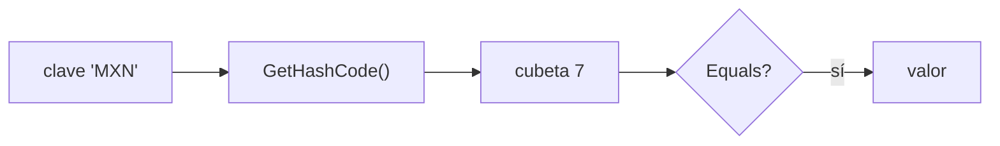

# Dictionary de TKey y TValue

Parte de: [[Colecciones (List, Dictionary, HashSet, Queue, Stack)]]

> [!info] Cómo avanzar
> `progreso`: **pendiente** → **viendo** (estudiando) → **visto** (contestaste la autoevaluación sin abrir las respuestas) → **dominado** (hiciste el laboratorio o lo aplicaste de verdad).

## Contenido

### Qué es
`Dictionary<TKey, TValue>` guarda pares **clave → valor** y permite encontrar un valor por su clave en tiempo constante en promedio (O(1)), sin recorrer todos los elementos. Es la estructura para "dame el cliente con código X", contar ocurrencias, agrupar o cachear resultados en memoria. Cada clave es única dentro del diccionario.

### Cómo funciona
1. Al agregar, calcula `clave.GetHashCode()` y con ese número elige una **cubeta** (bucket).
2. Dentro de la cubeta compara con `Equals` para distinguir claves con el mismo hash (colisiones).
3. Buscar repite el cálculo: hash → cubeta → `Equals`. Por eso es rápido aunque haya millones de elementos.
4. Cuando se llena, crea una tabla interna más grande y reubica todo (por eso conviene pasar capacidad inicial si conoces el tamaño).



Comportamientos que debes memorizar:
| Operación | Si la clave **no** existe | Si la clave **ya** existe |
|---|---|---|
| `dic[k]` (leer) | `KeyNotFoundException` | regresa el valor |
| `dic[k] = v` (escribir) | la agrega | **reemplaza** el valor |
| `dic.Add(k, v)` | la agrega | `ArgumentException` |
| `TryGetValue(k, out v)` | `false` | `true` y el valor |
| `TryAdd(k, v)` | la agrega, `true` | no hace nada, `false` |
| `GetValueOrDefault(k)` | `default` | el valor |

**Comparador**: por defecto usa `EqualityComparer<TKey>.Default`; para `string` eso distingue mayúsculas. Pasa `StringComparer.OrdinalIgnoreCase` en el constructor para que `"abc"` y `"ABC"` sean la misma clave.

**Claves mutables**: si usas como clave un objeto cuyo `GetHashCode` depende de propiedades que luego cambias, el diccionario lo dejó en la cubeta del hash viejo. A partir de ahí no lo encontrarás ni podrás quitarlo. Las claves deben ser inmutables: `string`, `int`, `Guid`, records con propiedades `init`.

### Ejemplo
Contar palabras:
```csharp
var texto = "a b a c b a";
var conteo = new Dictionary<string, int>(StringComparer.OrdinalIgnoreCase);

foreach (var palabra in texto.Split(' ', StringSplitOptions.RemoveEmptyEntries))
{
    conteo[palabra] = conteo.GetValueOrDefault(palabra) + 1;
}
// a=3, b=2, c=1
foreach (var (palabra, veces) in conteo)
    Console.WriteLine($"{palabra}={veces}");
```

Variante sin doble búsqueda (útil en rutas calientes) con `CollectionsMarshal`:
```csharp
using System.Runtime.InteropServices;

ref int n = ref CollectionsMarshal.GetValueRefOrAddDefault(conteo, "d", out _);
n++; // modifica el valor dentro del diccionario sin buscar dos veces
```

Catálogo en memoria para un proceso de importación (Wee.Reporteria):
```csharp
public sealed record Cuenta(string Codigo, string Nombre);

var cuentas = (await sql.ListarCuentasAsync(ct))
    .ToDictionary(c => c.Codigo, StringComparer.OrdinalIgnoreCase);

foreach (var fila in filasExcel)
{
    if (!cuentas.TryGetValue(fila.CodigoCuenta, out var cuenta))
    {
        errores.Add($"Fila {fila.Numero}: la cuenta {fila.CodigoCuenta} no existe");
        continue;
    }
    // usar cuenta.Nombre ...
}
```
`ToDictionary` lanza excepción si hay claves repetidas; si puede haberlas, agrupa primero con `GroupBy` o usa `ToLookup`.

### Cuándo usarlo y cuándo no
- **Úsalo** para búsquedas repetidas por clave, conteos, agrupaciones y caches locales.
- **No** lo uses si solo vas a recorrer en orden: `List<T>` usa menos memoria. El orden de enumeración de un `Dictionary` no está garantizado; si lo necesitas ordenado por clave usa `SortedDictionary`.
- Para datos de solo lectura que se consultan muchísimo, `FrozenDictionary` es más rápido al leer.
- Con escrituras desde varios hilos usa `ConcurrentDictionary`; para cache en una API, mejor [[IMemoryCache]] o [[HybridCache]].

### Errores comunes
- **Leer con `dic[k]` sin saber si existe**: `KeyNotFoundException` en producción. Usa `TryGetValue`.
- **`ContainsKey` seguido de `dic[k]`**: busca dos veces. `TryGetValue` lo hace en una.
- **Olvidar el comparador para strings**: duplicados como "MXN" y "mxn".
- **Claves mutables**: el elemento queda "perdido".
- **Diccionario estático compartido en una API**: no es seguro con escrituras concurrentes.

### Para profundizar
- [Dictionary<TKey,TValue> (API)](https://learn.microsoft.com/dotnet/api/system.collections.generic.dictionary-2)
- [Colecciones en .NET](https://learn.microsoft.com/dotnet/standard/collections/)
- [FrozenDictionary](https://learn.microsoft.com/dotnet/api/system.collections.frozen.frozendictionary-2)

## Ejercicios

Resuélvelos en papel o en la herramienta; la solución está plegada.

> [!question]- Cuenta cuántas veces aparece cada palabra de `"a b a c b a"` con un diccionario.
> ```csharp
> var c = new Dictionary<string, int>();
> foreach (var p in "a b a c b a".Split(' '))
>     c[p] = c.GetValueOrDefault(p) + 1;
> // a=3, b=2, c=1
> ```

## Autoevaluación

Contesta primero en voz alta o en papel; luego despliega la respuesta.

> [!question]- ¿Qué pasa con `dic["x"]` si la clave no existe? ¿Y `dic.Add("x", 1)` si ya existe?
> Leer una clave inexistente lanza `KeyNotFoundException`; `Add` con clave repetida lanza `ArgumentException`. Usa `TryGetValue`, `TryAdd` o el indexador para asignar (`dic["x"] = 1` sobrescribe).

> [!question]- ¿Cómo haces que las claves no distingan mayúsculas?
> `new Dictionary<string, int>(StringComparer.OrdinalIgnoreCase)`.

> [!question]- ¿Qué le pasa al diccionario si usas como clave un objeto mutable y lo cambias después?
> Su `GetHashCode` cambia y el diccionario ya no lo encuentra. Las claves deben ser inmutables (string, int, record inmutable).

## Práctica

- [[Lab 1 - Consola de inventario con colecciones y TryParse]]

