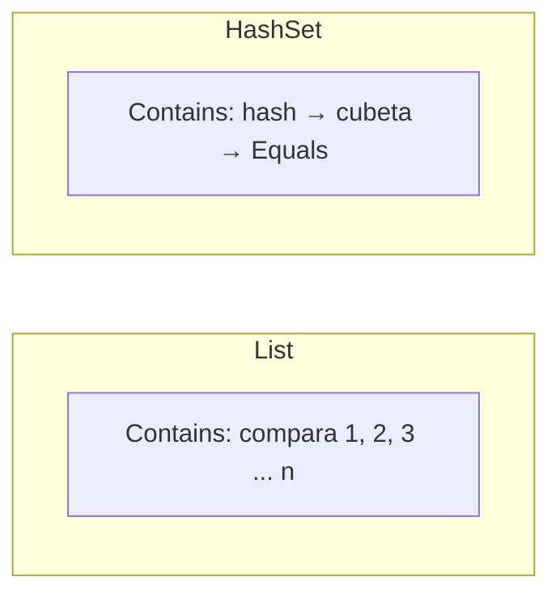

# HashSet de T

Parte de: [[Colecciones (List, Dictionary, HashSet, Queue, Stack)]]

> [!info] Cómo avanzar
> `progreso`: **pendiente** → **viendo** (estudiando) → **visto** (contestaste la autoevaluación sin abrir las respuestas) → **dominado** (hiciste el laboratorio o lo aplicaste de verdad).

## Contenido

### Qué es
`HashSet<T>` es un **conjunto**: guarda valores únicos, sin orden garantizado, y responde "¿este valor está?" en tiempo constante en promedio (O(1)). Sirve para eliminar duplicados, para verificar pertenencia muchas veces y para operaciones de teoría de conjuntos (unión, intersección, diferencia) sin escribir bucles anidados.

### Cómo funciona
Funciona como un [[Dictionary de TKey y TValue|Dictionary]] que solo tiene claves:
1. `Add(x)` calcula `x.GetHashCode()`, va a la cubeta correspondiente y compara con `Equals`.
2. Si ya existe un elemento igual, **no lo agrega y regresa `false`**; si no, lo agrega y regresa `true`. Ese `bool` es muy útil para detectar duplicados en una sola operación.
3. `Contains(x)` repite el cálculo del hash: no recorre la colección.

Comparado con `List<T>.Contains`, que revisa elemento por elemento (O(n)), la diferencia crece con el tamaño:



Si tienes 50 000 pedidos y para cada uno buscas su id en una lista de 50 000 ids, son del orden de 50 000 × 50 000 = 2 500 millones de comparaciones en el peor caso. Con un `HashSet` son unas 50 000 búsquedas de costo constante: pasar de segundos o minutos a milisegundos.

**Operaciones de conjuntos** (modifican el conjunto sobre el que se llaman):
| Método | Resultado |
|---|---|
| `UnionWith(otro)` | todos los elementos de ambos |
| `IntersectWith(otro)` | solo los comunes |
| `ExceptWith(otro)` | quita los que están en `otro` |
| `SymmetricExceptWith(otro)` | los que están en uno pero no en ambos |
| `IsSubsetOf`, `IsSupersetOf`, `Overlaps`, `SetEquals` | comparaciones, regresan `bool` |

### Ejemplo
Conciliar pagos contra pedidos (caso de Pochteca.Nomisma):
```csharp
List<Guid> idsPagados = await pagosSql.ListarIdsPagadosAsync(ct);   // 50 000 ids
List<Pedido> pedidos = await pedidosSql.ListarAsync(ct);             // 50 000 pedidos

// Mal: O(n·m)
// var pendientes = pedidos.Where(p => !idsPagados.Contains(p.Id)).ToList();

// Bien: O(n + m)
var pagados = new HashSet<Guid>(idsPagados);
var pendientes = pedidos.Where(p => !pagados.Contains(p.Id)).ToList();
```

Detectar duplicados al importar un Excel:
```csharp
var vistos = new HashSet<string>(StringComparer.OrdinalIgnoreCase);
foreach (var fila in filas)
{
    if (!vistos.Add(fila.Rfc))
        errores.Add($"Fila {fila.Numero}: RFC {fila.Rfc} repetido");
}
```

Permisos de un usuario (Xolotl.Hecate):
```csharp
var requeridos = new HashSet<string> { "egresos.leer", "egresos.crear" };
var delToken = new HashSet<string>(claims.Where(c => c.Type == "perm").Select(c => c.Value));

bool tieneTodos = requeridos.IsSubsetOf(delToken);
requeridos.ExceptWith(delToken);          // los que le faltan
Console.WriteLine(string.Join(", ", requeridos));
```

### Cuándo usarlo y cuándo no
- **Úsalo** cuando la pregunta principal es "¿está o no?", para deduplicar o para comparar conjuntos.
- **No** lo uses si necesitas orden de inserción o acceso por índice: usa `List<T>`. Si quieres los elementos ordenados, `SortedSet<T>`.
- Si además de la clave necesitas un valor asociado, usa `Dictionary`.
- Con LINQ, `Distinct()` crea internamente un conjunto; si vas a consultar pertenencia muchas veces, materializa tú el `HashSet` una vez (`ToHashSet()`).
- Para conjuntos fijos que se leen mucho (lista de extensiones permitidas), `FrozenSet<T>`.

### Errores comunes
- **Elementos con `Equals`/`GetHashCode` mal implementados**: dos objetos "iguales" de una clase normal se comparan por referencia, así que el set no detecta duplicados. Usa records o implementa ambos métodos (ver [[Igualdad por valor vs por referencia]]).
- **Modificar un elemento después de agregarlo** si su hash depende de propiedades mutables: queda en la cubeta equivocada.
- **Esperar un orden**: el orden de enumeración no está garantizado.
- **Olvidar el comparador para `string`**: "abc" y "ABC" serán distintos.

### Para profundizar
- [HashSet<T> (API)](https://learn.microsoft.com/dotnet/api/system.collections.generic.hashset-1)
- [Colecciones en .NET](https://learn.microsoft.com/dotnet/standard/collections/)
- [FrozenSet<T>](https://learn.microsoft.com/dotnet/api/system.collections.frozen.frozenset-1)

## Autoevaluación

Contesta primero en voz alta o en papel; luego despliega la respuesta.

> [!question]- ¿Para qué sirve un `HashSet<T>`?
> Para guardar elementos únicos con `Contains`/`Add` en O(1) promedio. `Add` regresa `false` si ya estaba.

> [!question]- ¿Qué operaciones de conjuntos ofrece?
> `UnionWith`, `IntersectWith`, `ExceptWith`, `IsSubsetOf`, `Overlaps`.

> [!question]- Tienes 50 000 ids y verificas en un bucle si cada pedido está en la lista. ¿Por qué cambiar `List.Contains` por `HashSet.Contains`?
> `List.Contains` es O(n) por llamada (O(n·m) total); `HashSet` es O(1) promedio, así el total baja a O(m).

## Práctica

- [[Lab 1 - Consola de inventario con colecciones y TryParse]]

