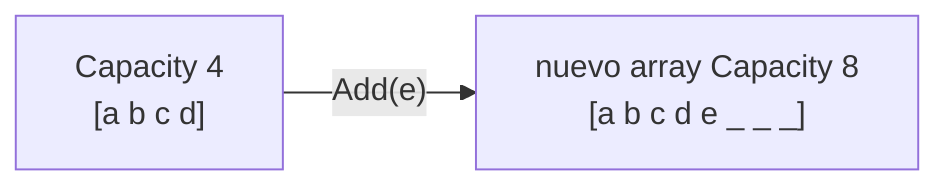

# List de T

Parte de: [[Colecciones (List, Dictionary, HashSet, Queue, Stack)]]

> [!info] Cómo avanzar
> `progreso`: **pendiente** → **viendo** (estudiando) → **visto** (contestaste la autoevaluación sin abrir las respuestas) → **dominado** (hiciste el laboratorio o lo aplicaste de verdad).

## Contenido

### Qué es
`List<T>` es la colección más usada en C#: una **secuencia ordenada** de elementos del mismo tipo, accesible por índice, que **crece automáticamente**. Por dentro es un array que se reemplaza por uno más grande cuando se llena. Es la opción por defecto cuando necesitas juntar elementos cuyo número no conoces de antemano.

### Cómo funciona
`List<T>` mantiene dos números:
- **`Count`**: cuántos elementos tiene de verdad.
- **`Capacity`**: cuántos caben en el array interno antes de tener que crecer.

Cuando haces `Add` y `Count == Capacity`, la lista crea un array nuevo del **doble** de tamaño, copia todo y descarta el viejo. Esa copia es O(n), pero como ocurre cada vez menos seguido, el costo **amortizado** de `Add` es O(1).



Costos de las operaciones clave:
| Operación | Costo | Por qué |
|---|---|---|
| `lista[i]` | O(1) | acceso directo al array |
| `Add(x)` | O(1) amortizado | a veces copia al crecer |
| `Insert(0, x)` | O(n) | recorre todos una posición a la derecha |
| `RemoveAt(0)` | O(n) | recorre todos a la izquierda |
| `RemoveAt(Count - 1)` | O(1) | no mueve nada |
| `Contains(x)` / `IndexOf(x)` | O(n) | búsqueda lineal |
| `Sort()` | O(n log n) | introsort |

Como el array interno es contiguo, recorrer una `List<T>` con `for` o `foreach` es muy rápido y amigable con la caché del procesador; es una de las razones por las que, en la práctica, gana a estructuras "teóricamente" mejores como `LinkedList<T>` en casi todos los casos.

**Capacidad inicial**: si sabes que vas a cargar unas 1 000 filas, `new List<T>(1000)` reserva desde el inicio y evita varias rondas de "crear array del doble y copiar", además de basura para el GC. `Capacity` nunca es menor que `Count`; `TrimExcess()` la ajusta si sobra mucho.

### Ejemplo
```csharp
public sealed record Egreso(Guid Id, string Concepto, decimal Monto);

// Leer filas de Excel con tamaño conocido (Wee.Reporteria)
var egresos = new List<Egreso>(capacity: hoja.FilasUsadas);
foreach (var fila in hoja.Filas)
{
    egresos.Add(new Egreso(Guid.CreateVersion7(), fila.Concepto, fila.Monto));
}

Console.WriteLine($"{egresos.Count} de {egresos.Capacity}");

// Collection expression (C# 12)
List<string> monedas = ["MXN", "USD"];
monedas.Add("EUR");

// Ordenar y filtrar
egresos.Sort((a, b) => b.Monto.CompareTo(a.Monto));     // descendente
egresos.RemoveAll(e => e.Monto <= 0);                    // quita en una pasada
Egreso? mayor = egresos.Count > 0 ? egresos[0] : null;

// Buscar muchas veces: no uses Contains en bucle; usa HashSet
var ids = egresos.Select(e => e.Id).ToHashSet();
```

Para quitar elementos mientras recorres, no uses `foreach` + `Remove` (lanza excepción); usa `RemoveAll` o un `for` de atrás hacia adelante:
```csharp
for (int i = egresos.Count - 1; i >= 0; i--)
    if (egresos[i].Concepto.Length == 0) egresos.RemoveAt(i);
```

**Consejo de lectura de código**: cuando veas `new List<T>()` seguido de un `foreach` que hace `Add`, pregúntate si cabe un `Select(...).ToList()`; y cuando veas `ToList()` en medio de una cadena de LINQ, pregúntate si realmente necesitas materializar ahí o si basta con seguir trabajando con `IEnumerable<T>`.

### Cuándo usarlo y cuándo no
- **Úsalo** para construir resultados, acumular elementos y cuando el acceso es secuencial o por índice.
- **No** lo uses para búsquedas frecuentes por valor (usa [[HashSet de T]] o [[Dictionary de TKey y TValue]]), ni para insertar/quitar al inicio constantemente (usa [[Queue y Stack de T|Queue]] o `LinkedList<T>`).
- **En contratos públicos** no expongas `List<T>`: regresa `IReadOnlyList<T>` para que el que llama no pueda modificarla (ver [[Encapsulamiento]] y [[Programar contra interfaces]]).
- Si el tamaño es fijo, un [[Arrays|array]] usa menos memoria.

### Errores comunes
- **`Contains` en un bucle sobre listas grandes**: O(n²) escondido.
- **`Insert(0, …)` repetido**: cada inserción mueve toda la lista.
- **Confundir `Count` con `Capacity`**: iterar hasta `Capacity` da `ArgumentOutOfRangeException`.
- **Modificar durante `foreach`**: `InvalidOperationException: Collection was modified`.
- **Compartir una `List<T>` entre hilos con escrituras**: no es segura; usa colecciones concurrentes o sincroniza.

### Para profundizar
- [List<T> (API)](https://learn.microsoft.com/dotnet/api/system.collections.generic.list-1)
- [Colecciones en .NET](https://learn.microsoft.com/dotnet/standard/collections/)
- [Collection expressions](https://learn.microsoft.com/dotnet/csharp/language-reference/operators/collection-expressions)

## Autoevaluación

Contesta primero en voz alta o en papel; luego despliega la respuesta.

> [!question]- ¿Qué costo tienen `Add`, `Insert(0, x)` y `Contains` en `List<T>`?
> `Add`: O(1) amortizado (duplica capacidad al llenarse). `Insert(0, x)`: O(n), recorre todo. `Contains`: O(n), búsqueda lineal.

> [!question]- ¿Para qué sirve pasar la capacidad inicial `new List<T>(1000)`?
> Evita las reasignaciones y copias internas cuando sabes cuántos elementos vas a agregar.

> [!question]- ¿Qué diferencia hay entre `Count` y `Capacity`?
> `Count` = elementos guardados. `Capacity` = espacio reservado en el array interno.

