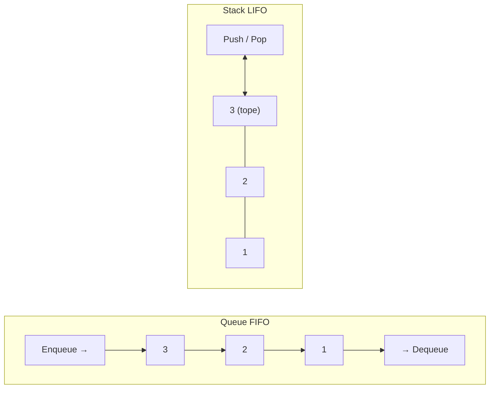

# Queue y Stack de T

Parte de: [[Colecciones (List, Dictionary, HashSet, Queue, Stack)]]

> [!info] Cómo avanzar
> `progreso`: **pendiente** → **viendo** (estudiando) → **visto** (contestaste la autoevaluación sin abrir las respuestas) → **dominado** (hiciste el laboratorio o lo aplicaste de verdad).

## Contenido

### Qué es
`Queue<T>` y `Stack<T>` son colecciones que **solo** permiten trabajar con un extremo, y por eso expresan muy bien la intención del código:
- **`Queue<T>` (cola, FIFO: *first in, first out*)**: el primero que entra es el primero que sale. Como la fila del banco: procesar trabajos en orden de llegada.
- **`Stack<T>` (pila, LIFO: *last in, first out*)**: el último que entra es el primero que sale. Como una pila de platos: deshacer la última acción, recorrer árboles en profundidad, evaluar expresiones.

Además existe `PriorityQueue<TElement, TPriority>` (desde .NET 6): sale primero el elemento con **menor** valor de prioridad, sin importar cuándo llegó.

### Cómo funciona
| | `Queue<T>` | `Stack<T>` |
|---|---|---|
| Agregar | `Enqueue(x)` al final | `Push(x)` arriba |
| Sacar | `Dequeue()` del frente | `Pop()` de arriba |
| Ver sin sacar | `Peek()` | `Peek()` |
| Versión segura | `TryDequeue`, `TryPeek` | `TryPop`, `TryPeek` |
| Vacía y llamas `Dequeue`/`Pop`/`Peek` | `InvalidOperationException` | `InvalidOperationException` |

Las dos usan un array interno: `Queue<T>` como **buffer circular** (índices de cabeza y cola que dan la vuelta) y `Stack<T>` como array que crece por el final. Todas las operaciones principales son O(1) (amortizado al crecer).



En la pila del ejemplo de la autoevaluación: se apilan 1, 2, 3; `Pop()` saca el 3 y el nuevo tope es 2, así que `Peek()` regresa **2**.

Fíjate en que ninguna de las dos permite acceso por índice ni quitar un elemento del medio: esa limitación es intencional. Si alguien lee `Queue<Trabajo>` en tu código, sabe de inmediato que el orden de llegada importa, cosa que una `List<Trabajo>` no comunica.

`PriorityQueue` usa un *heap* binario: `Enqueue` y `Dequeue` cuestan O(log n). No garantiza el orden entre elementos con la misma prioridad.

### Ejemplo
```csharp
// Cola: procesar archivos en orden de llegada
var pendientes = new Queue<string>();
pendientes.Enqueue("enero.xlsx");
pendientes.Enqueue("febrero.xlsx");

while (pendientes.TryDequeue(out var archivo))
{
    Console.WriteLine($"Procesando {archivo}");
}

// Pila: deshacer en un editor
var historial = new Stack<string>();
historial.Push("escribió 'Hola'");
historial.Push("borró línea 3");
if (historial.TryPop(out var ultima))
    Console.WriteLine($"Deshacer: {ultima}");    // borró línea 3

// Pila: validar paréntesis balanceados
static bool Balanceado(string s)
{
    var pila = new Stack<char>();
    foreach (var c in s)
    {
        if (c is '(' or '[') pila.Push(c);
        else if (c == ')' && (!pila.TryPop(out var a) || a != '(')) return false;
        else if (c == ']' && (!pila.TryPop(out var b) || b != '[')) return false;
    }
    return pila.Count == 0;
}

// Cola de prioridad: atender primero lo urgente (menor número = más urgente)
var tickets = new PriorityQueue<string, int>();
tickets.Enqueue("Cambiar logo", 3);
tickets.Enqueue("Caída de producción", 1);
tickets.Enqueue("Duda de reporte", 2);
while (tickets.TryDequeue(out var t, out var prioridad))
    Console.WriteLine($"{prioridad}: {t}");   // 1, 2, 3
```

### Cuándo usarlo y cuándo no
- **Queue**: procesamiento en orden, recorrido BFS de un grafo, buffers dentro de un solo hilo.
- **Stack**: deshacer/rehacer, DFS iterativo, parsers y validación de anidamiento.
- **PriorityQueue**: planificadores, algoritmo de Dijkstra, "los k más grandes", reintentos por fecha de siguiente intento.
- **No** los uses entre hilos: para productor/consumidor en una API usa `Channel<T>` (ver [[System.Threading.Channels]]) o `ConcurrentQueue<T>`, y para trabajos en segundo plano [[BackgroundService]].
- Si necesitas acceso por índice o quitar del medio, usa [[List de T]].

### Errores comunes
- **Llamar `Dequeue`/`Pop` sin verificar**: excepción con la colección vacía. Usa las variantes `Try`.
- **Confundir el orden**: `Stack` regresa los elementos al revés de como entraron, también al enumerarlos con `foreach`.
- **Suponer que `PriorityQueue` saca primero el número mayor**: saca el **menor**; para invertir pasa un `IComparer` o usa prioridades negativas.
- **Recorrer una `PriorityQueue` esperando orden**: no se puede hacer `foreach` directo sobre ella; su propiedad `UnorderedItems` sí se recorre, pero (como dice el nombre) sin orden de prioridad. Solo `Dequeue` respeta el orden.
- **Usar `List.RemoveAt(0)` como cola**: cada salida mueve toda la lista (O(n)).

### Para profundizar
- [Queue<T> (API)](https://learn.microsoft.com/dotnet/api/system.collections.generic.queue-1)
- [Stack<T> (API)](https://learn.microsoft.com/dotnet/api/system.collections.generic.stack-1)
- [PriorityQueue<TElement,TPriority> (API)](https://learn.microsoft.com/dotnet/api/system.collections.generic.priorityqueue-2)

## Ejercicios

Resuélvelos en papel o en la herramienta; la solución está plegada.

> [!question]- `var s = new Stack<int>(); s.Push(1); s.Push(2); s.Push(3); s.Pop();` ¿Qué da `s.Peek()`?
> `2`.

## Autoevaluación

Contesta primero en voz alta o en papel; luego despliega la respuesta.

> [!question]- ¿Qué diferencia hay entre `Queue<T>` y `Stack<T>`?
> `Queue` es FIFO (`Enqueue`/`Dequeue`): sale el primero que entró. `Stack` es LIFO (`Push`/`Pop`): sale el último.

> [!question]- ¿Qué pasa con `Dequeue()` en una cola vacía?
> Lanza `InvalidOperationException`. Usa `TryDequeue(out var x)`.

> [!question]- ¿Cuándo usarías `PriorityQueue<TElement,TPriority>`?
> Cuando debe salir primero el de menor prioridad, no el más antiguo (p. ej. reintentos programados por hora).

