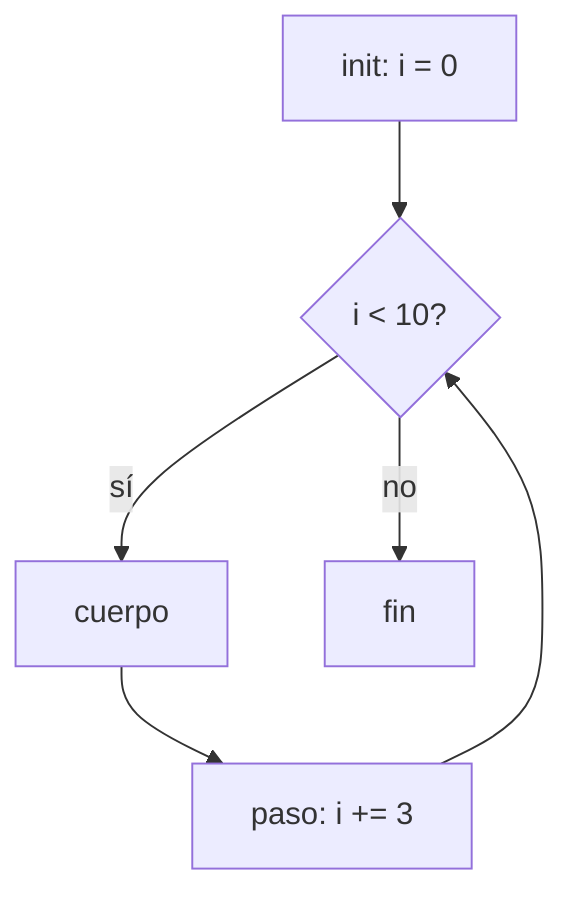

# Condicionales y bucles

Parte de: [[03-CSharp-DotNet/01 Básico/_Índice Básico|Básico]]

> [!info] Cómo avanzar
> `progreso`: **pendiente** → **viendo** (estudiando) → **visto** (contestaste la autoevaluación sin abrir las respuestas) → **dominado** (hiciste el laboratorio o lo aplicaste de verdad).

## Contenido

### Qué es
Las **condicionales** (`if`/`else`, `switch`) deciden qué camino toma el programa; los **bucles** (`for`, `foreach`, `while`, `do-while`) repiten un bloque. Junto con las instrucciones de salto (`break`, `continue`, `return`) son el control de flujo básico de cualquier programa en C#. Dominar sus detalles evita errores sutiles: bucles que se ejecutan una vez de más o de menos, o excepciones por modificar una colección mientras se recorre.

### Cómo funciona
**Condicionales**
- `if (condición) { ... } else if (...) { ... } else { ... }`: la condición debe ser `bool`; C# no convierte números a booleanos como C o JavaScript.
- `switch` como instrucción, con `case` y `break` (no hay "caída" implícita entre casos con código).
- `switch` como **expresión** (C# 8+), que regresa un valor y combina con *pattern matching*: ver [[switch expressions]] y [[Pattern matching]].
- El operador ternario `c ? a : b` para elegir entre dos valores.

**Bucles**
| Bucle | Evalúa la condición | Úsalo cuando |
|---|---|---|
| `for (init; cond; paso)` | antes de cada vuelta | necesitas el índice, saltos de N o recorrer al revés |
| `foreach (var x in col)` | — (usa el enumerador) | solo recorres cada elemento |
| `while (cond)` | antes | no sabes cuántas vueltas habrá |
| `do { } while (cond);` | **después** | el cuerpo debe ejecutarse al menos una vez |



Ejemplos de la autoevaluación razonados:
- `for (int i = 0; i < 10; i += 3)` toma los valores 0, 3, 6 y 9; con 12 la condición falla. Son **4** vueltas.
- `do { Console.Write(i); i++; } while (i < 5);` con `i = 5`: el cuerpo corre una vez (imprime `5`) y luego la condición es falsa.

**Saltos**
- `break`: sale del bucle (o del `switch`) por completo.
- `continue`: salta al siguiente ciclo, sin ejecutar el resto del cuerpo.
- `return`: sale del método.

**`foreach` y la modificación de la colección**: `foreach` usa un enumerador que lleva un número de versión de la colección. Si la colección cambia (`Add`, `Remove`) a mitad del recorrido, la siguiente llamada a `MoveNext()` lanza `InvalidOperationException: Collection was modified`.

### Ejemplo
```csharp
public sealed record Factura(string Folio, decimal Total, bool Cancelada);

List<Factura> facturas =
[
    new("A1", 1500m, false),
    new("A2", 0m, true),
    new("A3", 9800m, false),
];

decimal suma = 0;
foreach (var f in facturas)
{
    if (f.Cancelada) continue;           // ignora y sigue con la siguiente
    if (f.Total > 9000m)
    {
        Console.WriteLine($"Revisar {f.Folio}");
        break;                           // detiene todo el recorrido
    }
    suma += f.Total;
}

// for: recorrer al revés para poder quitar sin romper índices
for (int i = facturas.Count - 1; i >= 0; i--)
{
    if (facturas[i].Cancelada) facturas.RemoveAt(i);
}
// Más corto y claro:
facturas.RemoveAll(f => f.Cancelada);

// while: reintentos con límite
int intentos = 0;
bool ok = false;
while (!ok && intentos < 3)
{
    intentos++;
    ok = await EnviarAsync();
}

// do-while: pedir un dato hasta que sea válido (al menos una vez)
int cantidad;
do
{
    Console.Write("Cantidad: ");
} while (!int.TryParse(Console.ReadLine(), out cantidad) || cantidad <= 0);
```

### Cuándo usarlo y cuándo no
- Prefiere **`foreach`** para recorrer: es más legible y no tiene errores de índice.
- Usa **`for`** cuando necesitas el índice, recorrer al revés, avanzar de N en N o modificar elementos de un array por posición.
- Usa **cláusulas de guarda** (`if (x is null) return ...;`) al inicio en lugar de anidar muchos `if`.
- Cuando un `if/else` solo elige un valor, una **switch expression** o un ternario suele leerse mejor.
- Para transformar o filtrar colecciones, LINQ (`Where`, `Select`) expresa la intención mejor que un bucle manual; pero un bucle sencillo es más claro que una cadena de LINQ con efectos secundarios.

### Errores comunes
- **Salirse por uno** (`i <= lista.Count`): `ArgumentOutOfRangeException` en la última vuelta.
- **Quitar elementos dentro de `foreach`**: excepción. Recorre al revés con `for`, usa `RemoveAll` o arma una lista nueva.
- **Confundir `break` con `continue`**: `break` termina el bucle; `continue` solo salta la vuelta actual.
- **`while` sin cambio de estado**: bucle infinito. Asegúrate de que algo dentro del cuerpo acerque la condición a `false`.
- **Capturar la variable de un `for` en una lambda**: todas las lambdas ven el valor final de `i`. En `foreach` (desde C# 5) cada vuelta tiene su propia variable, en `for` no; copia a una variable local si la necesitas.

### Para profundizar
- [Instrucciones de selección (if, switch)](https://learn.microsoft.com/dotnet/csharp/language-reference/statements/selection-statements)
- [Instrucciones de iteración (for, foreach, while, do)](https://learn.microsoft.com/dotnet/csharp/language-reference/statements/iteration-statements)
- [Instrucciones de salto (break, continue, return)](https://learn.microsoft.com/dotnet/csharp/language-reference/statements/jump-statements)

## Ejercicios

Resuélvelos en papel o en la herramienta; la solución está plegada.

> [!question]- ¿Cuántas veces imprime? `for (int i = 0; i < 10; i += 3) Console.Write(i);`
> 4 veces: `0 3 6 9`.

> [!question]- ¿Qué imprime? `int i = 5; do { Console.Write(i); i++; } while (i < 5);`
> `5`. `do-while` ejecuta el cuerpo al menos una vez.

## Autoevaluación

Contesta primero en voz alta o en papel; luego despliega la respuesta.

> [!question]- ¿Qué pasa si haces `lista.Remove(x)` dentro de un `foreach` sobre esa misma lista?
> Lanza `InvalidOperationException` ("Collection was modified"). Usa `lista.RemoveAll(predicado)`, recorre una copia (`ToList()`) o un `for` hacia atrás.

> [!question]- ¿Cuándo usarías `for` en vez de `foreach`?
> Cuando necesitas el índice, recorrer al revés, saltar elementos o modificar posiciones de un array/lista. Para solo leer, `foreach` es más claro.

> [!question]- ¿Qué diferencia hay entre `break` y `continue`?
> `break` sale del bucle; `continue` salta a la siguiente iteración.

