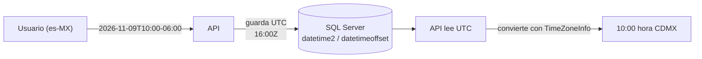

# DateTime vs DateTimeOffset

Parte de: [[03-CSharp-DotNet/01 Básico/_Índice Básico|Básico]]

> [!info] Cómo avanzar
> `progreso`: **pendiente** → **viendo** (estudiando) → **visto** (contestaste la autoevaluación sin abrir las respuestas) → **dominado** (hiciste el laboratorio o lo aplicaste de verdad).

## Contenido

### Qué es
.NET tiene dos tipos principales para un momento en el tiempo:
- **`DateTime`**: fecha y hora más una propiedad `Kind` que dice si es `Utc`, `Local` o `Unspecified`. **No guarda el desfase** respecto a UTC.
- **`DateTimeOffset`**: fecha y hora **más el desfase** (`-06:00`, `+00:00`). Representa un instante exacto sin ambigüedad.

Además existen `DateOnly` y `TimeOnly` (desde .NET 6) para fechas sin hora (fecha de nacimiento, fecha de un corte) y horas sin fecha (horario de apertura), y `TimeProvider` (desde .NET 8) para obtener la hora actual de forma que se pueda sustituir en pruebas.

### Cómo funciona
`DateTimeOffset` guarda dos datos: la hora "de reloj" y el offset. `2026-11-09T10:00:00-06:00` significa "las 10:00 en un lugar que va 6 horas detrás de UTC"; para pasarlo a UTC se **resta** el offset: 10:00 − (−6 h) = **16:00Z**. Dos `DateTimeOffset` se comparan por el instante, así que `10:00-06:00` y `16:00+00:00` son iguales.

Con `DateTime`, el `Kind` depende de cómo lo creaste:
- `DateTime.UtcNow` → `Utc`; `DateTime.Now` → `Local` (zona del servidor).
- `DateTime.Parse("2026-03-01")` → **`Unspecified`**: el texto no dice zona. Si luego llamas `ToUniversalTime()`, .NET supone que era hora local del servidor, y el resultado cambia según dónde corra el código.

**Diferencias de fechas**: restar dos fechas da un `TimeSpan`. Entre el 2026-02-20 y el 2026-03-02 hay **10 días** (2026 no es bisiesto, febrero tiene 28 días: 8 días hasta el 28 más 2 de marzo).

**Zonas horarias**: el offset no es lo mismo que la zona. La zona (por ejemplo `America/Mexico_City`) tiene reglas que cambian con el tiempo; desde finales de 2022 la Ciudad de México ya no aplica horario de verano y está en UTC−6 todo el año, pero algunos municipios fronterizos sí lo aplican. Por eso no "hardcodees" `-6`: usa `TimeZoneInfo`. En .NET 6 o posterior, `FindSystemTimeZoneById` acepta el id IANA (`America/Mexico_City`) también en Windows, además del id de Windows (`Central Standard Time (Mexico)`).



**Regla práctica**: guarda en la base **UTC** (`datetime2` con convención UTC) o `datetimeoffset`; convierte a la hora local del usuario solo al mostrar.

### Ejemplo
```csharp
// Handler que no depende del reloj real: recibe TimeProvider
public sealed class CerrarCorte(ICerrarCorteSql sql, TimeProvider reloj)
{
    private static readonly TimeZoneInfo ZonaCdmx =
        TimeZoneInfo.FindSystemTimeZoneById("America/Mexico_City");

    public async Task<Resultado> Handle(Guid corteId, CancellationToken ct)
    {
        DateTimeOffset ahoraUtc = reloj.GetUtcNow();             // instante exacto
        DateTimeOffset ahoraCdmx = TimeZoneInfo.ConvertTime(ahoraUtc, ZonaCdmx);
        DateOnly fechaDelCorte = DateOnly.FromDateTime(ahoraCdmx.DateTime);

        await sql.EjecutarAsync(new(corteId, ahoraUtc, fechaDelCorte), ct);
        return new Resultado(fechaDelCorte);
    }
}

// Convertir una fecha recibida con offset
var recibida = DateTimeOffset.Parse("2026-11-09T10:00:00-06:00",
    System.Globalization.CultureInfo.InvariantCulture);
Console.WriteLine(recibida.UtcDateTime.ToString("O"));        // 2026-11-09T16:00:00.0000000Z

// Diferencia en días
var dias = (new DateOnly(2026, 3, 2).DayNumber - new DateOnly(2026, 2, 20).DayNumber); // 10
```

En el registro de servicios: `builder.Services.AddSingleton(TimeProvider.System);`. En las pruebas inyectas un reloj fijo (`FakeTimeProvider` del paquete `Microsoft.Extensions.TimeProvider.Testing`); ver [[TimeProvider para probar fechas]].

### Cuándo usarlo y cuándo no
- **`DateTimeOffset`**: instantes que vienen o van a otros sistemas (APIs, JWT, auditoría, logs).
- **`DateTime` con `Kind = Utc`**: válido si todo tu sistema sigue la convención "siempre UTC" y la columna es `datetime2`.
- **`DateOnly`**: fechas de calendario sin hora (vencimientos, cortes, cumpleaños). Evita el clásico error de que "el 1 de marzo" se convierta en "28 de febrero 18:00" al pasarlo a UTC.
- **No** llames `DateTime.Now`/`UtcNow` directo en handlers: no puedes probar "qué pasa a las 23:59 del último día del mes" y el resultado depende de la zona del servidor (en Azure App Service suele ser UTC). Inyecta `TimeProvider`.

### Errores comunes
- **Guardar hora local del servidor**: al mover la app a Azure (UTC) los datos nuevos y viejos quedan desfasados 6 horas.
- **Parsear sin zona y luego convertir**: `Kind = Unspecified` se interpreta como local del servidor.
- **Usar offsets fijos en vez de zonas**: falla en los lugares que sí cambian de horario.
- **Comparar `DateTime` de distinto `Kind`**: la comparación ignora el `Kind` y compara los ticks, dando resultados incorrectos.
- **Formatear con la cultura actual al serializar**: usa el formato ISO 8601 (`"O"`) para intercambio.

### Para profundizar
- [Elegir entre DateTime, DateOnly, DateTimeOffset, TimeSpan, TimeOnly y TimeZoneInfo](https://learn.microsoft.com/dotnet/standard/datetime/choosing-between-datetime)
- [¿Qué es TimeProvider?](https://learn.microsoft.com/dotnet/standard/datetime/timeprovider-overview)
- [Convertir horas entre zonas horarias](https://learn.microsoft.com/dotnet/standard/datetime/converting-between-time-zones)
- [Estructura DateTimeOffset (API)](https://learn.microsoft.com/dotnet/api/system.datetimeoffset)

## Ejercicios

Resuélvelos en papel o en la herramienta; la solución está plegada.

> [!question]- Convierte `2026-11-09T10:00:00-06:00` a UTC.
> `2026-11-09T16:00:00Z`.

> [!question]- `DateTime.Parse("2026-03-01").Kind` ¿Cuál es?
> `Unspecified`.

> [!question]- ¿Cuántos días hay entre el 2026-02-20 y el 2026-03-02?
> 10 días (`(new DateOnly(2026,3,2).DayNumber - new DateOnly(2026,2,20).DayNumber)`; febrero 2026 tiene 28 días).

## Autoevaluación

Contesta primero en voz alta o en papel; luego despliega la respuesta.

> [!question]- ¿Qué diferencia hay entre `DateTime` y `DateTimeOffset`?
> `DateTime` guarda fecha y hora con un `Kind` (`Utc`, `Local`, `Unspecified`) pero no el desfase. `DateTimeOffset` guarda fecha, hora **y** desfase respecto a UTC, así que representa un instante sin ambigüedad.

> [!question]- ¿Qué guardas en la base: hora local o UTC?
> UTC (o `datetimeoffset` en SQL Server) y conviertes a la zona del usuario al mostrar. Guardar hora local sin zona produce errores si cambia el servidor o la regla de horario.

> [!question]- ¿Por qué no llamar `DateTime.Now` directamente en un handler?
> Porque no lo puedes controlar en pruebas y depende de la zona del servidor. Inyecta `TimeProvider` y usa `GetUtcNow()`.

> [!question]- ¿Cómo conviertes a hora de la Ciudad de México?
> `TimeZoneInfo.ConvertTime(instante, TimeZoneInfo.FindSystemTimeZoneById("America/Mexico_City"))`. Desde .NET 6 los ids IANA funcionan también en Windows. México dejó de usar horario de verano en 2022 (salvo zonas fronterizas).

## Práctica

- [[Lab 1 - Consola de inventario con colecciones y TryParse]]

