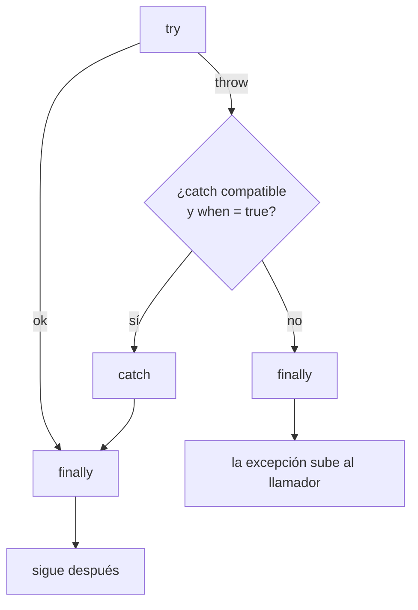

# Excepciones (try, catch, finally, throw)

Parte de: [[03-CSharp-DotNet/01 Básico/_Índice Básico|Básico]]

> [!info] Cómo avanzar
> `progreso`: **pendiente** → **viendo** (estudiando) → **visto** (contestaste la autoevaluación sin abrir las respuestas) → **dominado** (hiciste el laboratorio o lo aplicaste de verdad).

## Contenido

### Qué es
Una **excepción** es un objeto (que hereda de `System.Exception`) que representa un error ocurrido durante la ejecución. Cuando se lanza con `throw`, el flujo normal se interrumpe y el runtime busca hacia arriba en la pila de llamadas el primer `catch` compatible. Las excepciones sirven para situaciones **excepcionales**: algo que no debería pasar o que el código actual no puede resolver (la base de datos no responde, un archivo no existe, un argumento inválido que indica un bug).

### Cómo funciona
```csharp
try
{
    // código que puede fallar
}
catch (SqlException ex) when (ex.Number == 2627)   // filtro opcional
{
    // manejo específico
}
catch (Exception ex)
{
    // manejo general (pon los catch del más específico al más general)
}
finally
{
    // se ejecuta SIEMPRE: haya excepción, return o no
}
```

1. Se ejecuta el `try`. Si no hay error, se salta los `catch` y corre el `finally`.
2. Si hay una excepción, el runtime busca el primer `catch` cuyo tipo coincida **y** cuyo filtro `when` sea verdadero.
3. Corre el `catch` y luego el `finally`. Si ningún `catch` coincide, corre el `finally` y la excepción sigue subiendo.
4. Si llega hasta arriba sin manejar, el proceso termina (en ASP.NET Core la atrapa el middleware de errores y responde 500).



Por eso `try { Write("A"); throw new Exception(); } catch { Write("B"); } finally { Write("C"); } Write("D");` imprime **ABCD**: la excepción se manejó, así que la ejecución continúa.

**`finally` y `return`**: el `finally` corre incluso cuando el `try` hace `return`. En `int F() { try { return 1; } finally { Write("F"); } }`, el valor 1 se calcula, corre el `finally` (escribe `F`) y luego el método regresa. `Write(F())` imprime **F1**.

**`throw;` vs `throw ex;`**: dentro de un `catch`, `throw;` relanza la **misma** excepción conservando el *stack trace* original. `throw ex;` la relanza como si naciera en esa línea y pierdes dónde ocurrió realmente. Si quieres agregar contexto, envuelve: `throw new ImportacionException("Fila 12", ex);` (la original queda en `InnerException`).

**Filtros `when`**: se evalúan **antes** de desenrollar la pila. Si el filtro es falso, es como si el `catch` no existiera. Son ideales para distinguir por código de error: en SQL Server 2627 (violación de `UNIQUE`/`PRIMARY KEY`) y 2601 (índice único duplicado).

### Ejemplo
Registrar un usuario y traducir el duplicado a un error de negocio (Xolotl.Hecate):
```csharp
public sealed class RegistrarUsuario(IRegistrarUsuarioSql sql, ILogger<RegistrarUsuario> log)
{
    public async Task<Resultado> Handle(Comando cmd, CancellationToken ct)
    {
        try
        {
            await sql.EjecutarAsync(new(cmd.Correo, cmd.Nombre), ct);
            return Resultado.Ok();
        }
        catch (SqlException ex) when (ex.Number is 2627 or 2601)
        {
            // caso esperado: lo convertimos en un resultado, no en un 500
            return Resultado.Falla("USUARIO_DUPLICADO", "El correo ya está registrado.");
        }
        // cualquier otra excepción sube al manejador global (IExceptionHandler)
    }
}
```

Liberar recursos: `finally` es la base de `using`. Hoy casi nunca escribes `finally` a mano para eso:
```csharp
await using var conexion = new SqlConnection(cadena);   // Dispose garantizado
await conexion.OpenAsync(ct);
```

Validación de argumentos (bugs del programador):
```csharp
ArgumentNullException.ThrowIfNull(cmd);
ArgumentOutOfRangeException.ThrowIfNegativeOrZero(cmd.Cantidad);
```

### Cuándo usarlo y cuándo no
- **Excepciones**: fallas de infraestructura (BD caída, timeout), bugs (argumento nulo), estados imposibles. Deja que suban al manejador global, que las registra y responde un ProblemDetails 500 (ver [[Manejo global de errores (IExceptionHandler)]]).
- **Un tipo `Result`**: errores **esperados** del negocio (validación, duplicado, saldo insuficiente). Son parte del flujo normal, el llamador debe decidir qué hacer y lanzar excepciones para eso es caro y oculta el flujo.
- **No** uses excepciones para control de flujo normal (por ejemplo, `int.Parse` dentro de `try` para "probar" si es número: usa `TryParse`).
- Atrapa solo lo que **puedes manejar** de verdad en ese punto.

### Errores comunes
- **`catch (Exception) { }` vacío**: se traga el error, el sistema queda en estado inconsistente y no queda rastro en los logs. Si de verdad debes ignorar algo, atrapa el tipo específico y registra.
- **`throw ex;`**: pierdes el stack trace original. Usa `throw;`.
- **Atrapar `Exception` muy abajo**: impide que el manejador global haga su trabajo y duplica logs.
- **Lanzar `Exception` genérica**: usa tipos que digan qué pasó (`InvalidOperationException`, `ArgumentException`) o los tuyos.
- **Olvidar que `OperationCanceledException` es normal** cuando el cliente cancela: no la registres como error.

### Para profundizar
- [Excepciones y control de excepciones (C#)](https://learn.microsoft.com/dotnet/csharp/fundamentals/exceptions/)
- [Instrucciones de control de excepciones: throw, try-catch, try-finally](https://learn.microsoft.com/dotnet/csharp/language-reference/statements/exception-handling-statements)
- [Procedimientos recomendados para excepciones](https://learn.microsoft.com/dotnet/standard/exceptions/best-practices-for-exceptions)

## Ejercicios

Resuélvelos en papel o en la herramienta; la solución está plegada.

> [!question]- ¿Qué imprime? `try { Console.Write("A"); throw new Exception(); } catch { Console.Write("B"); } finally { Console.Write("C"); } Console.Write("D");`
> `ABCD`.

> [!question]- ¿Qué imprime? `int F() { try { return 1; } finally { Console.Write("F"); } } Console.Write(F());`
> `F1`: el `finally` se ejecuta antes de que el valor llegue al llamador.

## Autoevaluación

Contesta primero en voz alta o en papel; luego despliega la respuesta.

> [!question]- ¿Qué diferencia hay entre `throw;` y `throw ex;` dentro de un `catch`?
> `throw;` relanza conservando la pila original. `throw ex;` reinicia la traza en esa línea y pierdes dónde ocurrió el error.

> [!question]- ¿Para qué sirve un filtro `catch (SqlException ex) when (ex.Number == 2627)`?
> Atrapa solo el caso que te interesa (llave duplicada) sin desenrollar la pila para los demás. Útil para traducir errores de SQL a un `Result` de conflicto (409).

> [!question]- ¿Cuándo usarías excepciones y cuándo un `Result`?
> Excepción: lo inesperado (BD caída, bug). `Result`: fallas de negocio esperadas (validación, no encontrado, conflicto), que el handler regresa y el controller traduce a ProblemDetails con su `codigo`.

> [!question]- Error común: `catch (Exception) { }` vacío. ¿Por qué es grave?
> Oculta el error: no queda log ni evento en Sentry y el sistema sigue en un estado inconsistente. Si atrapas, registra y relanza, o maneja algo concreto.

## Práctica

- [[Lab 1 - Consola de inventario con colecciones y TryParse]]

