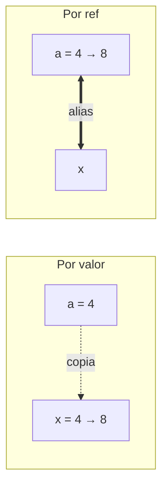

# Métodos y parámetros (ref, out, in, params)

Parte de: [[03-CSharp-DotNet/01 Básico/_Índice Básico|Básico]]

> [!info] Cómo avanzar
> `progreso`: **pendiente** → **viendo** (estudiando) → **visto** (contestaste la autoevaluación sin abrir las respuestas) → **dominado** (hiciste el laboratorio o lo aplicaste de verdad).

## Contenido

### Qué es
Un **método** es un bloque de código con nombre que recibe parámetros y opcionalmente regresa un valor. Por defecto, C# pasa los argumentos **por valor**: el método recibe una copia (del valor, si es un tipo de valor; de la referencia, si es un tipo de referencia). Los modificadores `ref`, `out` e `in` cambian eso para pasar **por referencia**, y `params` permite recibir un número variable de argumentos.

### Cómo funciona
| Modificador | ¿Debe estar asignado antes de llamar? | ¿El método puede modificarlo? | ¿El método debe asignarlo? |
|---|---|---|---|
| (ninguno) | sí | modifica solo su copia | no |
| `ref` | sí | sí, y el llamador ve el cambio | no |
| `out` | no | sí | **sí, antes de regresar** |
| `in` | sí | **no** (solo lectura) | no |
| `ref readonly` (C# 12) | sí | no | no |

- **`ref`**: el parámetro es un alias de la variable del llamador. En `void F(ref int x) => x *= 2;` con `a = 4`, la primera llamada deja `a = 8` y la segunda `a = 16`.
- **`out`**: sirve para "regresar" valores extra. El compilador obliga a asignarlo en todos los caminos: `void G(out int x) { }` **no compila** (error CS0177). En el llamador se puede declarar en línea: `int.TryParse(s, out var n)`.
- **`in`**: pasa por referencia pero de solo lectura. Su utilidad real es evitar copiar **structs grandes**; para un `int` no aporta nada.
- **`params`**: el último parámetro puede recibir cero o más argumentos sueltos: `Sumar(1, 2, 3)`. Tradicionalmente es un array (`params int[]`); desde C# 13 también puede ser `params ReadOnlySpan<T>`, `params IEnumerable<T>` u otros tipos de colección, lo que evita crear un array en cada llamada.



**Formas de cuerpo**: `int Doble(int x) => x * 2;` (cuerpo de expresión) o con llaves y `return`. Los métodos se pueden **sobrecargar** (mismo nombre, distintos parámetros) y existen **funciones locales** dentro de otro método.

### Ejemplo
```csharp
// out: el patrón Try
public static bool TryLeerFolio(string texto, out int folio)
{
    folio = 0;
    if (!texto.StartsWith("F-")) return false;
    return int.TryParse(texto.AsSpan(2), out folio);
}

if (TryLeerFolio("F-120", out var f)) Console.WriteLine(f);   // 120

// ref: intercambiar (aunque con tuplas es más simple: (a, b) = (b, a))
static void Intercambiar(ref int a, ref int b) => (a, b) = (b, a);

// in: struct grande sin copiar
public readonly record struct Matriz4(double M11, double M12, /* ... */ double M44);
static double Traza(in Matriz4 m) => m.M11 + m.M44;

// params moderno (C# 13): sin array intermedio
static decimal Sumar(params ReadOnlySpan<decimal> montos)
{
    decimal total = 0;
    foreach (var m in montos) total += m;
    return total;
}
Console.WriteLine(Sumar(10m, 20m, 30.5m));   // 60.5
```

**Varios resultados**: en código moderno, en lugar de `void Calcular(out decimal subtotal, out decimal iva, out decimal total)` se prefiere regresar una tupla con nombre o un record:
```csharp
public sealed record Totales(decimal Subtotal, decimal Iva, decimal Total);

static Totales Calcular(IEnumerable<decimal> partidas)
{
    var subtotal = partidas.Sum();
    var iva = Math.Round(subtotal * 0.16m, 2);
    return new(subtotal, iva, subtotal + iva);
}
var (sub, iva, total) = Calcular([100m, 250m]);
```
Se lee mejor, se puede deconstruir, funciona con `async` (los métodos `async` **no** pueden tener parámetros `ref`/`out`) y es fácil de comparar en pruebas.

### Cuándo usarlo y cuándo no
- **`out`**: el patrón `TryXxx` (regresa `bool` y el valor por `out`). Fuera de eso, prefiere tuplas o records.
- **`ref`**: código de bajo nivel o de alto rendimiento; en código de negocio casi nunca.
- **`in` / `ref readonly`**: structs grandes en rutas calientes.
- **`params`**: métodos de utilidad que naturalmente reciben listas cortas (`Path.Combine`, `string.Concat`, loggers).
- Para muchos parámetros opcionales, ver [[Parámetros opcionales y nombrados]].

### Errores comunes
- **Pensar que pasar un objeto "por valor" lo copia**: se copia la referencia; el método puede modificar el objeto, pero no reemplazar la variable del llamador (ver [[Tipos de valor y de referencia]]).
- **Usar `out` para varios resultados**: ensucia la firma y no funciona con `async`.
- **Usar `in` con tipos pequeños o structs no `readonly`**: el compilador puede hacer copias defensivas y el beneficio desaparece.
- **Olvidar `ref`/`out` en la llamada**: deben escribirse también al llamar (`F(ref a)`), lo que hace visible el efecto.

### Para profundizar
- [Parámetros de métodos (ref, out, in, params)](https://learn.microsoft.com/dotnet/csharp/language-reference/keywords/method-parameters)
- [Métodos en C#](https://learn.microsoft.com/dotnet/csharp/methods)
- [Funciones locales](https://learn.microsoft.com/dotnet/csharp/programming-guide/classes-and-structs/local-functions)

## Ejercicios

Resuélvelos en papel o en la herramienta; la solución está plegada.

> [!question]- ¿Cuánto vale `a`? `void F(ref int x) => x *= 2; int a = 4; F(ref a); F(ref a);`
> `16`.

> [!question]- ¿Compila `void G(out int x) { }`?
> No: un parámetro `out` debe asignarse antes de salir (error CS0177).

## Autoevaluación

Contesta primero en voz alta o en papel; luego despliega la respuesta.

> [!question]- ¿Qué diferencia hay entre `ref`, `out` e `in`?
> `ref`: el argumento debe llegar inicializado y el método puede leerlo y cambiarlo. `out`: puede llegar sin valor y el método **debe** asignarlo (ej. `TryParse`). `in`: se pasa por referencia pero de solo lectura (útil con structs grandes).

> [!question]- ¿Para qué sirve `params`?
> Permite llamar con una cantidad variable de argumentos: `Sumar(1, 2, 3)`. Desde C# 13 acepta colecciones como `params ReadOnlySpan<int>`, que evita crear un array.

> [!question]- ¿Por qué en código moderno se prefiere regresar una tupla o un record en vez de varios `out`?
> Es más legible, funciona con `async` (los métodos async no admiten `ref`/`out`) y se puede deconstruir: `var (ok, valor) = Intentar();`. `out` se reserva para el patrón `TryXxx`.

