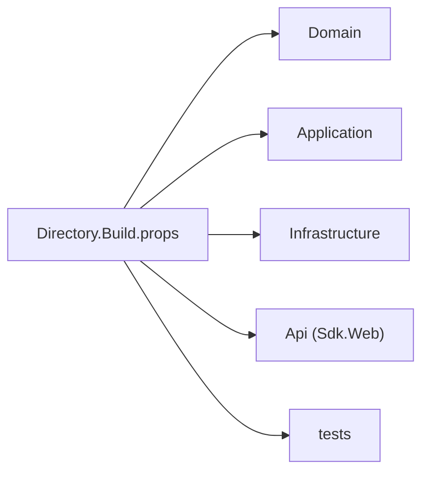

---
aliases:
  - .NET y C#
proyecto:
  - Ocelotl.Hermes
  - Itzamna.Dionisio
proyectos:
  - "[[Ocelotl.Hermes]]"
  - "[[Itzamna.Dionisio]]"
tipo: tecnologia
nivel: intermedio
estado: completo
tags:
  - conocimiento
  - backend
  - dotnet
  - csharp
progreso: pendiente
area: C# y .NET
---
# .NET y C#

> Plataforma y lenguaje con los que está escrito [[Ocelotl.Hermes]]: net10.0 con C# `latest`, `Nullable` e `ImplicitUsings` activados para toda la solución.

> [!note] Nombre del archivo
> El nombre canónico es ".NET y C#", pero Obsidian no indexa archivos que empiezan con punto; por eso el archivo se llama `NET y C#.md` y lleva el alias `.NET y C#`.

## Qué es y qué problema resuelve
**.NET** es el runtime y la biblioteca base multiplataforma de Microsoft; **C#** es su lenguaje principal. Juntos permiten escribir servicios de alto rendimiento (HTTP, tareas en segundo plano, acceso a datos) con tipado estático, `async/await` nativo y un ecosistema de paquetes NuGet.

En Ocelotl resuelve la necesidad de un **backend local** que vive dentro de la PC de la farmacia, se lanza desde Electron, habla con los robots BD Rowa (cuyo SDK es una DLL .NET) y con [[Argo]] por HTTP.

## Cómo funciona por dentro
- **SDK y TargetFramework**: cada `.csproj` declara un SDK (`Microsoft.NET.Sdk` o `Microsoft.NET.Sdk.Web` para la API). El framework destino (`net10.0`) define qué APIs hay disponibles.
- **Directory.Build.props**: MSBuild lo importa automáticamente en todos los proyectos bajo esa carpeta; así se centralizan opciones comunes.
- **Nullable reference types**: con `Nullable=enable` el compilador distingue `string` de `string?` y avisa de posibles `null`.
- **ImplicitUsings**: agrega `using` globales (System, System.Linq, System.Threading.Tasks…) según el SDK.
- **Características de C# moderno usadas en Hermes**:
  - `record` (tipos inmutables con igualdad por valor) para comandos, resultados y eventos.
  - **Primary constructors** en clases (`class Handler(IRobotConexiones robots)`): los parámetros quedan disponibles en todo el cuerpo, ideal para inyección de dependencias.
  - **Pattern matching**: `switch` de expresiones, patrones de propiedad (`{ Permitido: true, Datos: { } datos }`), patrones relacionales (`is > 0`, `is < 1 or > LimiteMaximo`).
  - **Collection expressions** (`[]`), **raw string literals** (`"""`; el SQL ya no va en C#, ver [[SQL en archivos con una interfaz por consulta]]), `System.Threading.Lock`, `Guid.CreateVersion7()`, `TimeProvider`.



## Cuándo usarla y cuándo no
### Ventajas
- Rendimiento alto y un solo ejecutable (`Ocel.Hermes.API.exe`) que Electron puede lanzar.
- Interoperabilidad directa con el SDK de Rowa (DLLs .NET) sin puentes.
- Tipado fuerte + nullable: muchos errores aparecen al compilar.
- `async/await`, `CancellationToken` y `TimeProvider` integrados en toda la biblioteca base.
### Desventajas
- Tamaño de despliegue mayor que un script Node/Python.
- Curva de aprendizaje del ecosistema (MSBuild, DI, hosting).
- Parte del SDK de Rowa (simuladores) depende de WinForms, solo Windows (ver `Ocelotl.Hermes.Integration.Tests.csproj`).

## Alternativas
| Alternativa | En qué se diferencia |
|---|---|
| Node.js (TypeScript) | Mismo lenguaje que [[Ocelotl.Iris]], pero sin acceso directo a las DLL .NET de Rowa. |
| Java / Kotlin (JVM) | Ecosistema similar en madurez; no interopera con el SDK .NET de Rowa. |
| Go | Binarios pequeños y simples; sin biblioteca para WWKS2/Rowa. |
| .NET Framework 4.x | Solo Windows, sin las APIs modernas (Minimal APIs, `TimeProvider`, C# reciente). |

## Cómo se usó en Ocelotl
En [[Ocelotl.Hermes]] toda la solución (Domain, Application, Infrastructure, Api y tests) comparte configuración vía `Directory.Build.props`: net10.0, `Nullable`, `ImplicitUsings`, `LangVersion latest` y la ruta a las DLL de Rowa (`RowaLibDir`). La arquitectura se describe en [[Ocelotl.Hermes - Arquitectura]].

`Ocelotl.Hermes/Directory.Build.props`:
```xml
<Project>
  <PropertyGroup>
    <TargetFramework>net10.0</TargetFramework>
    <Nullable>enable</Nullable>
    <ImplicitUsings>enable</ImplicitUsings>
    <LangVersion>latest</LangVersion>
    <TreatWarningsAsErrors>false</TreatWarningsAsErrors>
    <!-- Carpeta con las DLL del SDK de BD Rowa (WWKS2). -->
    <RowaLibDir>$(MSBuildThisFileDirectory)lib\Rowa\</RowaLibDir>
  </PropertyGroup>
</Project>
```

Cada slice usa `record` para la entrada/salida y un primary constructor en el `Handler` (`Ocelotl.Hermes/src/Ocelotl.Hermes.Application/Features/Conexion/Conectar.cs`):
```csharp
public sealed record Command(string IpAddress, ushort? Puerto);

public sealed class Handler(IRobotConexiones robots)
{
    public async Task<Result> Handle(Command command, CancellationToken ct)
    {
        var ip = Validar.DireccionIp(command.IpAddress);
        var puerto = command.Puerto is > 0 ? command.Puerto.Value : PuertoPorDefecto;
        var resultado = await robots.ConectarAsync(ip, puerto, ct);
```

Pattern matching con `switch` de expresiones para traducir tipos del SDK (`Ocelotl.Hermes/src/Ocelotl.Hermes.Infrastructure/Robot/RowaMapeos.cs`):
```csharp
public static EstadoRobot Estado(bool conectado, ComponentState estado) =>
    !conectado ? EstadoRobot.Desconectado : estado switch
    {
        ComponentState.Ready => EstadoRobot.Listo,
        ComponentState.NotReady => EstadoRobot.NoListo,
        _ => EstadoRobot.Desconectado,
    };
```

Los eventos de dominio son `record` que implementan `IEventoRobot` (`Domain/Eventos/EventosRobot.cs`) y las decisiones de ingreso son una jerarquía cerrada `abstract record DecisionPack` con `Permitir` / `Rechazar` (`Domain/Operaciones/PackEntrante.cs`), consumida con `switch` en `RowaInputHandler` (ver [[Ingresos]]).

> [!tip] Reutilizable
> El `Directory.Build.props` con `Nullable`, `ImplicitUsings` y `LangVersion` centralizados, y el uso de `TimeProvider` inyectado en lugar de `DateTime.Now` (para poder fijar el reloj en pruebas), sirven igual en cualquier solución .NET.


## Cómo se usó en Itzamna
[[Itzamna.Dionisio]] usa la misma base que Hermes: `net10.0`, `Nullable`, `ImplicitUsings`, `LangVersion latest` y `TreatWarningsAsErrors=false` en `Itzamna.Dionisio/Directory.Build.props` (más `NoWarn CS1591` para no exigir comentarios XML). `global.json` fija el SDK `10.0.100` con `rollForward: latestFeature`; el pipeline instala `10.0.x` ([[Azure Pipelines]]). La solución usa el formato nuevo **`.slnx`** (`Itzamna.Dionisio.slnx`).

Características de C# moderno que se ven en el código:
- **Primary constructors** en handlers, middleware y el `DbContext`: `public sealed class AppDbContext(DbContextOptions<AppDbContext> options, ITenantContext tenant, ICurrentUser user) : DbContext(options), IAppDbContext`.
- **Records** para comandos/consultas y DTOs (`public sealed record RestoreVersionCommand(int Version) : IRequest<PublishResultDto>;`), y `readonly record struct Unit`.
- **Interfaz sin cuerpo con `;`**: `public interface IRequest<TResponse>;`.
- **Switch de expresiones con patrones de tipo** en `AppExceptionHandler` ([[ProblemDetails]]) y patrones de propiedad (`t is { IsClass: true, IsAbstract: false }`, `r.Id is { } id`, `i.Key is "profile" or "photo" or "contact"`).
- **Collection expressions** (`[480, 960, 1600, 2400]`, `= []`), rangos (`a.Variants[^1]`, `p[1..]`).
- **`Guid.CreateVersion7()`** como id de todas las entidades (ordenable por tiempo, mejor para índices que `NewGuid`).
- **`ReadOnlySpan<byte>`** para leer la firma de bytes de un archivo sin copiar (`MediaRules.SniffMime`).
- **Clases `partial`** con `GeneratedRegex` en `PortfolioSnapshotBuilder` (`sealed partial class`).
- `public partial class Program { }` al final de `Program.cs` (típico para pruebas con `WebApplicationFactory`, que todavía no existen; ver [[xUnit]]).

Ejemplo (`Itzamna.Dionisio/src/Itzamna.Dionisio.Application/Features/Media/MediaFeatures.cs`):
```csharp
/// <summary>Tipo real según la firma de bytes. Nunca se confía en la extensión ni en el MIME declarado.</summary>
public static string? SniffMime(ReadOnlySpan<byte> h)
{
    if (h.Length >= 3 && h[0] == 0xFF && h[1] == 0xD8 && h[2] == 0xFF) return "image/jpeg";
    if (h.Length >= 8 && h[0] == 0x89 && h[1] == 0x50 && h[2] == 0x4E && h[3] == 0x47) return "image/png";
    if (h.Length >= 4 && h[0] == 0x1A && h[1] == 0x45 && h[2] == 0xDF && h[3] == 0xA3) return "video/webm";
    return null;
}
```
(Recortado: el original también detecta WebP y MP4.)

A diferencia de Hermes, Dionisio no inyecta `TimeProvider`: usa `DateTime.UtcNow` directo (auditoría, publicación, `SoftDelete`), lo que dificulta fijar el reloj en pruebas.

> [!note] Pendiente de confirmar
> Convención de `.ai/02_CONVENTIONS.md`: "records para DTOs, handlers `sealed`". No vi una regla sobre `DateTime.UtcNow` vs `TimeProvider`; si se agregan pruebas de handlers, convendría decidirlo.

## Errores comunes y buenas prácticas
- Ignorar las advertencias de nullable: en Hermes `TreatWarningsAsErrors` está en `false`, así que conviene revisarlas igual.
- Usar `DateTime.Now` directo: Hermes inyecta `TimeProvider` (`services.AddSingleton(TimeProvider.System)`) y en pruebas usa `RelojFijo`.
- `async void`: el antiguo `InputObserver` lo usaba y una excepción tumbaba el proceso (comentario en `RowaInputHandler.cs`). Preferir `Task` y atrapar errores.
- Records con colecciones: la igualdad por valor no compara el contenido de listas.
- Mantener el dominio sin dependencias externas (`Ocelotl.Hermes.Domain.csproj` está vacío a propósito).

## Qué estudiar después
- [[ASP.NET Core Controllers]], [[Inyección de dependencias]], [[Options pattern]]
- [[BackgroundService]], [[System.Threading.Channels]]
- [[xUnit]]
- [[Clean Architecture]], [[Vertical Slice Architecture]]
- Nullable reference types en profundidad, `async`/`await` y `CancellationToken`.

## Documentación oficial
- https://learn.microsoft.com/dotnet/
- https://learn.microsoft.com/dotnet/csharp/
- https://learn.microsoft.com/dotnet/csharp/whats-new/
- https://learn.microsoft.com/visualstudio/msbuild/customize-by-directory

## Autoevaluación

Contesta primero en voz alta o en papel; luego despliega la respuesta.

> [!question]- ¿Qué relación hay entre C#, .NET, el CLR y la BCL?
> C# es el **lenguaje**; el compilador (Roslyn) lo convierte a **IL**. El **CLR** es el runtime que carga ese IL, lo compila a código máquina (JIT), administra la memoria (GC) y la seguridad de tipos. La **BCL** es la biblioteca base (`System.*`). .NET es la plataforma completa: runtime + bibliotecas + SDK y herramientas.

> [!question]- Tus APIs están en .NET 10. ¿Qué significa que sea una versión LTS y por qué importa para un proyecto de cliente?
> LTS = soporte de largo plazo (3 años de parches); las versiones STS duran menos. Para APIs que van a producción y se mantienen años conviene quedarse en LTS y actualizar de LTS a LTS, aplicando los parches mensuales del runtime.

> [!question]- ¿Qué ganas al fijar `<Nullable>enable</Nullable>` y `<TreatWarningsAsErrors>true</TreatWarningsAsErrors>` en todos tus proyectos?
> Que el compilador te avise (y frene el build) cuando un valor puede ser `null` y no lo validas, y que ningún warning se acumule. Se pone una sola vez en `Directory.Build.props` para que aplique a toda la solución.

> [!question]- Error común: "C# es interpretado porque corre sobre una máquina virtual". ¿Por qué es falso?
> El IL se compila a código nativo con el **JIT** al ejecutarse (y con tiered compilation se recompila optimizado). Además existe ReadyToRun y **Native AOT**, que compilan a nativo antes de ejecutar. No hay un intérprete línea por línea.

