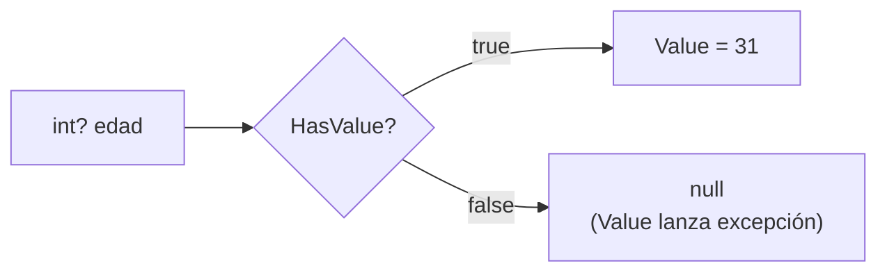

# Nullable de valor (Nullable de int)

Parte de: [[03-CSharp-DotNet/01 Básico/_Índice Básico|Básico]]

> [!info] Cómo avanzar
> `progreso`: **pendiente** → **viendo** (estudiando) → **visto** (contestaste la autoevaluación sin abrir las respuestas) → **dominado** (hiciste el laboratorio o lo aplicaste de verdad).

## Contenido

### Qué es
Los tipos de valor (`int`, `decimal`, `bool`, `DateTime`, structs) **siempre tienen un valor**: un `int` sin asignar es `0`, nunca `null`. A veces necesitas representar "no hay dato": una columna `NULL` en SQL Server, un filtro opcional en una consulta, una fecha de cancelación que aún no ocurre. Para eso existe **`Nullable<T>`**, que se escribe abreviado **`T?`**: `int?`, `decimal?`, `DateTime?`.

### Cómo funciona
`int?` es un struct `Nullable<int>` con dos campos: `HasValue` (`bool`) y `Value` (`int`). Sigue siendo un **tipo de valor**; no hay objeto en el heap.

- `HasValue` indica si hay dato.
- `Value` regresa el dato o lanza **`InvalidOperationException`** si `HasValue` es `false`.
- `GetValueOrDefault()` regresa el dato o `default(T)` (0 para `int`); `GetValueOrDefault(x)` regresa `x` si no hay dato.
- `a ?? b` regresa `a` si tiene valor, si no `b`: con `int? a = 5`, `int c = a ?? -1` vale **5**.

**Operadores "elevados" (lifted)**: los operadores aritméticos y de comparación funcionan con nullables con estas reglas:
| Expresión | Resultado si `a` es `null` |
|---|---|
| `a + 1`, `a * 2` | `null` (cualquier operando null → null) |
| `a > 0`, `a < 0`, `a >= 0`, `a <= 0` | **`false`** |
| `a == null` | `true` |
| `a != 0` | `true` |

Así, con `int? a = null`: `a + 1` es `null`, `a > 0` es `false` **y** `a <= 0` también es `false`. Esto rompe la intuición de que "si no es mayor, es menor o igual". Es la misma lógica de tres valores de SQL, donde comparar con `NULL` no es verdadero.

**Diferencia con `string?`**: `int?` es un tipo distinto en ejecución (`Nullable<int>`), con `HasValue`/`Value`. `string?` es **el mismo tipo `string`**; el `?` es solo una anotación para el análisis del compilador (ver [[null y nullable reference types]]). Por eso `string?` no tiene `.Value`.



### Ejemplo
Filtros opcionales en una consulta con Dapper y un procedimiento almacenado (Itzamna.Dionisio):
```csharp
public sealed record ListarEgresosQuery(
    DateOnly? Desde,
    DateOnly? Hasta,
    decimal? MontoMinimo,
    int Pagina = 1);

public sealed record EgresoItem(Guid Id, string Concepto, decimal Monto, DateTime? CanceladoUtc);

// Dapper envía null como DBNull automáticamente
var filas = await conexion.QueryAsync<EgresoItem>(
    sql.Texto,                       // contenido de ListarEgresos.sql
    new { q.Desde, q.Hasta, q.MontoMinimo, q.Pagina },
    commandType: CommandType.Text);

foreach (var e in filas)
{
    // Pattern matching: la forma más clara de leer un nullable
    if (e.CanceladoUtc is DateTime cancelado)
        Console.WriteLine($"{e.Concepto} cancelado el {cancelado:yyyy-MM-dd}");

    string estado = e.CanceladoUtc.HasValue ? "Cancelado" : "Vigente";
}
```
En el `.sql`, el patrón típico para filtros opcionales:
```sql
SELECT Id, Concepto, Monto, CanceladoUtc
FROM dbo.Egreso
WHERE (@Desde IS NULL OR Fecha >= @Desde)
  AND (@MontoMinimo IS NULL OR Monto >= @MontoMinimo);
```

Más formas de consumir un `int?`:
```csharp
int? stock = ObtenerStock();
int seguro = stock ?? 0;                      // valor por defecto
int otro = stock.GetValueOrDefault();         // igual: 0 si es null
if (stock is > 0) Console.WriteLine("Hay");   // false si es null o <= 0
```

### Cuándo usarlo y cuándo no
- **Úsalo** cuando "no hay dato" es distinto de cero o de falso: columnas `NULL`, campos opcionales de una petición, valores aún no calculados.
- En **DTOs de entrada** de una API, `int?` permite distinguir "no lo mandaron" de "mandaron 0", útil para validar con FluentValidation (`NotNull()`).
- **No** lo uses "por si acaso": si un valor siempre debe existir, deja el tipo no anulable y el compilador te ayuda.
- Para tipos de referencia usa las anotaciones de [[null y nullable reference types]]; para operar con nulls, [[Operadores de null en CSharp]].

### Errores comunes
- **Leer `.Value` sin verificar**: `InvalidOperationException: Nullable object must have a value`.
- **Suponer que `!(a > 0)` implica `a <= 0`**: con `null` ambos son falsos.
- **Sumar nullables y obtener `null` sin querer**: `total += partida.Descuento;` deja `total` en `null` si algún descuento es null; usa `?? 0`.
- **Mapear una columna `NULL` a `int`** en Dapper: el valor por defecto oculta el null o falla; usa `int?` en el record.

### Para profundizar
- [Tipos de valor que aceptan valores NULL (referencia de C#)](https://learn.microsoft.com/dotnet/csharp/language-reference/builtin-types/nullable-value-types)
- [Estructura Nullable<T> (API)](https://learn.microsoft.com/dotnet/api/system.nullable-1)
- [Operadores ?? y ??=](https://learn.microsoft.com/dotnet/csharp/language-reference/operators/null-coalescing-operator)

## Ejercicios

Resuélvelos en papel o en la herramienta; la solución está plegada.

> [!question]- `int? a = null; int? b = a + 1;` ¿Cuánto vale `b`?
> `null`. Los operadores "elevados" propagan null.

> [!question]- `int? a = null; bool r = a > 0;` ¿Cuánto vale `r`? ¿Y `a <= 0`?
> Ambos `false`: una comparación con null siempre da `false`.

> [!question]- `int? a = 5; int c = a ?? -1;` ¿Cuánto vale `c`?
> `5`.

## Autoevaluación

Contesta primero en voz alta o en papel; luego despliega la respuesta.

> [!question]- ¿Qué es `int?`?
> Azúcar para `Nullable<int>`: un struct con `HasValue` y `Value`. Permite representar "sin valor", p. ej. una columna `INT NULL` de SQL.

> [!question]- ¿Qué pasa al leer `.Value` cuando no hay valor?
> Lanza `InvalidOperationException`. Usa `x ?? 0`, `x.GetValueOrDefault()` o `if (x is int v)`.

> [!question]- ¿Qué diferencia hay entre `int?` y `string?`?
> `int?` es un tipo **distinto** (`Nullable<int>`) que existe en tiempo de ejecución. `string?` es la misma `string` con una anotación para el compilador (nullable reference types).

