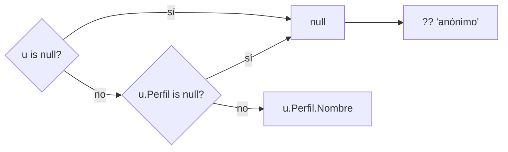

# Operadores de null en CSharp

Parte de: [[03-CSharp-DotNet/01 Básico/_Índice Básico|Básico]]

> [!info] Cómo avanzar
> `progreso`: **pendiente** → **viendo** (estudiando) → **visto** (contestaste la autoevaluación sin abrir las respuestas) → **dominado** (hiciste el laboratorio o lo aplicaste de verdad).

## Contenido

### Qué es
C# tiene un grupo de operadores pensados para trabajar con valores que pueden ser `null` sin llenar el código de `if (x != null)`:
- **`?.` y `?[]`** (null-conditional): accede a un miembro o índice solo si el objeto no es `null`; si lo es, toda la expresión da `null`.
- **`??`** (null-coalescing): regresa el operando izquierdo si no es `null`; si no, el derecho.
- **`??=`** (null-coalescing assignment): asigna el derecho **solo si** la variable es `null`.
- **`is null` / `is not null`**: comprobación de null que no puede ser alterada por sobrecargas de operadores.

### Cómo funciona
**`?.` cortocircuita la cadena**: en `u?.Perfil?.Nombre`, si `u` es `null` no se evalúa nada más y el resultado es `null`. Como el resultado puede ser `null`, su tipo se vuelve anulable: si `Edad` es `int`, `cliente?.Edad` es de tipo **`int?`**.

**`??` se evalúa de izquierda a derecha** y se puede encadenar: `a ?? b ?? c` regresa el primero que no sea `null`. Con `a = null`, `b = null`, `c = "x"`, el resultado es `"x"`. El lado derecho solo se evalúa si hace falta, así que `x ?? throw new ArgumentNullException(...)` es válido.

**`??=`** no hace nada si la variable ya tiene valor. Por eso:
```csharp
List<int>? l = null;
l ??= new();          // l era null → crea lista vacía
l.Add(3);             // [3]
l ??= new() { 9 };    // l ya no es null → no hace nada
// l contiene solo [3]
```

**`?.` con `??`** es la combinación más común: `string? s = null; int n = s?.Length ?? 0;` da **0**: `s?.Length` es `null` (de tipo `int?`) y `??` lo cambia por 0.

**`== null` vs `is null`**: `==` puede estar **sobrecargado** por la clase (por ejemplo, objetos de Unity o tipos que definen `operator ==`), y entonces `x == null` ejecuta código personalizado que podría responder `true` para un objeto que existe. `is null` siempre compara la referencia real y no se puede sobrecargar. En código moderno usa `is null` / `is not null`.

**Asignación condicional (C# 14)**: también puedes usar `?.` del lado izquierdo de una asignación: `cliente?.UltimoAcceso = ahora;` asigna solo si `cliente` no es `null`.



### Ejemplo
Reescribir el código clásico:
```csharp
// Antes
string nombre;
if (u != null && u.Perfil != null) nombre = u.Perfil.Nombre;
else nombre = "anónimo";

// Después
string nombre = u?.Perfil?.Nombre ?? "anónimo";
```

Casos reales en una API:
```csharp
public sealed class ObtenerPerfil(IObtenerPerfilSql sql)
{
    private Dictionary<Guid, PerfilDto>? _cache;   // se crea al primer uso

    public async Task<PerfilDto> Handle(Guid id, CancellationToken ct)
    {
        _cache ??= new();                                       // inicialización perezosa
        if (_cache.TryGetValue(id, out var enCache)) return enCache;

        var fila = await sql.EjecutarAsync(id, ct)
                   ?? throw new KeyNotFoundException($"Perfil {id} no existe");

        var dto = new PerfilDto(
            fila.Nombre,
            fila.Telefono?.Trim() ?? "",                       // puede venir NULL de la BD
            fila.Direcciones?[0].Ciudad ?? "Sin dirección");   // índice condicional

        _cache[id] = dto;
        return dto;
    }
}

// Eventos: invocar solo si hay suscriptores
Cambio?.Invoke(this, EventArgs.Empty);

// Comprobaciones modernas
if (fila is null) return Resultado.NoEncontrado();
if (token is not null) headers.Authorization = new("Bearer", token);
```

### Cuándo usarlo y cuándo no
- **`?.` + `??`**: navegar estructuras opcionales (DTOs externos, JSON de terceros) con un valor por defecto claro.
- **`??=`**: inicialización perezosa de campos y valores por defecto en parámetros opcionales.
- **`?? throw`**: validar en una línea que algo existe.
- **No** abuses de `?.` para tapar errores de diseño: si un valor nunca debería ser `null`, decláralo no anulable (con [[null y nullable reference types]]) y deja que el compilador te avise. Encadenar `?.` en todos lados esconde bugs: el resultado `null` aparece lejos de donde se originó.
- Para tipos de valor anulables y sus reglas de comparación, ver [[Nullable de valor (Nullable de int)]].

### Errores comunes
- **Olvidar que `?.` cambia el tipo**: `int edad = cliente?.Edad;` no compila; necesitas `?? 0` o `int?`.
- **Usar `?.` y luego desreferenciar sin protección**: `u?.Perfil.Nombre` lanza `NullReferenceException` si `Perfil` es `null` (solo protegiste `u`).
- **`??=` con propiedades que hacen trabajo en el getter**: se evalúan dos veces (lectura y escritura).
- **`?.Invoke` en `async`**: `await handler?.Invoke()` lanza si `handler` es `null`, porque `await null` falla; usa `if (handler is not null) await handler();`.
- **Usar `== null` con tipos que sobrecargan `==`**: prefiere `is null`.

### Para profundizar
- [Operadores de acceso a miembros (incluye ?. y ?[])](https://learn.microsoft.com/dotnet/csharp/language-reference/operators/member-access-operators)
- [Operadores ?? y ??=](https://learn.microsoft.com/dotnet/csharp/language-reference/operators/null-coalescing-operator)
- [Coincidencia de patrones: is null](https://learn.microsoft.com/dotnet/csharp/language-reference/operators/patterns)

## Ejercicios

Resuélvelos en papel o en la herramienta; la solución está plegada.

> [!question]- `string? s = null; int n = s?.Length ?? 0;` ¿Cuánto vale `n`?
> `0`.

> [!question]- `List<int>? l = null; l ??= new(); l.Add(3); l ??= new() { 9 };` ¿Qué contiene `l`?
> `[3]`. El segundo `??=` no asigna porque `l` ya no es null.

> [!question]- `string? a = null, b = null, c = "x"; var r = a ?? b ?? c;` ¿Cuánto vale `r`?
> `"x"`. `??` es asociativo por la derecha y toma el primero no null.

> [!question]- Reescribe con operadores de null: `string nombre; if (u != null && u.Perfil != null) nombre = u.Perfil.Nombre; else nombre = "anónimo";`
> `string nombre = u?.Perfil?.Nombre ?? "anónimo";`

## Autoevaluación

Contesta primero en voz alta o en papel; luego despliega la respuesta.

> [!question]- ¿Qué hacen `?.`, `??` y `??=`?
> `a?.B` evalúa `B` solo si `a` no es null (si lo es, da null). `x ?? y` regresa `x` si no es null, si no `y`. `x ??= y` asigna `y` a `x` solo si `x` es null.

> [!question]- ¿Por qué `if (x == null)` puede comportarse distinto que `if (x is null)`?
> `==` puede estar sobrecargado por el tipo; `is null` siempre compara la referencia. Por eso `is null` / `is not null` es la forma recomendada.

> [!question]- ¿Qué tipo tiene `cliente?.Edad` si `Edad` es `int`?
> `int?`: como el resultado puede ser null, el tipo se vuelve anulable.

## Práctica

- [[Lab 1 - Consola de inventario con colecciones y TryParse]]

