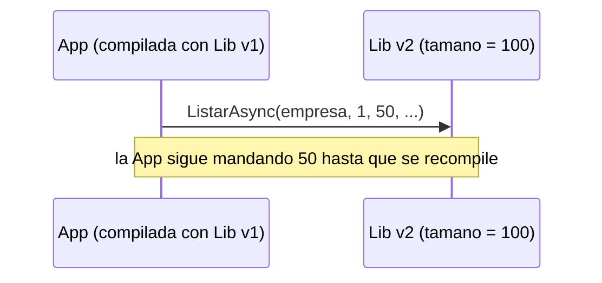

# Parámetros opcionales y nombrados

Parte de: [[03-CSharp-DotNet/01 Básico/_Índice Básico|Básico]]

> [!info] Cómo avanzar
> `progreso`: **pendiente** → **viendo** (estudiando) → **visto** (contestaste la autoevaluación sin abrir las respuestas) → **dominado** (hiciste el laboratorio o lo aplicaste de verdad).

## Contenido

### Qué es
- Un **parámetro opcional** tiene un valor por defecto en la declaración del método; quien llama puede omitirlo.
- Un **argumento nombrado** se pasa indicando el nombre del parámetro (`pagina: 2`), sin importar su posición.

Juntos reducen la necesidad de muchas sobrecargas y hacen que las llamadas con varios valores del mismo tipo (sobre todo `bool` e `int`) se lean solas.

### Cómo funciona
**Declaración**: los opcionales van **al final** de la lista y su valor por defecto debe ser una **constante de compilación**: un literal, `null`, `default`, una constante o un valor de enum.
```csharp
public Task<IReadOnlyList<EgresoItem>> ListarAsync(
    Guid empresaId,                 // obligatorio
    int pagina = 1,                 // opcional
    int tamano = 50,                // opcional
    bool incluirCancelados = false, // opcional
    CancellationToken ct = default) // patrón habitual
```
No puedes usar `DateTime.Now` o `new List<int>()` como valor por defecto; para eso usa `null` y resuélvelo dentro: `fecha ??= reloj.GetUtcNow();`.

**Llamada**:
```csharp
await ListarAsync(empresa);                               // usa todos los defaults
await ListarAsync(empresa, 2);                            // pagina = 2
await ListarAsync(empresa, tamano: 100);                  // salta "pagina"
await ListarAsync(empresa, incluirCancelados: true, ct: ct);
```
Puedes mezclar posicionales y nombrados; los nombrados pueden ir en cualquier orden, y desde C# 7.2 pueden ir antes de posicionales si están en su posición correcta.

**Cómo se compila**: el valor por defecto **no** vive en el método llamado; el compilador lo **copia en cada llamada** al compilar el código que llama. La llamada `ListarAsync(empresa)` queda compilada como `ListarAsync(empresa, 1, 50, false, default)`.



Esto tiene una consecuencia importante en **bibliotecas publicadas** (paquetes NuGet, un ensamblado compartido entre proyectos): si cambias `tamano = 50` por `tamano = 100` y publicas, las aplicaciones que ya estaban compiladas siguen mandando 50 hasta que se recompilen contra la versión nueva. El cambio no es binario-compatible en el sentido que esperarías. Agregar un parámetro opcional nuevo tampoco lo es: el método cambia de firma y los binarios viejos fallan con `MissingMethodException` si no recompilas.

### Ejemplo
Argumentos nombrados para que la llamada se explique sola:
```csharp
// ¿Qué significan true, false y 3?
var reporte = generador.Crear(datos, true, false, 3);

// Mucho mejor:
var reporte = generador.Crear(
    datos,
    incluirTotales: true,
    agruparPorMes: false,
    decimales: 3);
```

Un método de utilidad con opcionales razonables (Wee.Reporteria):
```csharp
public static class Excel
{
    public static byte[] Exportar<T>(
        IReadOnlyList<T> filas,
        string hoja = "Datos",
        bool autoAjustarColumnas = true,
        string? formatoMoneda = null)
    {
        formatoMoneda ??= "$#,##0.00";
        // ... arma el libro
        return [];
    }
}

var bytes = Excel.Exportar(egresos, hoja: "Egresos 2026");
```

Con records, los parámetros opcionales del constructor posicional funcionan igual:
```csharp
public sealed record ListarEgresosQuery(Guid EmpresaId, int Pagina = 1, int Tamano = 50);
var q = new ListarEgresosQuery(empresa, Tamano: 20);
```

### Cuándo usarlo y cuándo no
- **Opcionales**: cuando hay un valor por defecto obvio y estable (`CancellationToken ct = default`, `pagina = 1`). Reemplazan cadenas de sobrecargas que solo pasan valores fijos.
- **Nombrados**: siempre que pases literales `bool`, números "mágicos" o varios parámetros del mismo tipo seguidos (`Transferir(origen: a, destino: b)` evita invertirlos).
- **No** abuses: un método con 8 opcionales pide un objeto de opciones (`record ExportarOpciones(...)`) o el [[Options pattern]] si es configuración.
- En **APIs públicas de bibliotecas**, considera sobrecargas en lugar de opcionales para poder evolucionar sin romper binarios.

### Errores comunes
- **Cambiar el valor por defecto en una biblioteca** esperando que todos lo tomen: solo lo ven quienes recompilan.
- **Agregar un opcional a un método público**: rompe a los consumidores ya compilados. Agrega una sobrecarga.
- **Opcionales `bool` sin nombre en la llamada**: `Crear(x, true)` no dice nada al lector.
- **Ambigüedad con sobrecargas**: si existen `F(int a)` y `F(int a, int b = 0)`, `F(1)` elige la primera; es fácil confundirse. Evita mezclar sobrecargas con opcionales en el mismo método.

### Para profundizar
- [Argumentos opcionales y con nombre](https://learn.microsoft.com/dotnet/csharp/programming-guide/classes-and-structs/named-and-optional-arguments)
- [Parámetros de métodos](https://learn.microsoft.com/dotnet/csharp/language-reference/keywords/method-parameters)
- [Cambios que rompen la compatibilidad en bibliotecas](https://learn.microsoft.com/dotnet/core/compatibility/library-change-rules)

## Autoevaluación

Contesta primero en voz alta o en papel; luego despliega la respuesta.

> [!question]- ¿Cómo se declaran y llaman?
> `void Enviar(string a, int intentos = 3, bool log = false)`. Llamada nombrada: `Enviar("x", log: true)`; se pueden omitir los opcionales y cambiar el orden de los nombrados.

> [!question]- ¿Qué problema tiene cambiar el valor por defecto en una biblioteca publicada?
> El valor se copia en el **código que llama** al compilar. Los consumidores que no recompilen seguirán usando el valor viejo. En APIs públicas es mejor una sobrecarga o un objeto de opciones.

> [!question]- ¿Cuándo un argumento nombrado mejora la lectura?
> Con booleanos o números sueltos: `Crear(nombre, esActivo: true, reintentos: 0)` se entiende sin abrir la firma.

