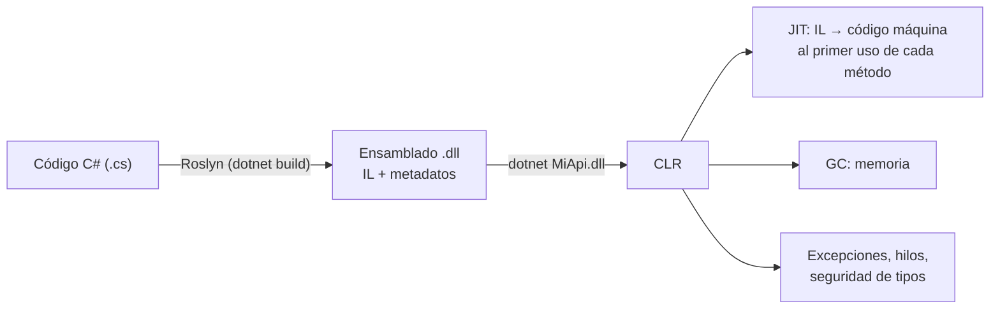

# Qué es .NET, el CLR y el SDK

Parte de: [[03-CSharp-DotNet/01 Básico/_Índice Básico|Básico]]

> [!info] Cómo avanzar
> `progreso`: **pendiente** → **viendo** (estudiando) → **visto** (contestaste la autoevaluación sin abrir las respuestas) → **dominado** (hiciste el laboratorio o lo aplicaste de verdad).

## Contenido

### Qué es
**.NET** es la plataforma de desarrollo gratuita, de código abierto y multiplataforma (Windows, Linux, macOS) de Microsoft. Incluye:
- El **runtime**, cuyo núcleo es el **CLR** (*Common Language Runtime*): ejecuta tus aplicaciones.
- Las **bibliotecas base** (BCL: `System.*`, colecciones, E/S, HTTP, JSON) y *frameworks* como ASP.NET Core.
- El **SDK**: las herramientas para crear, compilar, probar y publicar (`dotnet` CLI, compilador Roslyn, MSBuild, NuGet, plantillas).

C# es el lenguaje principal, pero el runtime ejecuta cualquier lenguaje que compile a IL (F#, VB). Para el panorama general y cómo se usa en tus proyectos, ver [[NET y CSharp]].

### Cómo funciona


1. **Compilación**: `dotnet build` usa MSBuild para leer el `.csproj` y Roslyn para compilar C# a **IL** (lenguaje intermedio) dentro de un ensamblado `.dll`, junto con metadatos que describen todos los tipos.
2. **Ejecución**: `dotnet MiApi.dll` arranca el *host*, que elige la versión del runtime indicada en `MiApi.runtimeconfig.json`. El CLR carga el ensamblado, verifica sus metadatos y, la primera vez que se llama cada método, lo compila a código máquina con el **JIT**. Con *tiered compilation* primero compila rápido y luego recompila optimizado los métodos que se usan mucho.
3. **Servicios del runtime**: el **recolector de basura** libera la memoria que ya no se usa, el CLR maneja excepciones e hilos y garantiza la seguridad de tipos (no puedes tratar un `string` como un `int`).
4. También existen **ReadyToRun** y **Native AOT**, que compilan a nativo antes de ejecutar para arrancar más rápido.

**SDK vs runtime**
| | Runtime | SDK |
|---|---|---|
| Qué hace | solo **ejecuta** aplicaciones | crea, compila, prueba, publica (incluye un runtime) |
| Componentes | `Microsoft.NETCore.App`, `Microsoft.AspNetCore.App` | `dotnet build/test/publish`, Roslyn, MSBuild, NuGet, plantillas |
| Dónde | servidores de producción (o el *Hosting Bundle* en IIS) | tu PC y los agentes de build de Azure DevOps |

**TFM (*Target Framework Moniker*)**: en el `.csproj`, `<TargetFramework>net10.0</TargetFramework>` dice contra qué versión se compila y qué APIs puedes usar. Un paquete NuGet puede apuntar a varios: `<TargetFrameworks>net8.0;net10.0</TargetFrameworks>`.

**Versiones y soporte**: .NET 10 es una versión **LTS** (soporte de largo plazo, 3 años); las versiones STS tienen un soporte más corto. Para APIs que se mantienen años en producción conviene ir de LTS a LTS y aplicar los parches mensuales del runtime.

### Ejemplo
Revisar qué tienes instalado y fijar la versión del SDK del equipo:
```bash
dotnet --list-sdks          # SDKs instalados
dotnet --list-runtimes      # runtimes instalados
dotnet --info               # cuál se está usando en esta carpeta y por qué

dotnet new globaljson --sdk-version 10.0.100 --roll-forward latestFeature
```
`global.json` en la raíz de la solución:
```json
{
  "sdk": {
    "version": "10.0.100",
    "rollForward": "latestFeature"
  }
}
```
Con eso todas las máquinas y el pipeline usan la misma banda de SDK (10.0.1xx o superior dentro de 10.0), y el build deja de dar resultados distintos según quién compila. En Azure Pipelines, la tarea `UseDotNet@2` puede leer ese archivo (`useGlobalJson: true`).

Un `.csproj` mínimo de API:
```xml
<Project Sdk="Microsoft.NET.Sdk.Web">
  <PropertyGroup>
    <TargetFramework>net10.0</TargetFramework>
    <Nullable>enable</Nullable>
    <ImplicitUsings>enable</ImplicitUsings>
  </PropertyGroup>
</Project>
```

### Cuándo usarlo y cuándo no
- **.NET moderno** (5 en adelante) para todo proyecto nuevo: multiplataforma, más rápido, con las APIs y el C# actuales.
- **.NET Framework 4.x** solo para mantener aplicaciones existentes que dependen de tecnologías exclusivas de Windows (WebForms, WCF servidor).
- Instala **solo el runtime** en servidores; el SDK es para desarrollar y compilar.
- Considera **Native AOT** cuando el tiempo de arranque o el tamaño en memoria importan (funciones, contenedores pequeños), sabiendo que limita reflexión y algunas bibliotecas.

### Errores comunes
- **No fijar el SDK**: cada desarrollador compila con una versión distinta; aparecen warnings y comportamientos diferentes.
- **Confundir versión del SDK con versión del runtime**: el SDK 10.0.100 trae un runtime 10.0.x, pero los números no coinciden uno a uno.
- **Desplegar sin el runtime adecuado** (por ejemplo, falta el *Hosting Bundle* en IIS): la app no arranca con error 500.30/500.31.
- **Creer que C# es interpretado**: el IL se compila a nativo con JIT o AOT.

### Para profundizar
- [Introducción a .NET](https://learn.microsoft.com/dotnet/core/introduction)
- [Common Language Runtime (CLR)](https://learn.microsoft.com/dotnet/standard/clr)
- [global.json](https://learn.microsoft.com/dotnet/core/tools/global-json)
- [Plataformas de destino (TFM)](https://learn.microsoft.com/dotnet/standard/frameworks)

## Autoevaluación

Contesta primero en voz alta o en papel; luego despliega la respuesta.

> [!question]- ¿Qué diferencia hay entre el **SDK** y el **runtime** de .NET?
> El runtime (`Microsoft.NETCore.App`, `Microsoft.AspNetCore.App`) solo **ejecuta** aplicaciones. El SDK incluye el runtime más el compilador, `dotnet build/test/publish`, plantillas y NuGet. En un servidor de producción basta el runtime (o el Hosting Bundle en IIS); en tu PC necesitas el SDK.

> [!question]- ¿Qué hace el CLR cuando ejecutas `dotnet MiApi.dll`?
> Carga el ensamblado, verifica los metadatos, compila con JIT cada método la primera vez que se llama, administra la memoria con el GC, maneja excepciones e hilos y aplica la seguridad de tipos.

> [!question]- Tu equipo tiene varios SDKs instalados y el build da resultados distintos en cada máquina. ¿Cómo fijas la versión?
> Con un `global.json` en la raíz de la solución:
> ```json
> { "sdk": { "version": "10.0.100", "rollForward": "latestFeature" } }
> ```
> `dotnet --list-sdks` muestra los instalados y `dotnet --info` cuál se está usando.

> [!question]- ¿Qué es el TFM `net10.0` en el `.csproj`?
> El *Target Framework Moniker*: indica contra qué versión de .NET se compila y qué APIs están disponibles. Un proyecto puede tener varios con `<TargetFrameworks>net8.0;net10.0</TargetFrameworks>` (útil en paquetes NuGet).

