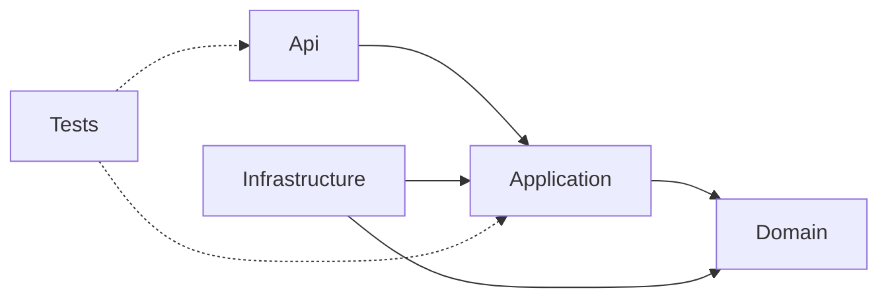

# Solución, proyecto y estructura de carpetas

Parte de: [[03-CSharp-DotNet/01 Básico/_Índice Básico|Básico]]

> [!info] Cómo avanzar
> `progreso`: **pendiente** → **viendo** (estudiando) → **visto** (contestaste la autoevaluación sin abrir las respuestas) → **dominado** (hiciste el laboratorio o lo aplicaste de verdad).

## Contenido

### Qué es
- Un **proyecto** (`.csproj`) describe cómo compilar **un** ensamblado (`.dll` o `.exe`): qué archivos incluye, su TFM, sus paquetes NuGet y a qué otros proyectos referencia.
- Una **solución** (`.sln` o el formato nuevo `.slnx`) solo **agrupa** proyectos para abrirlos, compilarlos y probarlos juntos. No genera nada por sí misma.
- La **estructura de carpetas** es la convención que hace que cualquiera encuentre el código y que las dependencias entre capas sean evidentes.

### Cómo funciona
**SDK-style `.csproj`**: desde .NET Core, los proyectos incluyen automáticamente todos los `.cs` de su carpeta; solo declaras lo distinto. Las opciones compartidas por todos los proyectos van en `Directory.Build.props` (ver [[Directory.Build.props y Central Package Management]]).

**`.sln` vs `.slnx`**: el `.sln` clásico es un formato de texto propio, con GUIDs por proyecto y secciones de configuración repetidas; los conflictos de merge son frecuentes. El `.slnx` es XML corto y legible:
```xml
<Solution>
  <Folder Name="/src/">
    <Project Path="src/Dionisio.Api/Dionisio.Api.csproj" />
    <Project Path="src/Dionisio.Application/Dionisio.Application.csproj" />
  </Folder>
  <Folder Name="/tests/">
    <Project Path="tests/Dionisio.Tests/Dionisio.Tests.csproj" />
  </Folder>
</Solution>
```
Una solución existente se convierte con `dotnet sln migrate`. Desde el SDK de .NET 10, `dotnet new sln` genera `.slnx` por defecto.

**Regla de dependencias**: en una API organizada por capas, las referencias apuntan **hacia adentro**, hacia el dominio:

- `Domain` no referencia a nadie (ni paquetes de infraestructura).
- `Application` define interfaces (por ejemplo, una por consulta SQL) que `Infrastructure` implementa.
- `Api` arma todo (composición en `Program.cs`) y referencia a `Application` y a `Infrastructure` para registrar servicios.
- Los proyectos de pruebas referencian lo que prueban.
Esta regla se puede verificar automáticamente con [[Pruebas de reglas de arquitectura (NetArchTest)]].

Con **vertical slice**, dentro de `Application` las carpetas se organizan por funcionalidad (`Features/Egresos/ListarEgresos.cs` con su `.sql` al lado) en vez de por tipo técnico (`Services/`, `Repositories/`).

### Ejemplo
Armar la solución completa desde la terminal:
```bash
mkdir Itzamna.Dionisio && cd Itzamna.Dionisio
dotnet new sln -n Itzamna.Dionisio                       # crea .slnx en .NET 10
dotnet new globaljson --sdk-version 10.0.100 --roll-forward latestFeature

dotnet new classlib -n Itzamna.Dionisio.Domain         -o src/Itzamna.Dionisio.Domain
dotnet new classlib -n Itzamna.Dionisio.Application    -o src/Itzamna.Dionisio.Application
dotnet new classlib -n Itzamna.Dionisio.Infrastructure -o src/Itzamna.Dionisio.Infrastructure
dotnet new webapi   -n Itzamna.Dionisio.Api            -o src/Itzamna.Dionisio.Api --use-controllers
dotnet new xunit    -n Itzamna.Dionisio.Tests          -o tests/Itzamna.Dionisio.Tests

dotnet sln add src/* tests/*

dotnet add src/Itzamna.Dionisio.Application    reference src/Itzamna.Dionisio.Domain
dotnet add src/Itzamna.Dionisio.Infrastructure reference src/Itzamna.Dionisio.Application
dotnet add src/Itzamna.Dionisio.Api            reference src/Itzamna.Dionisio.Application src/Itzamna.Dionisio.Infrastructure
dotnet add tests/Itzamna.Dionisio.Tests        reference src/Itzamna.Dionisio.Api

dotnet build && dotnet test
```

Estructura resultante:
```text
Itzamna.Dionisio/
├─ Itzamna.Dionisio.slnx
├─ global.json
├─ Directory.Build.props
├─ azure-pipelines.yml
├─ src/
│  ├─ Itzamna.Dionisio.Api/            (controllers, Program.cs)
│  ├─ Itzamna.Dionisio.Application/    (Features/<Slice>/*.cs + *.sql)
│  ├─ Itzamna.Dionisio.Domain/         (entidades, reglas)
│  └─ Itzamna.Dionisio.Infrastructure/ (Dapper, SQL Server, correo)
└─ tests/
   └─ Itzamna.Dionisio.Tests/
```
Los secretos no van en ningún archivo del repo: usa User Secrets en desarrollo y variables o Key Vault en Azure (ver [[Secretos con User Secrets]]).

### Cuándo usarlo y cuándo no
- **Varios proyectos** cuando quieres que el compilador haga cumplir las fronteras (el dominio literalmente no puede usar Dapper si no lo referencia).
- **Un solo proyecto** con carpetas puede bastar en servicios pequeños o prototipos; no dividas por dividir: cada proyecto agrega tiempo de build y ceremonia.
- Usa `.slnx` en soluciones nuevas; migra las viejas cuando todo el equipo tenga herramientas que lo soporten.

### Errores comunes
- **Referencias circulares o hacia afuera** (`Domain → Infrastructure`): el dominio queda atado a la base de datos.
- **Mezclar pruebas con código de producción** en el mismo proyecto.
- **Opciones repetidas en cada `.csproj`**: se desincronizan; centralízalas en `Directory.Build.props`.
- **Versionar `bin/` y `obj/`**: agrega el `.gitignore` de .NET (`dotnet new gitignore`).

### Para profundizar
- [dotnet sln](https://learn.microsoft.com/dotnet/core/tools/dotnet-sln)
- [dotnet new sln genera .slnx por defecto (.NET 10)](https://learn.microsoft.com/dotnet/core/compatibility/sdk/10.0/dotnet-new-sln-slnx-default)
- [Archivos de proyecto de .NET](https://learn.microsoft.com/dotnet/core/project-sdk/overview)
- [Arquitecturas de aplicaciones web comunes](https://learn.microsoft.com/dotnet/architecture/modern-web-apps-azure/common-web-application-architectures)

## Autoevaluación

Contesta primero en voz alta o en papel; luego despliega la respuesta.

> [!question]- ¿Qué diferencia hay entre una **solución** y un **proyecto**?
> El proyecto (`.csproj`) produce **un** ensamblado (dll/exe) con sus referencias y paquetes. La solución (`.sln` / `.slnx`) solo agrupa proyectos para abrirlos y compilarlos juntos; no genera nada por sí misma.

> [!question]- ¿Qué ventaja tiene `.slnx` sobre `.sln`?
> Es XML legible y corto (sin GUIDs ni secciones de configuración repetidas), así que los conflictos de merge son raros. Se crea o convierte con `dotnet sln migrate`. En .NET 10 `dotnet new sln` genera `.slnx` por defecto (Pendiente de confirmar).

> [!question]- Organizas una API en `Api`, `Application`, `Domain`, `Infrastructure` y `Tests`. ¿Qué regla de referencias debe cumplirse?
> Las dependencias apuntan hacia adentro: `Api → Application → Domain`, e `Infrastructure → Application/Domain`. `Domain` no referencia a nadie. Las pruebas pueden referenciar lo que prueban. Se puede verificar con NetArchTest.

> [!question]- ¿Con qué comandos armas la solución desde la terminal?
> ```bash
> dotnet new sln -n Mi
> dotnet new webapi -n Mi.Api -o src/Mi.Api --use-controllers
> dotnet new xunit -n Mi.Tests -o tests/Mi.Tests
> dotnet sln add src/Mi.Api tests/Mi.Tests
> dotnet add tests/Mi.Tests reference src/Mi.Api
> ```

## Práctica

- [[Lab 1 - Consola de inventario con colecciones y TryParse]]

