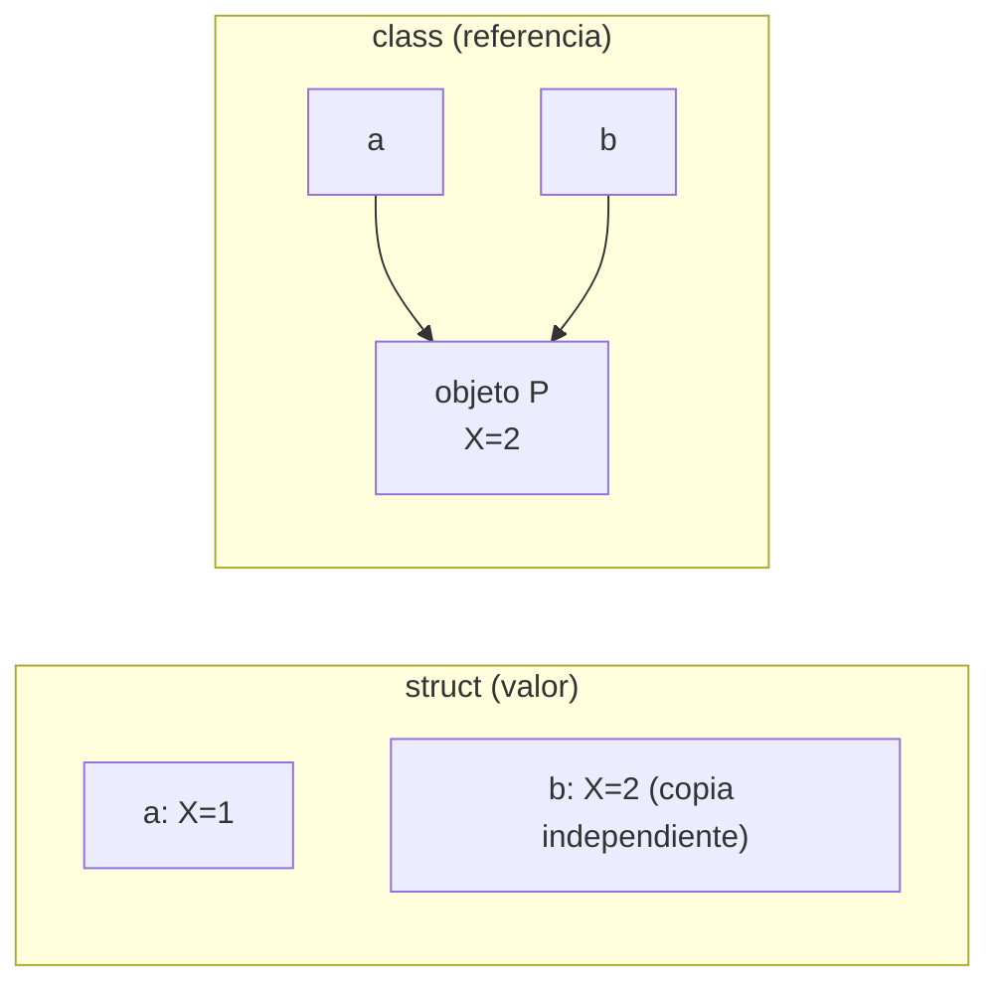

# Tipos de valor y de referencia

Parte de: [[03-CSharp-DotNet/01 Básico/_Índice Básico|Básico]]

> [!info] Cómo avanzar
> `progreso`: **pendiente** → **viendo** (estudiando) → **visto** (contestaste la autoevaluación sin abrir las respuestas) → **dominado** (hiciste el laboratorio o lo aplicaste de verdad).

## Contenido

### Qué es
Todo tipo en C# es de una de dos categorías, y la diferencia determina qué pasa al **asignar** y al **pasar a un método**:
- **Tipos de valor** (`struct`, `enum`, los numéricos, `bool`, `char`, `DateTime`, `record struct`): la variable **contiene el dato**. Asignar copia el dato completo.
- **Tipos de referencia** (`class`, `record`, `string`, arrays, interfaces, delegados): la variable contiene una **referencia** a un objeto. Asignar copia la referencia; ambas variables apuntan al **mismo** objeto.

### Cómo funciona


Con `struct P { public int X; }`: `var b = a;` copia los campos; `b.X = 2` no afecta `a`, así que `a.X` sigue siendo **1**. Con `class P`, `a` y `b` apuntan al mismo objeto: `a.X` es **2**.

**Pasar a métodos**: por defecto **todo** se pasa por valor; con tipos de referencia, lo que se copia es la referencia:
```csharp
void Cambia(List<int> l)
{
    l.Add(9);            // modifica el objeto compartido → el llamador lo ve
    l = new List<int>(); // reasigna solo la copia local de la referencia
    l.Add(7);            // afecta la lista nueva, no la del llamador
}
var x = new List<int> { 1 };
Cambia(x);
Console.WriteLine(string.Join(",", x));   // 1,9
```
Para reemplazar la variable del llamador se necesita `ref` (ver [[Métodos y parámetros (ref, out, in, params)]]).

**Boxing**: cuando un tipo de valor se convierte a `object` o a una interfaz, el runtime crea un objeto en el heap y copia el valor dentro (*boxing*). Sacarlo (*unboxing*) requiere un cast al tipo exacto. Cuesta una asignación de memoria más trabajo para el recolector de basura, y en bucles grandes se nota. Las colecciones genéricas (`List<int>`) existen justamente para evitarlo; las viejas (`ArrayList`) hacían boxing de cada elemento.
```csharp
int n = 42;
object o = n;        // boxing: nuevo objeto en el heap
int m = (int)o;      // unboxing
n = 7;               // o sigue valiendo 42: es una copia
```

**¿Stack o heap?** La frase "los tipos de valor viven en el stack y los de referencia en el heap" es imprecisa. Lo correcto: **los objetos de tipos de referencia siempre van al heap**; los tipos de valor viven **donde vive su contenedor**. Una variable local `int` suele estar en el stack (o en un registro), pero un `int` que es campo de una clase vive dentro del objeto en el heap, igual que los elementos de un `int[]`, o una variable local capturada por una lambda o usada en un método `async`. La diferencia que importa es la **semántica de copia**, no la ubicación.

**Igualdad**: los structs comparan por valor con `Equals` (por campos); las clases, por referencia salvo que se sobrescriba. Ver [[Igualdad por valor vs por referencia]].

### Ejemplo
Un bug típico al pensar que se copia un objeto:
```csharp
public sealed class Filtro { public int Pagina { get; set; } = 1; }

var original = new Filtro();
var siguiente = original;        // NO es una copia
siguiente.Pagina++;
Console.WriteLine(original.Pagina);   // 2 (sorpresa)

// Con un record y `with` sí obtienes una copia
public sealed record FiltroR(int Pagina = 1);
var o = new FiltroR();
var s = o with { Pagina = o.Pagina + 1 };
Console.WriteLine(o.Pagina);          // 1
```

Un tipo de valor pequeño e inmutable para dinero:
```csharp
public readonly record struct Dinero(decimal Monto, string Moneda)
{
    public Dinero Sumar(Dinero otro) =>
        otro.Moneda == Moneda ? this with { Monto = Monto + otro.Monto }
                              : throw new InvalidOperationException("Monedas distintas");
}
```

### Cuándo usarlo y cuándo no
- **Clases** (referencia) por defecto: entidades, servicios, handlers, cualquier cosa con identidad o tamaño mediano/grande.
- **Structs** (valor) para valores pequeños e inmutables (coordenadas, dinero, ids fuertemente tipados) donde la copia es barata y evitar asignaciones en el heap ayuda. Ver [[struct]] y [[record struct]].
- Evita boxing en rutas calientes: usa genéricos y evita guardar structs en variables `object` o interfaces no genéricas.

### Errores comunes
- **Pensar que asignar una clase la copia**: ambos nombres modifican el mismo objeto.
- **Pensar que pasar una lista a un método la protege**: el método puede modificarla. Expón `IReadOnlyList<T>`.
- **Modificar un struct que está dentro de una colección**: modificas una copia (o no compila).
- **Repetir el mito de stack/heap** en una entrevista: explica la semántica de copia y que el valor vive donde vive su contenedor.

### Para profundizar
- [Tipos de valor (referencia de C#)](https://learn.microsoft.com/dotnet/csharp/language-reference/builtin-types/value-types)
- [Tipos de referencia (referencia de C#)](https://learn.microsoft.com/dotnet/csharp/language-reference/keywords/reference-types)
- [Boxing y unboxing](https://learn.microsoft.com/dotnet/csharp/programming-guide/types/boxing-and-unboxing)
- [Sistema de tipos de C#](https://learn.microsoft.com/dotnet/csharp/fundamentals/types/)

## Ejercicios

Resuélvelos en papel o en la herramienta; la solución está plegada.

> [!question]- ¿Qué imprime? `struct P { public int X; } var a = new P { X = 1 }; var b = a; b.X = 2; Console.WriteLine(a.X);`
> `1`. `b` es una copia de `a`.

> [!question]- Mismo código pero con `class P`. ¿Qué imprime?
> `2`. `a` y `b` apuntan al mismo objeto.

> [!question]- ¿Qué imprime? `void Cambia(List<int> l) { l.Add(9); l = new List<int>(); l.Add(7); } var x = new List<int> { 1 }; Cambia(x); Console.WriteLine(string.Join(",", x));`
> `1,9`. Se pasa una copia de la referencia: `Add(9)` modifica la lista original, pero reasignar `l` no afecta a `x`.

## Autoevaluación

Contesta primero en voz alta o en papel; luego despliega la respuesta.

> [!question]- ¿Qué diferencia hay entre un tipo de valor y uno de referencia?
> Una variable de **tipo de valor** (`int`, `struct`, `enum`, `DateTime`) contiene el dato; al asignarla se **copia**. Una de **tipo de referencia** (`class`, `string`, arrays, `record`) contiene una referencia al objeto en el heap; al asignarla se copia la referencia y ambas variables ven el mismo objeto.

> [!question]- ¿Qué es el *boxing* y por qué cuesta?
> Convertir un tipo de valor a `object` (o a una interfaz) crea una copia en el heap. Cuesta una asignación y presión al GC. Pasa, por ejemplo, con `object o = 5;` o con colecciones no genéricas como `ArrayList`.

> [!question]- Error común: "los tipos de valor viven en el stack y los de referencia en el heap". ¿Qué tiene de impreciso?
> Un `int` que es campo de una clase vive en el heap junto con el objeto; un struct dentro de un array también. Lo que define al tipo de valor es la **semántica de copia**, no el lugar de memoria.

