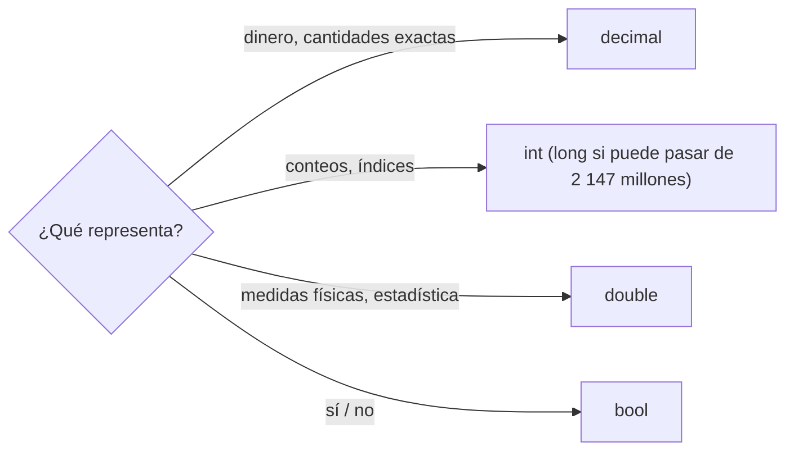

# Tipos primitivos

Parte de: [[03-CSharp-DotNet/01 Básico/_Índice Básico|Básico]]

> [!info] Cómo avanzar
> `progreso`: **pendiente** → **viendo** (estudiando) → **visto** (contestaste la autoevaluación sin abrir las respuestas) → **dominado** (hiciste el laboratorio o lo aplicaste de verdad).

## Contenido

### Qué es
Los **tipos primitivos** (o integrados) son los que el lenguaje trae con palabra clave propia: números enteros, números de punto flotante, `decimal`, `bool` y `char`. Cada palabra clave es un alias de un tipo de .NET (`int` es `System.Int32`, `decimal` es `System.Decimal`). Conocer su tamaño, su rango y cómo se comportan en las operaciones evita errores clásicos con dinero, divisiones y desbordamientos. `string` y `object` también tienen palabra clave, pero son tipos de referencia (ver [[string e inmutabilidad]]).

### Cómo funciona
| Tipo | .NET | Tamaño | Uso típico |
|---|---|---|---|
| `bool` | `Boolean` | 1 byte | verdadero/falso |
| `byte` / `sbyte` | `Byte` / `SByte` | 1 byte | datos binarios |
| `short` / `ushort` | `Int16` / `UInt16` | 2 bytes | poco común |
| `char` | `Char` | 2 bytes | una unidad UTF-16 |
| `int` / `uint` | `Int32` / `UInt32` | 4 bytes | contadores, índices |
| `long` / `ulong` | `Int64` / `UInt64` | 8 bytes | ids grandes, ticks |
| `float` | `Single` | 4 bytes | gráficos, sensores |
| `double` | `Double` | 8 bytes | cálculos científicos, estadísticos |
| `decimal` | `Decimal` | 16 bytes | **dinero** |

También existen `nint`/`nuint` (tamaño del puntero) e `Int128`/`Half` para casos especiales.

**División entera**: si ambos operandos son enteros, la división también lo es y **trunca**: `7 / 2` es `3`. Si alguno es de punto flotante, el resultado también: `7 / 2.0` es `3.5`. El residuo `%` toma el signo del dividendo: `-7 % 3` es `-1` (porque −7 = −2·3 + (−1)).

**Punto flotante binario**: `double` y `float` representan números en base 2, así que muchos decimales "redondos" (0.1, 0.2) no tienen representación exacta. Por eso `0.1 + 0.2 == 0.3` es **`false`** con `double` (el resultado es 0.30000000000000004). `decimal` usa base 10 con hasta 28–29 dígitos significativos: `0.1m + 0.2m == 0.3m` es **`true`**. Para dinero usa siempre `decimal` (y `decimal(18,2)` o similar en SQL Server); `double` acumula errores de centavos en sumas, IVA y reportes.

**Desbordamiento**: por defecto la aritmética entera es *unchecked*: `int x = int.MaxValue; x++;` da la vuelta silenciosamente a `int.MinValue` (−2 147 483 648). Con `checked { ... }` o la opción `<CheckForOverflowUnderflow>true</CheckForOverflowUnderflow>` lanza `OverflowException`. `decimal` siempre lanza al desbordar; `double` llega a `Infinity`.



### Ejemplo
```csharp
// Literales con sufijo
decimal precio = 1299.90m;     // m = decimal
long grande = 9_000_000_000L;  // _ como separador visual
double tasa = 0.0725;
float temp = 21.5f;

// División
Console.WriteLine(7 / 2);      // 3
Console.WriteLine(7 / 2.0);    // 3.5
Console.WriteLine(-7 % 3);     // -1

// Dinero bien hecho
decimal subtotal = 0.1m + 0.2m;
Console.WriteLine(subtotal == 0.3m);            // True
decimal iva = Math.Round(subtotal * 0.16m, 2, MidpointRounding.AwayFromZero);

// Comparar double con tolerancia
double a = 0.1 + 0.2;
Console.WriteLine(Math.Abs(a - 0.3) < 1e-9);   // True

// Desbordamiento
int x = int.MaxValue;
x++;
Console.WriteLine(x);                           // -2147483648
try { checked { int y = int.MaxValue; y++; } }
catch (OverflowException) { Console.WriteLine("Desbordó"); }

// Promedio con enteros: convierte antes de dividir
int total = 7, casos = 2;
double promedio = (double)total / casos;        // 3.5, no 3

// Rangos
Console.WriteLine($"{int.MinValue}..{int.MaxValue}");
Console.WriteLine(sizeof(char));                // 2
```

### Cuándo usarlo y cuándo no
- **`int`** por defecto para enteros; **`long`** cuando el valor puede superar unos 2 147 millones (ids de tablas grandes, milisegundos Unix).
- **`decimal`** para dinero, porcentajes fiscales y cualquier cantidad que deba cuadrar al centavo.
- **`double`** para cálculos científicos, estadísticos o de geometría donde importa el rango y la velocidad, no la exactitud decimal.
- **`byte`** solo para datos binarios; no lo uses para "ahorrar memoria" en variables sueltas.
- En SQL Server mapea `int`↔`INT`, `long`↔`BIGINT`, `decimal`↔`DECIMAL(p,s)`, `bool`↔`BIT`, `double`↔`FLOAT`.

### Errores comunes
- **Usar `double` para dinero**: diferencias de centavos que nadie puede explicar en el cierre.
- **Dividir enteros esperando decimales**: `total / casos` trunca; convierte uno antes.
- **Comparar `double` con `==`**: usa una tolerancia.
- **Ignorar el desbordamiento** en contadores o multiplicaciones (`int` × `int` puede desbordar aunque guardes en `long`: convierte antes de multiplicar).
- **Confundir `char` con un carácter visible**: un emoji puede ocupar dos `char` (un par sustituto UTF-16).

### Para profundizar
- [Tipos integrados (referencia de C#)](https://learn.microsoft.com/dotnet/csharp/language-reference/builtin-types/built-in-types)
- [Tipos numéricos enteros](https://learn.microsoft.com/dotnet/csharp/language-reference/builtin-types/integral-numeric-types)
- [Tipos numéricos de punto flotante (float, double, decimal)](https://learn.microsoft.com/dotnet/csharp/language-reference/builtin-types/floating-point-numeric-types)
- [Operadores aritméticos](https://learn.microsoft.com/dotnet/csharp/language-reference/operators/arithmetic-operators)

## Ejercicios

Resuélvelos en papel o en la herramienta; la solución está plegada.

> [!question]- ¿`0.1 + 0.2 == 0.3` es `true` o `false` con `double`? ¿Y con `decimal`?
> `double`: `false` (da 0.30000000000000004). `decimal`: `true`.

> [!question]- ¿Cuánto vale `7 / 2` y `7 / 2.0` en C#?
> `7 / 2` = `3` (división entera). `7 / 2.0` = `3.5`.

> [!question]- ¿Cuánto vale `-7 % 3`?
> `-1`. En C# el residuo toma el signo del dividendo.

## Autoevaluación

Contesta primero en voz alta o en papel; luego despliega la respuesta.

> [!question]- ¿Qué tipo usarías para montos de dinero y por qué no `double`?
> `decimal`: es base 10 con 28–29 dígitos significativos, así que `0.1m + 0.2m == 0.3m`. `double` es binario y no representa exactamente 0.1, lo que produce errores de redondeo en sumas de importes. En SQL Server se mapea a `decimal(p,s)`.

> [!question]- ¿Qué pasa con `int x = int.MaxValue; x++;`?
> Por defecto el desbordamiento **no** lanza error: da la vuelta a `int.MinValue`. Con `checked { x++; }` (o `<CheckForOverflowUnderflow>`) lanza `OverflowException`.

> [!question]- ¿Qué tamaño tienen `int`, `long`, `char` y `bool`?
> `int` = `System.Int32` (32 bits), `long` = `Int64` (64 bits), `char` = un code unit UTF-16 (16 bits), `bool` = 1 byte en memoria. Las palabras clave son alias de tipos de `System`.

## Práctica

- [[Lab 1 - Consola de inventario con colecciones y TryParse]]

