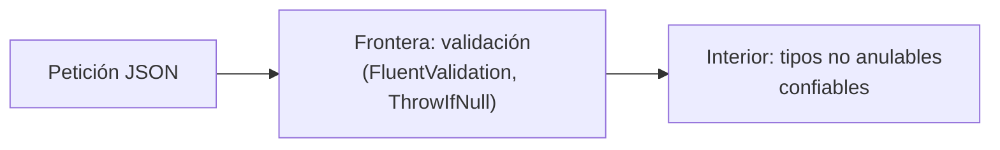

# null y nullable reference types

Parte de: [[03-CSharp-DotNet/01 Básico/_Índice Básico|Básico]]

> [!info] Cómo avanzar
> `progreso`: **pendiente** → **viendo** (estudiando) → **visto** (contestaste la autoevaluación sin abrir las respuestas) → **dominado** (hiciste el laboratorio o lo aplicaste de verdad).

## Contenido

### Qué es
`null` significa "esta referencia no apunta a ningún objeto". Desreferenciarlo (`x.Algo` cuando `x` es `null`) lanza `NullReferenceException`, probablemente el error más común en .NET. Los **nullable reference types** (NRT, desde C# 8) son un análisis del compilador que distingue en los tipos de referencia:
- `string` → "nunca debería ser null".
- `string?` → "puede ser null; compruébalo antes de usarlo".

Con esto, muchos `NullReferenceException` se convierten en **advertencias de compilación** que ves antes de ejecutar.

### Cómo funciona
Se activa en el `.csproj` (o una vez para toda la solución en `Directory.Build.props`):
```xml
<PropertyGroup>
  <Nullable>enable</Nullable>
  <TreatWarningsAsErrors>true</TreatWarningsAsErrors> <!-- opcional pero recomendado -->
</PropertyGroup>
```
El compilador hace **análisis de flujo**: sabe que después de `if (x is null) return;` la variable ya no es null.
- Asignar `null` a un `string` → advertencia CS8600/CS8625.
- Desreferenciar un `string?` sin comprobar → advertencia CS8602.
- Una propiedad `string` sin inicializar en el constructor → advertencia CS8618 (usa `required`, un valor inicial o un constructor).

Es importante entender que **solo son anotaciones**: en tiempo de ejecución `string` y `string?` son el mismo tipo, no hay verificación automática. Si los datos vienen de fuera (JSON, base de datos, una biblioteca sin anotaciones), pueden traer `null` aunque el tipo diga `string`. Por eso se sigue validando en las fronteras.

**El operador `!` (null-forgiving)**: `x!.Length` le dice al compilador "confía en mí, no es null" y apaga la advertencia. No agrega ninguna comprobación: si te equivocas, obtienes la misma `NullReferenceException`. Úsalo solo cuando sabes algo que el análisis no puede ver (por ejemplo, después de una validación en otro método) y prefiere atributos como `[NotNullWhen(true)]` en tus propios métodos `TryXxx`.



**Validación corta de argumentos**:
```csharp
ArgumentNullException.ThrowIfNull(comando);
ArgumentException.ThrowIfNullOrWhiteSpace(comando.Nombre);
```
Usan `[CallerArgumentExpression]` para poner automáticamente el nombre del argumento en el mensaje.

### Ejemplo
**NRT + controllers + FluentValidation**: con `[ApiController]`, MVC trata las propiedades de referencia **no anulables** como si tuvieran `[Required]`. Si el cliente omite `Nombre`, MVC responde un 400 automático antes de que tu validador corra, con un formato que no trae tu `codigo`. Para que la validación quede en tu pipeline:
```csharp
builder.Services.AddControllers(o =>
{
    o.SuppressImplicitRequiredAttributeForNonNullableReferenceTypes = true;
});

public sealed record CrearClienteRequest(string Nombre, string? Telefono);

public sealed class CrearClienteValidator : AbstractValidator<CrearClienteRequest>
{
    public CrearClienteValidator()
    {
        RuleFor(x => x.Nombre).NotEmpty().MaximumLength(120);
        RuleFor(x => x.Telefono).Matches(@"^\d{10}$").When(x => x.Telefono is not null);
    }
}
```
Ver [[FluentValidation]] y [[Model binding y validación]].

Métodos propios con anotaciones que ayudan al análisis:
```csharp
using System.Diagnostics.CodeAnalysis;

public static bool TryObtener(string clave, [NotNullWhen(true)] out Cliente? cliente)
{
    cliente = _cache.GetValueOrDefault(clave);
    return cliente is not null;
}

if (TryObtener("C-1", out var c))
    Console.WriteLine(c.Nombre);   // sin advertencia: el compilador sabe que no es null
```

Leer de Dapper: si la columna admite `NULL`, decláralo así en el record (`string? Telefono`); si no, la anotación miente y el bug aparece lejos.

### Cuándo usarlo y cuándo no
- **Actívalo siempre** en proyectos nuevos, para toda la solución, y trata las advertencias como errores.
- En proyectos viejos actívalo por archivo (`#nullable enable`) y avanza poco a poco.
- Usa `?` solo donde "no hay valor" es un estado legítimo; si algo siempre debe existir, no lo marques anulable para "callar" advertencias.
- Para operar con valores que pueden ser null, ver [[Operadores de null en CSharp]]; para tipos de valor, [[Nullable de valor (Nullable de int)]].

### Errores comunes
- **Llenar el código de `!`**: solo escondes las advertencias; los errores siguen.
- **Confiar en las anotaciones con datos externos**: JSON y BD pueden traer null. Valida en la frontera.
- **Marcar todo como `?`**: pierdes el beneficio; el compilador ya no distingue lo obligatorio.
- **Ignorar advertencias CS86xx** porque "compila": activa `TreatWarningsAsErrors`.
- **Olvidar la opción de MVC** y recibir 400 que no vienen de tu validación.

### Para profundizar
- [Tipos de referencia que aceptan valores NULL](https://learn.microsoft.com/dotnet/csharp/nullable-references)
- [Operador ! (null-forgiving)](https://learn.microsoft.com/dotnet/csharp/language-reference/operators/null-forgiving)
- [Atributos para el análisis estático de estado NULL](https://learn.microsoft.com/dotnet/csharp/language-reference/attributes/nullable-analysis)
- [MvcOptions.SuppressImplicitRequiredAttributeForNonNullableReferenceTypes](https://learn.microsoft.com/dotnet/api/microsoft.aspnetcore.mvc.mvcoptions.suppressimplicitrequiredattributefornonnullablereferencetypes)

## Autoevaluación

Contesta primero en voz alta o en papel; luego despliega la respuesta.

> [!question]- ¿Qué hace `<Nullable>enable</Nullable>`?
> Activa el análisis de anulabilidad: `string` significa "nunca null" y `string?` "puede ser null". El compilador avisa si desreferencias algo que puede ser null o si asignas null a algo que no debería. Son **advertencias** de compilación: en tiempo de ejecución nada cambia.

> [!question]- ¿Qué hace el operador `!` (null-forgiving) y cuál es el riesgo?
> `x!` le dice al compilador "confía, no es null" y apaga la advertencia. Si te equivocas obtienes `NullReferenceException` igual. Úsalo solo cuando sabes algo que el análisis no ve.

> [!question]- En un controller con `[ApiController]`, una propiedad `string Nombre` no anulable se vuelve `[Required]` implícito. ¿Cómo evitas que MVC responda antes que FluentValidation?
> Con `SuppressImplicitRequiredAttributeForNonNullableReferenceTypes = true` en `AddControllers(o => ...)`. Así la validación queda en tu pipeline y la respuesta sale con tu `codigo`.

> [!question]- ¿Cómo validas un argumento de forma corta en .NET moderno?
> `ArgumentNullException.ThrowIfNull(x);` o `ArgumentException.ThrowIfNullOrWhiteSpace(nombre);`. Usan `CallerArgumentExpression` para poner el nombre del parámetro en el mensaje.

## Práctica

- [[Lab 1 - Consola de inventario con colecciones y TryParse]]

