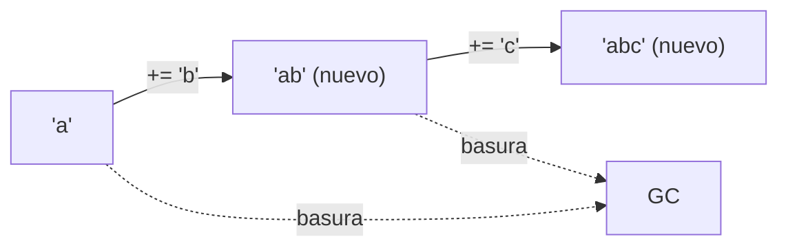

# string e inmutabilidad

Parte de: [[03-CSharp-DotNet/01 Básico/_Índice Básico|Básico]]

> [!info] Cómo avanzar
> `progreso`: **pendiente** → **viendo** (estudiando) → **visto** (contestaste la autoevaluación sin abrir las respuestas) → **dominado** (hiciste el laboratorio o lo aplicaste de verdad).

## Contenido

### Qué es
`string` (alias de `System.String`) es una secuencia de caracteres UTF-16. Es un **tipo de referencia** pero se comporta como un valor en dos aspectos: `==` compara el **contenido** y, sobre todo, es **inmutable**: una vez creado, su contenido no cambia nunca. Todos los métodos que "modifican" un string (`Replace`, `ToUpper`, `Trim`, `+`) en realidad **crean un string nuevo** y dejan el original intacto.

### Cómo funciona
```csharp
string s = "hola";
s.ToUpper();          // crea "HOLA" y lo descarta: s sigue siendo "hola"
s = s.ToUpper();      // ahora s apunta al nuevo string "HOLA"
```
La inmutabilidad trae ventajas: los strings son seguros para compartir entre hilos, pueden usarse como claves de diccionario sin miedo a que cambien y el runtime puede **internar** literales (un solo objeto para todos los `"hola"` literales del programa).

El costo aparece al concatenar repetidamente: `resultado += linea;` en un bucle de 10 000 vueltas crea 10 000 strings intermedios, cada uno copiando todo lo anterior. El trabajo crece de forma cuadrática y genera mucha basura para el GC.



Soluciones:
- **[[StringBuilder]]**: un buffer mutable que crece; al final llamas `ToString()` una sola vez.
- **`string.Join(sep, coleccion)`** y **`string.Concat`**: cuando ya tienes las piezas.
- **Interpolación** `$"..."`: el compilador la optimiza (con *interpolated string handlers*), ideal para pocas piezas.

**Comparar correctamente**: compara con `string.Equals(a, b, StringComparison.OrdinalIgnoreCase)` para códigos, claves, extensiones, rutas y tokens. Es correcto (no depende de la cultura) y rápido (compara números de caracteres). `a.ToUpper() == b.ToUpper()` crea dos strings nuevos y, con algunas culturas, da resultados distintos (el clásico problema de la "i" turca). Usa comparaciones con cultura (`StringComparison.CurrentCulture`) solo para ordenar texto que verá una persona.

**`null`, `""` y `string.Empty`**: `""` y `string.Empty` son el mismo string vacío (longitud 0); `null` es "no hay string". Para validarlos juntos usa `string.IsNullOrEmpty(s)` o, mejor para entradas de usuario, `string.IsNullOrWhiteSpace(s)`, que también trata `"   "` como vacío.

### Ejemplo
```csharp
// Comparación de códigos sin importar mayúsculas
bool esMxn = string.Equals(moneda, "MXN", StringComparison.OrdinalIgnoreCase);

// Diccionario con claves insensibles a mayúsculas
var porRfc = new Dictionary<string, Cliente>(StringComparer.OrdinalIgnoreCase);

// Validar entrada
if (string.IsNullOrWhiteSpace(request.Nombre))
    return Resultado.Falla("NOMBRE_REQUERIDO", "El nombre es obligatorio.");

// Construir un CSV grande: StringBuilder
var sb = new StringBuilder(capacity: egresos.Count * 64);
sb.AppendLine("Folio,Concepto,Monto");
foreach (var e in egresos)
    sb.Append(e.Folio).Append(',').Append(e.Concepto).Append(',')
      .AppendLine(e.Monto.ToString(CultureInfo.InvariantCulture));
string csv = sb.ToString();

// Pocas piezas: interpolación
string mensaje = $"Egreso {folio} por {monto:C} registrado";

// Raw string literal (C# 11), útil para JSON en pruebas
string json = """
    { "nombre": "Ana", "activo": true }
    """;

// Trabajar sin crear strings: spans
ReadOnlySpan<char> prefijo = folio.AsSpan(0, 2);
if (prefijo.SequenceEqual("F-")) { /* ... */ }
```

### Cuándo usarlo y cuándo no
- **`+` o interpolación**: unas cuantas piezas en una sola expresión.
- **`StringBuilder`**: concatenar dentro de bucles o construir textos grandes.
- **`string.Join`**: unir una colección con separador.
- **`Ordinal`/`OrdinalIgnoreCase`**: identificadores, códigos, claves, rutas, encabezados HTTP.
- **`CurrentCulture`**: ordenar o comparar texto para mostrar al usuario.
- **`ReadOnlySpan<char>`**: parsear en rutas calientes sin crear substrings (ver [[Span y Memory]]).

### Errores comunes
- **Olvidar asignar el resultado** (`s.Trim();` no hace nada útil).
- **Concatenar en bucles con `+=`**: lento y con mucha basura.
- **`ToLower()`/`ToUpper()` para comparar**: crea strings y depende de la cultura.
- **Validar solo `null`**: `""` y `"   "` también son inválidos casi siempre.
- **Usar `string` para secretos** que quieres borrar de memoria: es inmutable y puede quedarse en memoria hasta que el GC lo recoja.

### Para profundizar
- [Procedimientos recomendados para comparar cadenas](https://learn.microsoft.com/dotnet/standard/base-types/best-practices-strings)
- [Cadenas y literales de cadena (C#)](https://learn.microsoft.com/dotnet/csharp/programming-guide/strings/)
- [Clase StringBuilder](https://learn.microsoft.com/dotnet/api/system.text.stringbuilder)

## Autoevaluación

Contesta primero en voz alta o en papel; luego despliega la respuesta.

> [!question]- ¿Qué significa que `string` sea inmutable?
> Ningún método modifica la cadena original: `Replace`, `ToUpper`, `+` y `Trim` regresan una **nueva** cadena. Por eso `s.Trim();` sin asignar no hace nada.

> [!question]- ¿Cómo comparas dos códigos sin importar mayúsculas, de forma correcta y rápida?
> `string.Equals(a, b, StringComparison.OrdinalIgnoreCase)`. Evita `a.ToLower() == b.ToLower()` (crea cadenas y depende de la cultura). Para identificadores usa siempre comparaciones *Ordinal*.

> [!question]- ¿Por qué concatenar en un bucle de 10 000 vueltas con `+=` es lento?
> Cada `+=` crea una cadena nueva y copia todo lo anterior: el costo crece de forma cuadrática y genera mucha basura. Usa `StringBuilder` o `string.Join`.

> [!question]- ¿Qué diferencia hay entre `string.Empty`, `""` y `null`, y cómo se validan juntos?
> `""` y `string.Empty` son la cadena vacía (mismo valor); `null` es ausencia de objeto. `string.IsNullOrWhiteSpace(s)` cubre los tres casos más los espacios.

## Práctica

- [[Lab 8 - BenchmarkDotNet midiendo allocations]]

