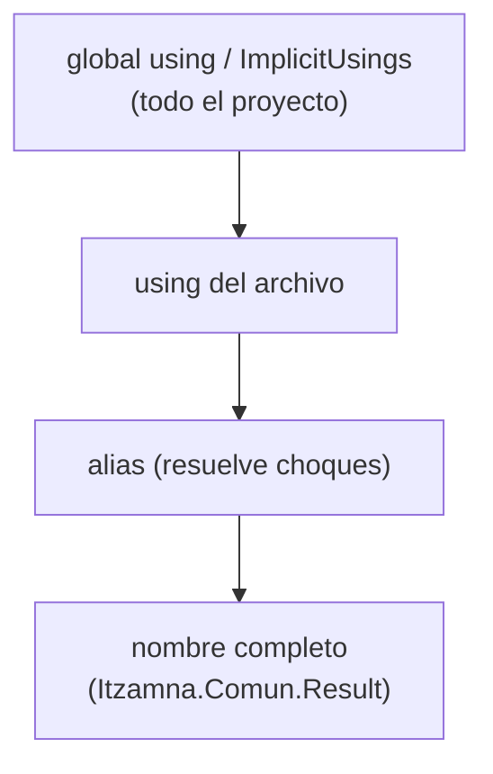

# using y namespaces

Parte de: [[03-CSharp-DotNet/01 Básico/_Índice Básico|Básico]]

> [!info] Cómo avanzar
> `progreso`: **pendiente** → **viendo** (estudiando) → **visto** (contestaste la autoevaluación sin abrir las respuestas) → **dominado** (hiciste el laboratorio o lo aplicaste de verdad).

## Contenido

### Qué es
Un **namespace** (espacio de nombres) agrupa tipos relacionados bajo un nombre jerárquico, por ejemplo `Itzamna.Dionisio.Application.Features.Egresos`. Evita choques entre clases con el mismo nombre y organiza el código. La **directiva `using`** importa un namespace para que puedas usar sus tipos sin escribir el nombre completo.

Ojo: la palabra `using` tiene **dos** usos distintos en C#:
1. **Directiva** `using System.Text;` al inicio del archivo: importa nombres (tiempo de compilación).
2. **Instrucción/declaración** `using var conexion = new SqlConnection(...);`: garantiza que se llame `Dispose()` al salir del bloque (tiempo de ejecución). No tienen relación más allá de la palabra; la segunda se estudia en [[IDisposable y using]].

### Cómo funciona
**Namespace file-scoped** (C# 10): en lugar de envolver todo en llaves, declaras el namespace con `;` y aplica a todo el archivo. Ahorra un nivel de indentación:
```csharp
namespace Itzamna.Dionisio.Application.Features.Egresos;

public sealed class ListarEgresos { /* ... */ }
```

**`global using`** (C# 10): una directiva que aplica a **todos** los archivos del proyecto. Se suele poner en un archivo `GlobalUsings.cs`:
```csharp
global using Dapper;
global using FluentValidation;
global using Microsoft.Data.SqlClient;
```

**`ImplicitUsings`**: con `<ImplicitUsings>enable</ImplicitUsings>` en el `.csproj`, el SDK genera automáticamente `global using` para los namespaces más comunes según el tipo de proyecto. Para `Microsoft.NET.Sdk` incluye `System`, `System.Collections.Generic`, `System.IO`, `System.Linq`, `System.Net.Http`, `System.Threading` y `System.Threading.Tasks`; el SDK web agrega los de ASP.NET Core. Puedes agregar o quitar en el `.csproj`:
```xml
<ItemGroup>
  <Using Include="Dapper" />
  <Using Remove="System.Net.Http" />
</ItemGroup>
```

**Alias**: si dos paquetes tienen una clase `Result`, el compilador marca ambigüedad (CS0104). Se resuelve con un alias o con el nombre completo:
```csharp
using Result = Itzamna.Comun.Result;
using FluentResult = FluentResults.Result;
```
Desde C# 12 un alias puede apuntar a cualquier tipo, incluso tuplas: `using Punto = (double X, double Y);`.

**`using static`** importa los miembros estáticos de un tipo: `using static System.Math;` permite escribir `Round(x, 2)`.



### Ejemplo
Un slice con namespace que refleja la carpeta:
```csharp
// src/Itzamna.Dionisio.Application/Features/Egresos/ListarEgresos.cs
using Itzamna.Dionisio.Application.Comun;      // tipos compartidos del proyecto
using Result = Itzamna.Dionisio.Application.Comun.Result;

namespace Itzamna.Dionisio.Application.Features.Egresos;

public static class ListarEgresos
{
    public sealed record Query(Guid EmpresaId, int Pagina = 1);
    public sealed record Item(Guid Id, string Concepto, decimal Monto);

    public sealed class Handler(IListarEgresosSql sql)
    {
        public async Task<Result> Handle(Query q, CancellationToken ct)   // Task viene de ImplicitUsings
        {
            IReadOnlyList<Item> items = await sql.EjecutarAsync(q, ct);
            return Result.Ok(items);
        }
    }
}
```
Y la otra palabra `using`, para recursos:
```csharp
await using var conexion = new SqlConnection(cadena);  // Dispose al salir del método
```

### Cuándo usarlo y cuándo no
- **Namespace = ruta de carpetas** del proyecto: es la convención que esperan el IDE y los analizadores (IDE0130).
- **File-scoped** en todo código nuevo.
- **`global using`** solo para namespaces que de verdad usan casi todos los archivos; si pones demasiados, pierdes la pista de qué depende de qué y aumentan los choques de nombres.
- **Alias** cuando hay choques o para acortar tipos genéricos largos; no para "renombrar" tipos por gusto.

### Errores comunes
- **Choques de nombres por `global using` de más**: `Result`, `Task`, `File`… se vuelven ambiguos.
- **Namespaces que no coinciden con la carpeta**: cuesta encontrar el código y confunden los analizadores.
- **Confundir la directiva con la instrucción `using`**: una importa nombres, la otra libera recursos.
- **Nombrar una clase igual que su namespace** (`Egresos.Egresos`): obliga a escribir nombres completos.

### Para profundizar
- [Directiva using](https://learn.microsoft.com/dotnet/csharp/language-reference/keywords/using-directive)
- [Palabra clave namespace (incluye file-scoped)](https://learn.microsoft.com/dotnet/csharp/language-reference/keywords/namespace)
- [ImplicitUsings en el SDK de .NET](https://learn.microsoft.com/dotnet/core/project-sdk/overview#implicit-using-directives)

## Autoevaluación

Contesta primero en voz alta o en papel; luego despliega la respuesta.

> [!question]- ¿Qué son `global using` e `ImplicitUsings`?
> `global using X;` aplica a todo el proyecto. `<ImplicitUsings>enable</ImplicitUsings>` agrega automáticamente los más comunes (`System`, `System.Linq`, `System.Threading.Tasks`, etc.).

> [!question]- ¿Qué es un namespace *file-scoped*?
> `namespace Mi.Api.Egresos;` al inicio del archivo, sin llaves: aplica a todo el archivo y ahorra un nivel de sangría.

> [!question]- Dos paquetes tienen una clase `Result`. ¿Cómo resuelves el choque?
> Con un alias: `using AppResult = Mi.Application.Result;`, o con el nombre completo.

> [!question]- ¿El `using` de namespaces tiene relación con `using var conexion = ...`?
> No. Es la misma palabra para dos cosas: importar namespaces y liberar recursos `IDisposable`.

