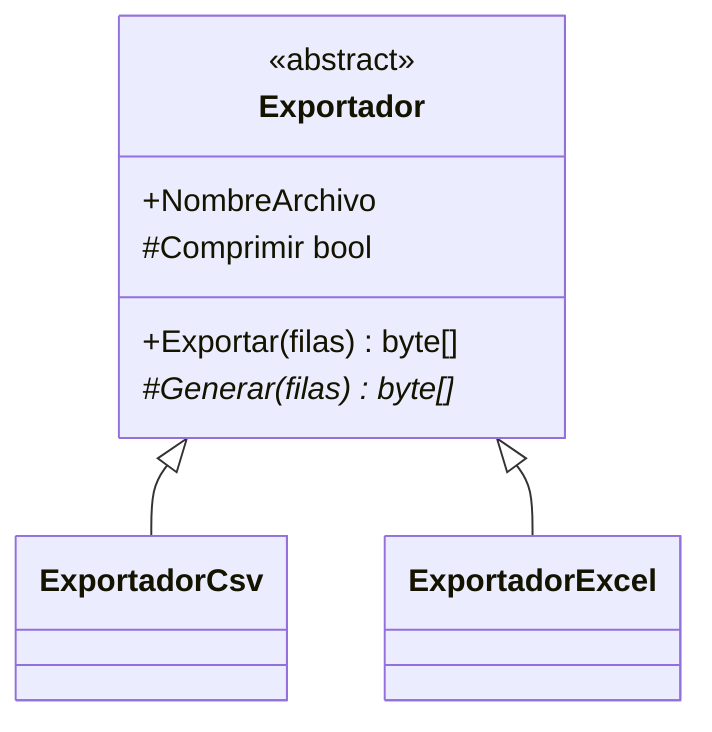

# Clases abstractas

Parte de: [[03-CSharp-DotNet/02 Orientación a objetos/_Índice Orientación a objetos|Orientación a objetos]]

> [!info] Cómo avanzar
> `progreso`: **pendiente** → **viendo** (estudiando) → **visto** (contestaste la autoevaluación sin abrir las respuestas) → **dominado** (hiciste el laboratorio o lo aplicaste de verdad).

## Contenido

### Qué es
Una **clase abstracta** (`abstract class`) es una clase que **no se puede instanciar** directamente y que existe para servir de base a otras. Puede combinar dos cosas:
- **Código común ya implementado** (campos, propiedades, métodos normales) que heredan todas las derivadas.
- **Miembros abstractos**: métodos o propiedades declarados sin cuerpo que cada clase derivada **está obligada** a implementar con `override`.

Sirve para modelar una familia de tipos que comparten estado y comportamiento, y que difieren solo en algunos pasos.

### Cómo funciona
```csharp
public abstract class Exportador
{
    // estado y lógica común
    protected Exportador(string nombreArchivo) => NombreArchivo = nombreArchivo;
    public string NombreArchivo { get; }

    // método plantilla: el algoritmo fijo
    public byte[] Exportar(IReadOnlyList<Fila> filas)
    {
        if (filas.Count == 0) throw new InvalidOperationException("Sin datos");
        var contenido = Generar(filas);       // paso que cambia
        return Comprimir ? Zip(contenido) : contenido;
    }

    protected abstract byte[] Generar(IReadOnlyList<Fila> filas);   // obligatorio
    protected virtual bool Comprimir => false;                     // opcional, con default

    private static byte[] Zip(byte[] datos) => datos; // simplificado
}
```
- `new Exportador(...)` no compila (CS0144).
- Una clase que hereda y **no** implementa todos los miembros abstractos debe ser también `abstract`.
- `abstract` significa "sin cuerpo, obligatorio sobrescribir"; `virtual` significa "con cuerpo, se puede sobrescribir".
- **Sí puede tener constructores**. No se llaman con `new` directamente, sino desde las derivadas con `: base(...)`. Se suelen declarar `protected` para dejar claro que solo las derivadas los usan. Sirven para inicializar el estado común y validar invariantes.



Este uso es el patrón **Template Method**: la base define el esqueleto del algoritmo y las derivadas rellenan los pasos variables.

Lo verás en el propio framework: `BackgroundService` es una clase abstracta que implementa el arranque y la detención de un servicio hospedado y te deja solo `ExecuteAsync` como miembro abstracto; `AbstractValidator<T>` de FluentValidation y `ControllerBase` siguen la misma idea de "base con código común + puntos de extensión". Cuando heredas de ellas no reescribes la infraestructura: solo rellenas lo que cambia en tu caso.

**Abstracto, virtual o normal**: al diseñar la base, cada miembro debe tener una decisión explícita. Si todas las derivadas deben dar su versión, `abstract`. Si hay un comportamiento razonable que algunas querrán cambiar, `virtual`. Si nadie debe alterarlo (por ejemplo, el método plantilla que garantiza el orden de los pasos), déjalo normal, sin `virtual`, para que las derivadas no puedan romper el algoritmo.

### Ejemplo
Las derivadas para Wee.Reporteria:
```csharp
public sealed class ExportadorCsv() : Exportador("reporte.csv")
{
    protected override byte[] Generar(IReadOnlyList<Fila> filas)
    {
        var sb = new StringBuilder();
        foreach (var f in filas) sb.AppendLine(string.Join(',', f.Celdas));
        return Encoding.UTF8.GetBytes(sb.ToString());
    }
}

public sealed class ExportadorExcel() : Exportador("reporte.xlsx")
{
    protected override byte[] Generar(IReadOnlyList<Fila> filas)
    {
        // usar ClosedXML u otra biblioteca
        return [];
    }
    protected override bool Comprimir => false;   // xlsx ya es un zip
}

Exportador exp = formato == "csv" ? new ExportadorCsv() : new ExportadorExcel();
byte[] archivo = exp.Exportar(filas);
```

Otro uso habitual: jerarquías cerradas de resultados con records abstractos:
```csharp
public abstract record DecisionPago;
public sealed record Aprobado(string Autorizacion) : DecisionPago;
public sealed record Rechazado(string Motivo) : DecisionPago;

string texto = decision switch
{
    Aprobado a  => $"OK {a.Autorizacion}",
    Rechazado r => $"No: {r.Motivo}",
    _ => throw new UnreachableException()
};
```

### Cuándo usarlo y cuándo no
- **Úsala** cuando varias clases comparten **estado y código** real y son, de verdad, variantes de lo mismo ("es un").
- **Úsala** para el patrón plantilla: un algoritmo fijo con pasos variables.
- **Prefiere una interfaz** cuando solo necesitas un contrato, cuando los tipos no están relacionados o cuando un tipo debe cumplir varios contratos (C# solo permite una clase base). Ver [[Interfaz vs clase abstracta]] e [[Interfaces]].
- **Prefiere composición** si la herencia solo sirve para "reutilizar un método": inyecta un colaborador en lugar de heredar (ver [[Herencia]]).
- Combinarlas es común: una interfaz `IExportador` como contrato público y una `ExportadorBase` abstracta como ayuda para implementarla.

### Errores comunes
- **Constructores `public` en una clase abstracta**: no dañan, pero comunican mal; usa `protected`.
- **Jerarquías profundas** (abstracta → abstracta → abstracta → concreta): difíciles de seguir y de cambiar. Mantén uno o dos niveles.
- **Llamar métodos abstractos o virtuales desde el constructor de la base**: la derivada aún no terminó de inicializarse (ver [[Polimorfismo]]).
- **Meter en la base código que solo usan algunas derivadas**: señal de que la abstracción está mal cortada.

### Para profundizar
- [abstract (referencia de C#)](https://learn.microsoft.com/dotnet/csharp/language-reference/keywords/abstract)
- [Clases y miembros de clase abstractos y sellados](https://learn.microsoft.com/dotnet/csharp/programming-guide/classes-and-structs/abstract-and-sealed-classes-and-class-members)
- [Herencia en C#](https://learn.microsoft.com/dotnet/csharp/fundamentals/object-oriented/inheritance)

## Autoevaluación

Contesta primero en voz alta o en papel; luego despliega la respuesta.

> [!question]- ¿Qué es una clase abstracta?
> Una clase que no se puede instanciar y puede tener miembros `abstract` (sin implementación, obligatorios en las derivadas) y miembros con implementación compartida.

> [!question]- ¿Cuándo usarías una clase abstracta?
> Cuando varias clases comparten código y estado además del contrato, p. ej. `ConsultaSql<TCampos,TFila>` que lee su `.sql` en el constructor y ejecuta con Dapper.

> [!question]- ¿Puede tener constructor?
> Sí, normalmente `protected`; lo llaman las derivadas con `: base(...)`.

## Práctica

- [[Lab 4 - Registro automático de sentencias SQL por reflexión]]

