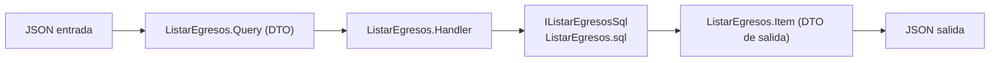

# Clases anidadas y DTOs

Parte de: [[03-CSharp-DotNet/02 Orientación a objetos/_Índice Orientación a objetos|Orientación a objetos]]

> [!info] Cómo avanzar
> `progreso`: **pendiente** → **viendo** (estudiando) → **visto** (contestaste la autoevaluación sin abrir las respuestas) → **dominado** (hiciste el laboratorio o lo aplicaste de verdad).

## Contenido

### Qué es
- Una **clase anidada** (o tipo anidado) es un tipo declarado **dentro** de otro: `ListarEgresos.Query`, `ListarEgresos.Handler`. Su nombre completo incluye el del tipo contenedor.
- Un **DTO** (*Data Transfer Object*) es un objeto **solo de datos**, sin reglas de negocio, que sirve para transportar información a través de una frontera: la API HTTP, una consulta SQL, un mensaje de cola.

Se mencionan juntos porque en **vertical slice** los DTOs de cada funcionalidad (petición, respuesta, filas de SQL) se declaran como tipos anidados del slice.

### Cómo funciona
**Tipos anidados**
- Se acceden con el nombre del contenedor: `new ListarEgresos.Query(...)`.
- Por defecto son `private`; normalmente los declaras `public` explícitamente.
- Un tipo anidado **puede acceder a los miembros `private` del tipo que lo contiene** (para los de instancia, necesita una referencia a una instancia). Es útil para builders y enumeradores.
- El contenedor puede ser una `static class` que solo sirve de "carpeta" con nombre.

**DTOs**
- Suelen ser `record` (inmutables, con igualdad por valor, fáciles de crear en pruebas).
- Tienen la forma que necesita el **consumidor**, no la forma de la entidad interna.
- El mapeo entidad → DTO se hace a mano (un `Select`, un método estático `Desde(...)`) o con una biblioteca (ver [[AutoMapper y alternativas]]).



**¿Por qué no exponer la entidad de dominio?**
- **Acoplamiento**: si la API regresa la entidad `Egreso`, cualquier cambio interno (renombrar una propiedad, agregar una relación) rompe el contrato con el front.
- **Fugas de datos**: la entidad puede tener campos que no deben salir (hash de contraseña, costos internos, ids de auditoría).
- **Sobre-asignación** (*mass assignment*): si recibes la entidad como entrada, un cliente podría mandar `"aprobado": true` y el model binding lo asignaría.
- **Ciclos y carga perezosa**: serializar entidades con navegaciones puede producir JSON enorme o ciclos.

### Ejemplo
Un slice completo en un solo archivo (Itzamna.Dionisio):
```csharp
namespace Itzamna.Dionisio.Application.Features.Egresos;

public static class ListarEgresos
{
    // Entrada
    public sealed record Query(Guid EmpresaId, int Pagina = 1, int Tamano = 50);

    // Salida (lo que ve el front)
    public sealed record Item(Guid Id, string Concepto, decimal Monto, DateOnly Fecha);

    // Contrato de la consulta SQL (una interfaz por consulta)
    public interface ISql
    {
        Task<IReadOnlyList<Item>> EjecutarAsync(Query q, CancellationToken ct);
    }

    public sealed class Validator : AbstractValidator<Query>
    {
        public Validator() => RuleFor(x => x.Tamano).InclusiveBetween(1, 200);
    }

    public sealed class Handler(ISql sql)
    {
        public Task<IReadOnlyList<Item>> Handle(Query q, CancellationToken ct) => sql.EjecutarAsync(q, ct);
    }
}

// En el controller
[HttpGet]
public async Task<ActionResult<IReadOnlyList<ListarEgresos.Item>>> Listar(
    [FromQuery] ListarEgresos.Query q, [FromServices] ListarEgresos.Handler h, CancellationToken ct)
    => Ok(await h.Handle(q, ct));
```
Hay muchos tipos llamados `Query`, `Item` y `Handler` en la solución, pero no chocan: cada uno vive bajo su slice, y al leer `ListarEgresos.Item` sabes exactamente de dónde viene.

Mapeo manual de entidad a DTO:
```csharp
public sealed record EgresoDetalle(Guid Id, string Concepto, decimal Monto)
{
    public static EgresoDetalle Desde(Egreso e) => new(e.Id, e.Concepto, e.Monto);
}
```

Acceso a privados desde un anidado (patrón builder):
```csharp
public sealed class Pedido
{
    private readonly List<Partida> _partidas = [];
    private Pedido() { }

    public sealed class Builder
    {
        private readonly Pedido _p = new();               // puede usar el constructor privado
        public Builder Agregar(Partida x) { _p._partidas.Add(x); return this; }  // y el campo privado
        public Pedido Construir() => _p;
    }
}
```

### Cuándo usarlo y cuándo no
- **Anidados**: tipos que solo tienen sentido dentro de un contexto (los DTOs de un slice, el enumerador de una colección, un builder).
- **No anides** tipos que se reutilizan en muchos lugares; ponlos en su propio archivo. Evita más de un nivel de anidación.
- **DTOs siempre** en las fronteras (HTTP, colas, SQL). Dentro del dominio, usa entidades con [[Encapsulamiento]].

### Errores comunes
- **Reutilizar el mismo DTO para crear, editar y listar**: cada operación necesita campos distintos y terminas con propiedades "a veces null". Un DTO por caso de uso.
- **Exponer la entidad para ahorrar código**: rompe el contrato al primer cambio y puede filtrar datos.
- **Olvidar `public` en el tipo anidado**: el controller no lo ve.
- **Meter lógica de negocio en DTOs**: pertenece al dominio o al handler.

### Para profundizar
- [Tipos anidados (guía de programación de C#)](https://learn.microsoft.com/dotnet/csharp/programming-guide/classes-and-structs/nested-types)
- [Crear objetos de transferencia de datos (DTOs)](https://learn.microsoft.com/aspnet/web-api/overview/data/using-web-api-with-entity-framework/part-5)
- [Registros (record)](https://learn.microsoft.com/dotnet/csharp/language-reference/builtin-types/record)

## Autoevaluación

Contesta primero en voz alta o en papel; luego despliega la respuesta.

> [!question]- ¿Por qué tus slices usan tipos anidados como `ListarEgresos.Query`, `.Item` y `.Handler`?
> Agrupan todo lo de una funcionalidad bajo un nombre, evitan choques (`Query` hay muchos) y hacen obvio de qué slice es cada tipo.

> [!question]- ¿Qué es un DTO y por qué no exponer la entidad de dominio en la API?
> Un objeto solo de datos para transportar información. Exponer la entidad acopla el contrato HTTP a tu modelo interno y puede filtrar campos sensibles. Mapeas a mano entidad → DTO.

> [!question]- ¿Una clase anidada puede acceder a miembros privados de la externa?
> Sí, tiene acceso a los miembros `private` del tipo contenedor (si tiene una referencia a una instancia para los de instancia).

## Práctica

- [[Lab 2 - Modelo de dominio con encapsulamiento y records]]

