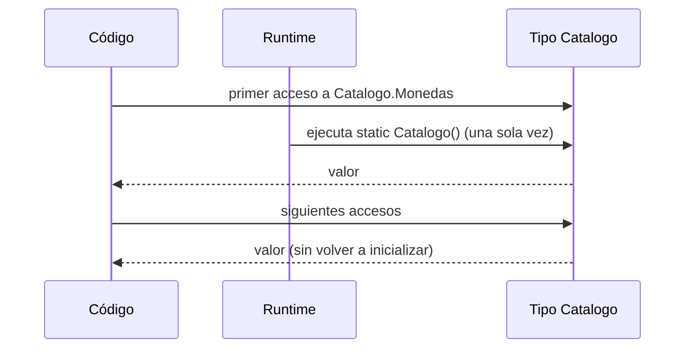

# Clases estáticas y miembros estáticos

Parte de: [[03-CSharp-DotNet/02 Orientación a objetos/_Índice Orientación a objetos|Orientación a objetos]]

> [!info] Cómo avanzar
> `progreso`: **pendiente** → **viendo** (estudiando) → **visto** (contestaste la autoevaluación sin abrir las respuestas) → **dominado** (hiciste el laboratorio o lo aplicaste de verdad).

## Contenido

### Qué es
- Un **miembro estático** (`static`) pertenece al **tipo**, no a una instancia: hay una sola copia compartida por todo el proceso. Se usa con el nombre de la clase: `Math.Round(...)`, `Guid.CreateVersion7()`.
- Una **clase estática** (`static class`) solo puede contener miembros estáticos, **no se puede instanciar** ni heredar. Es un contenedor de funciones sin estado: utilidades, constantes y métodos de extensión.

### Cómo funciona
```csharp
public static class Impuestos
{
    public const decimal TasaIva = 0.16m;                 // constante (implícitamente estática)
    public static decimal Iva(decimal subtotal) =>
        Math.Round(subtotal * TasaIva, 2, MidpointRounding.AwayFromZero);
}

decimal iva = Impuestos.Iva(1000m);   // 160.00
// new Impuestos();  → no compila
```
- El compilador marca la clase como `abstract` y `sealed` en el IL: por eso no se instancia ni se hereda.
- Los **métodos de extensión** deben declararse en una clase estática (ver [[Métodos de extensión]]).
- Una clase normal puede tener miembros estáticos mezclados con los de instancia: métodos de fábrica (`Pedido.Crear(...)`), contadores, caches.

**Constructor estático**: `static NombreClase() { ... }` inicializa el estado estático. Lo llama el runtime, **una sola vez**, automáticamente **antes del primer uso** del tipo: antes de crear la primera instancia o de acceder a cualquier miembro estático. No tiene modificadores de acceso ni parámetros, y no lo puedes llamar tú. Si lanza una excepción, el tipo queda inutilizable para el resto del proceso: cada uso posterior lanza `TypeInitializationException`.



**Estado estático mutable en una API web**: una API atiende muchas peticiones **en paralelo** en distintos hilos. Un campo `static` mutable es compartido por todas:
- **Condiciones de carrera**: dos peticiones modifican el mismo `List` o `Dictionary` a la vez y corrompen la estructura.
- **Fugas de datos entre usuarios**: si guardas "el usuario actual" en un `static`, otra petición lo sobrescribe.
- **Pruebas frágiles**: el estado sobrevive entre pruebas y las hace depender del orden.
- **Imposible de sustituir**: no puedes inyectar otra implementación.

Lo correcto es usar [[Inyección de dependencias]] con el ciclo de vida adecuado ([[Ciclos de vida (Singleton, Scoped, Transient)]]): un singleton registrado en el contenedor, que puede ser seguro para hilos y que se puede reemplazar en pruebas.

### Ejemplo
Usos sanos de `static`:
```csharp
// 1. Funciones puras de utilidad
public static class Rfc
{
    private static readonly Regex Patron = new(@"^[A-ZÑ&]{3,4}\d{6}[A-Z0-9]{3}$", RegexOptions.Compiled);
    public static bool EsValido(string? rfc) => rfc is not null && Patron.IsMatch(rfc.ToUpperInvariant());
}

// 2. Datos inmutables cargados una vez
public static class Catalogo
{
    public static readonly FrozenSet<string> Monedas =
        new[] { "MXN", "USD", "EUR" }.ToFrozenSet(StringComparer.OrdinalIgnoreCase);
}

// 3. Fábricas en la propia clase
public sealed class Pedido
{
    private Pedido(Guid id) => Id = id;
    public Guid Id { get; }
    public static Pedido Crear() => new(Guid.CreateVersion7());
}

// 4. Lambdas estáticas: garantizan que no capturan estado
var activos = clientes.Where(static c => c.Activo);
```

Lo que **no** debes hacer:
```csharp
public static class Sesion
{
    public static Guid UsuarioActual;                 // compartido entre TODAS las peticiones
    public static List<string> Errores = new();       // no es seguro para hilos
}
```
Cámbialo por un servicio `Scoped` (`ICurrentUser`) o, si de verdad es global, por un singleton inmutable o con estructuras concurrentes.

### Cuándo usarlo y cuándo no
- **Clase estática**: funciones puras sin dependencias (cálculos, validaciones de formato), constantes y métodos de extensión.
- **Miembros estáticos `readonly`**: datos inmutables que se cargan una vez (regex, catálogos fijos).
- **No** la uses para servicios que hablan con la BD, HTTP, el reloj o la configuración: inyéctalos para poder probarlos. `DateTime.UtcNow` es estático y por eso se prefiere `TimeProvider`.
- **No** guardes estado por usuario o por petición en estáticos.

### Errores comunes
- **Estado estático mutable en APIs**: carreras y fugas entre usuarios.
- **Clases estáticas "Helper" gigantes** con dependencias ocultas (leen configuración, abren conexiones): imposibles de probar.
- **Constructores estáticos que pueden fallar** (leer un archivo, la configuración): un error deja el tipo muerto con `TypeInitializationException`.
- **Abusar de singletons estáticos** (`Instance`) en lugar del contenedor de DI.

### Para profundizar
- [Clases estáticas y sus miembros](https://learn.microsoft.com/dotnet/csharp/programming-guide/classes-and-structs/static-classes-and-static-class-members)
- [Constructores estáticos](https://learn.microsoft.com/dotnet/csharp/programming-guide/classes-and-structs/static-constructors)
- [static (referencia de C#)](https://learn.microsoft.com/dotnet/csharp/language-reference/keywords/static)

## Autoevaluación

Contesta primero en voz alta o en papel; luego despliega la respuesta.

> [!question]- ¿Qué es una clase `static`?
> Una clase que no se instancia y solo tiene miembros estáticos; se usa para utilidades y métodos de extensión.

> [!question]- ¿Por qué evitar estado estático mutable en una API web?
> Se comparte entre todas las peticiones y hilos: provoca condiciones de carrera y fugas de datos entre usuarios. Además dificulta las pruebas. Usa servicios Singleton con estado protegido.

> [!question]- ¿Cuándo se ejecuta un constructor estático?
> Una vez, antes del primer uso del tipo. Si lanza excepción, el tipo queda inutilizable (`TypeInitializationException`).

