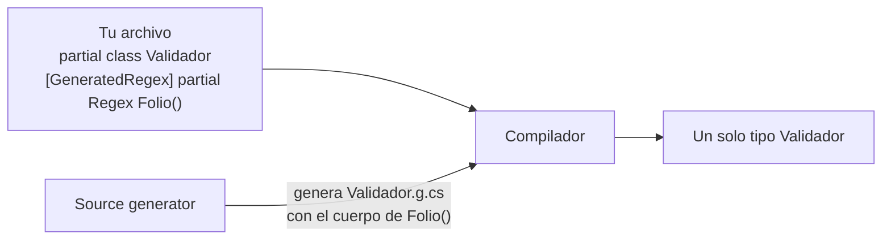

# Clases parciales

Parte de: [[03-CSharp-DotNet/02 Orientación a objetos/_Índice Orientación a objetos|Orientación a objetos]]

> [!info] Cómo avanzar
> `progreso`: **pendiente** → **viendo** (estudiando) → **visto** (contestaste la autoevaluación sin abrir las respuestas) → **dominado** (hiciste el laboratorio o lo aplicaste de verdad).

## Contenido

### Qué es
La palabra clave **`partial`** permite **dividir la definición de un tipo** (clase, struct, record o interfaz) en varias declaraciones, normalmente en archivos distintos. Al compilar, el compilador las une en un solo tipo. Además, ciertos miembros pueden ser parciales: se **declaran** en una parte y se **implementan** en otra (métodos parciales; propiedades e indexadores parciales desde C# 13; eventos y constructores parciales desde C# 14).

Su razón de ser principal es que **código escrito a mano y código generado** convivan en el mismo tipo sin pisarse.

### Cómo funciona
```csharp
// Archivo: Cliente.cs (escrito por ti)
public sealed partial class Cliente
{
    public string Nombre { get; set; } = "";
}

// Archivo: Cliente.Validacion.cs
public sealed partial class Cliente
{
    public bool EsValido() => Nombre.Length > 0;
}
```
Reglas:
- Todas las partes deben llevar `partial` y estar en el **mismo ensamblado** y el **mismo namespace**.
- Los modificadores se combinan: si una parte dice `sealed` o hereda de una base, aplica a todo el tipo. No pueden contradecirse (una `public` y otra `internal`).
- Las interfaces que implementa cada parte se suman.

**Métodos parciales**: una parte declara la firma y otra la implementa.
```csharp
public partial class Importador
{
    partial void AlTerminar(int filas);            // declaración sin cuerpo
}
public partial class Importador
{
    partial void AlTerminar(int filas) => Console.WriteLine(filas);   // implementación
}
```
Si un método parcial devuelve `void`, no tiene modificador de acceso y no tiene `out`, la implementación es opcional: si nadie la escribe, el compilador elimina las llamadas. Si tiene modificador de acceso o devuelve un valor, la implementación es obligatoria.

**¿Por qué los source generators requieren `partial`?** Un *source generator* corre durante la compilación y **agrega archivos `.cs` nuevos**; no puede modificar tu código. Para darle cuerpo a un método que tú declaraste, necesita escribir "la otra mitad" del tipo, y eso solo es posible si el tipo y el miembro son `partial`.



### Ejemplo
Expresión regular generada en compilación (más rápida, sin costo de construcción en ejecución y compatible con Native AOT):
```csharp
using System.Text.RegularExpressions;

public static partial class Folios
{
    [GeneratedRegex(@"^F-\d{6}$", RegexOptions.IgnoreCase)]
    private static partial Regex Patron();

    public static bool EsValido(string folio) => Patron().IsMatch(folio);
}
```
Desde C# 13 también puede ser una propiedad parcial:
```csharp
[GeneratedRegex(@"^\d{10}$")]
private static partial Regex Telefono { get; }
```

Otros casos donde verás `partial` en tus proyectos:
- `public partial class Program { }` al final de `Program.cs`, para que el proyecto de pruebas pueda usar `WebApplicationFactory<Program>` (ver [[Pruebas de integración con WebApplicationFactory]]).
- `[LoggerMessage]` para logs de alto rendimiento: `[LoggerMessage(Level = LogLevel.Information, Message = "Importadas {Filas} filas")] static partial void Importadas(ILogger l, int filas);`.
- Serialización con `System.Text.Json` generada: `[JsonSerializable(typeof(Egreso))] internal partial class AppJsonContext : JsonSerializerContext { }`.
- Diseñadores de WinForms o archivos generados por herramientas (clientes OpenAPI, gRPC).

Más contexto en [[Source generators y GeneratedRegex]].

### Cuándo usarlo y cuándo no
- **Úsalo** cuando un generador (Roslyn, diseñadores, herramientas de cliente) necesita completar tu tipo.
- **Úsalo** con moderación para separar implementaciones de interfaces muy distintas en archivos (`Cliente.cs`, `Cliente.IComparable.cs`) si de verdad mejora la lectura.
- **No** lo uses para "ordenar" una clase enorme partiéndola en varios archivos: la clase sigue siendo enorme, con demasiadas responsabilidades, y ahora además es más difícil verla completa. El problema es de diseño: divide en **varias clases** con responsabilidades claras (y, en vertical slice, en varios slices).

### Errores comunes
- **Partir una clase de 3 000 líneas en cinco `partial`**: esconde el problema en lugar de resolverlo.
- **Olvidar `partial` en el tipo contenedor** al usar `[GeneratedRegex]`: error de compilación; el tipo (y los que lo contienen) deben ser `partial`.
- **Modificadores contradictorios entre partes**: error de compilación.
- **Editar a mano archivos `.g.cs` generados**: se sobrescriben en la siguiente compilación.

### Para profundizar
- [Clases y métodos parciales](https://learn.microsoft.com/dotnet/csharp/programming-guide/classes-and-structs/partial-classes-and-methods)
- [partial (miembro)](https://learn.microsoft.com/dotnet/csharp/language-reference/keywords/partial-member)
- [Generadores de código fuente de expresiones regulares](https://learn.microsoft.com/dotnet/standard/base-types/regular-expression-source-generators)
- [Source generators](https://learn.microsoft.com/dotnet/csharp/roslyn-sdk/source-generators-overview)

## Autoevaluación

Contesta primero en voz alta o en papel; luego despliega la respuesta.

> [!question]- ¿Qué es una clase `partial`?
> Una clase definida en varios archivos que el compilador une en una sola.

> [!question]- ¿Por qué los *source generators* (como `GeneratedRegex`) requieren `partial`?
> El generador escribe la otra mitad de la clase o del método en un archivo generado; sin `partial` no la podría completar.

> [!question]- ¿Es buena idea partir una clase enorme en varios `partial` para "ordenarla"?
> No: sigue siendo una clase enorme. Mejor dividir responsabilidades en clases distintas.

